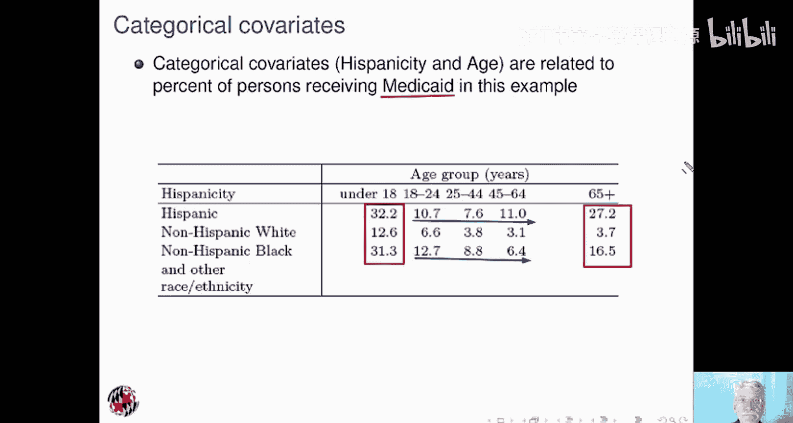

# 密歇根大学《调查数据收集和分析（2-6：方法、社调问卷设计、抽样、缺失数据、分析）｜Survey Data Collection and Analytics》 p128 5_精度提升方法.zh_en -BV1fw4m1e7Zh_p128-

One of the main uses of auxiliary data is to improve precision of estimates。

 which I'll sketch briefly here with a couple of examples。So let's look at two pictures。

Both of these cases are ones where I have one single covariate called x。

It could be something like the number of employees in a business last year and then a new co。

Analysis variable Y， which could be something like a number of employees this year in business establishment。

So in a case like this， on the left， you know， we've got some sort of cur bi linear relationship that goes like that。

 it's a pretty strong relationship between y and x。We can take advantage of that。

 to improve our estimates。In the right hand picture， there's still a relationship。

 not quite as strong because you can see the points are more diffuse above and below this line that I sketched in。

But still。As X goes up， Y tends to go up， and we can certainly take advantage of that in estimation。

So we'll need to learn how to formally do that。Now。The covaris do not have to be quantitative。

We could have categorical variables that may be just as useful to this。

So I've got a table here that's Hispanicity， which is broken down this way， I've got Hispanics。

 non Hispanic， whites， non Hispanic， black， plus other race ethnicities。

And then across the top of the table， I've got age group in years。 and the thing that I'm。

Showing you here are the percentage of persons。In the cells of the table that receive Medicaid。

 which is an assistance program for medical care for lower income people in the US。

So what you can see here is there's a kind of a gradient。As we go across the ages in under 18。

 there's a relatively high proportion of people who receive Medicaid。 know，32。2%， if you're Hispanic。

It's less so for non Hispanic whites， 31。3 for non Hispanic blacks。And then it's also high for。

The retirement age is 65 plus， relatively high。As we go across the age groups， though。

In the working years。Certainly less。somewhatwhat of a pattern going from higher when you're 18 to 24 or lower。

45 to 64， at least among whites and blacks here but。

Substantially less than at the two extreme age groups。

So that this is an example of a case where we've got a relationship between this 01 variable。

 do you receive Medicaid or not， and race ethnicity and your age so we can take advantage of that and estimation to improve the precision of estimates。

