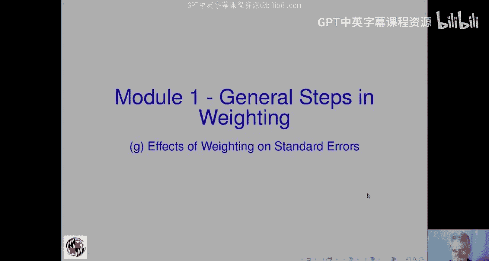
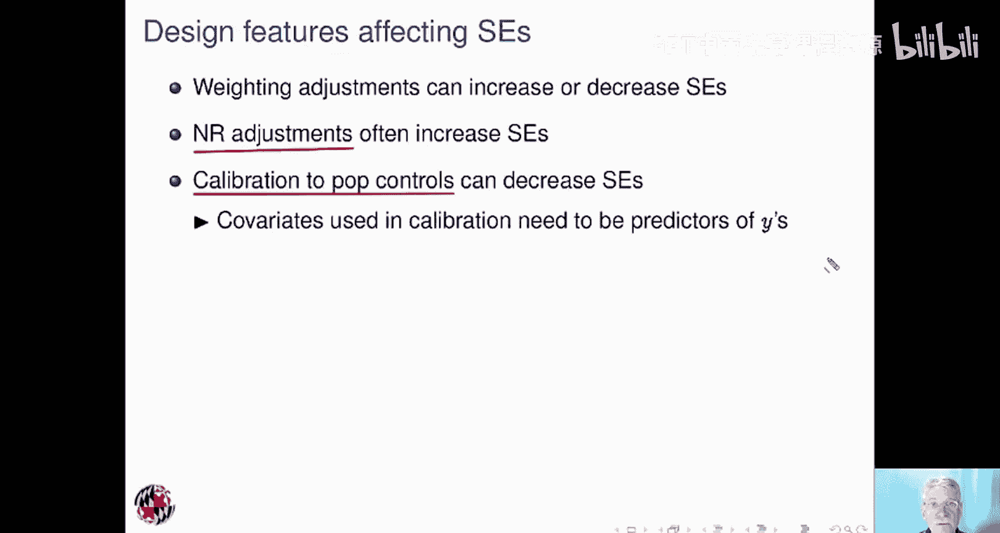

# 密歇根大学《调查数据收集和分析（2-6：方法、社调问卷设计、抽样、缺失数据、分析）｜Survey Data Collection and Analytics》 p129 6_加权对标准误的影响.zh_en -BV1fw4m1e7Zh_p129-

嗯。

We'll conclude module 1 of course 5 by talking about the effects of waiting on standard errors。

Now there are a number of features of a design that can affect standard errors。

 and I've listed them here。Ones I have in mind， are stratification。

 clustering and sampling with varying probabilities。So let's think about stratification first。

An efficient allocation to the stum can reduce standard errors。

 for at least for full population estimates。 Another use of standard errors is to control the sample size and precision of statum estimates。

So we need to think about both those when we estimate standard errors。

Clustering is the second thing that I mentioned that will affect standard errors。

Oftentimes that will increase standard errors。 It doesn't have to be that way。 But if you。

 you cluster units together that are somewhat alike on what you're measuring。

 thats will be the effect you'll get。Less precision from your sample size than if the units were completely independent and uncllustered。

The effects can be different for full population estimates as compared to domain estimates or subgroup estimates。

The effect can be different on different y values。And it can be different for different statistics。

 Tos， means， model parameter estimates， All those things may be affected differently by stratification and clustering in the use of weights。

And finally。Waiting adjustments。Can increase or decrease standard errors。

 depending on exactly what the purpose of the weighting adjustments are。

 non nonre estimates will tend to increase standard errors， at least in typical applications。

 if you use calibration to population controls those can decrease standard errors。

 assuming that you've got。Covariates used in the calibration that are reasonably good predictors of the wise that you're trying to measure。

So that module is an overview of the purposes of waiting。In the next module。

 we'll cover specific steps that need to be used。

