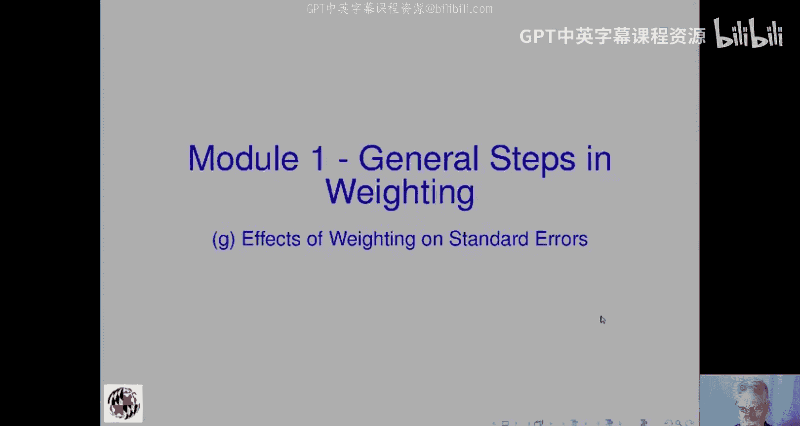
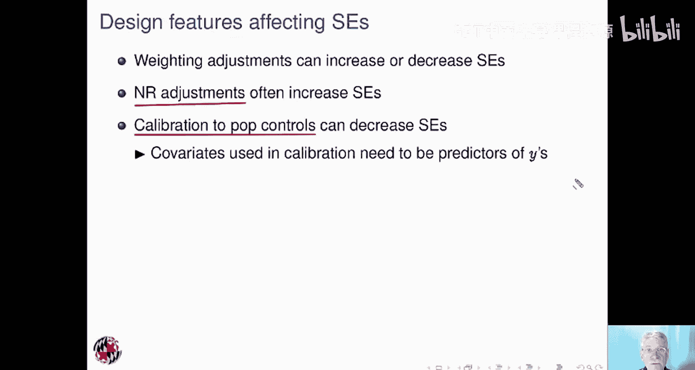

# 调查数据收集和分析：课程5：模块1：加权对标准误的影响

在本节课中，我们将探讨调查设计中加权对标准误的影响。标准误是衡量估计值精确度的重要指标，而调查设计的多个方面都会对其产生影响。

上一节我们介绍了加权的基本概念和目的，本节中我们来看看加权如何具体影响估计的精确度。

## 影响标准误的设计特征

有多种调查设计特征会影响标准误，以下是主要的三类：

*   **分层**：高效的分层样本分配可以减少总体估计的标准误。分层设计的另一个用途是控制各层内估计的样本量和精确度。因此，在估计标准误时，我们需要同时考虑这两个方面。
*   **整群抽样**：整群抽样通常会增加标准误，但并非总是如此。如果你将测量特征上相似的单元聚集在一起，那么与单元完全独立且不整群的情况相比，你从相同样本量中获得的精确度会降低。整群对总体估计的影响可能不同于对域估计或子组估计的影响。此外，它对不同的测量变量、不同的统计量（如均值、模型参数估计）的影响也可能不同。
*   **加权调整**：加权调整可能增加或减少标准误，具体取决于调整的目的。例如，无回答加权调整通常会增加标准误。而如果你使用校准法将样本与总体控制变量对齐，并且这些协变量能较好地预测你试图测量的变量，那么这种校准可能会减少标准误。

## 总结

本节课中我们一起学习了调查设计中分层、整群和加权调整如何影响标准误。理解这些影响对于正确解释调查结果的精确度至关重要。在下一个模块中，我们将介绍实施加权所需的具体步骤。