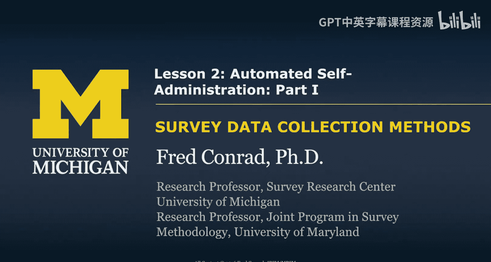
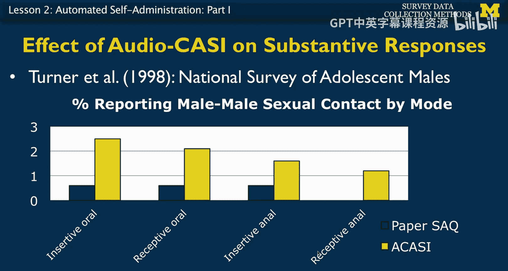

# 密歇根大学《调查数据收集和分析（2-6：方法、社调问卷设计、抽样、缺失数据、分析）｜Survey Data Collection and Analytics》 p13 12_2.1.1 调查模式：访员与自填式CASI-ACASI.zh_en -BV1fw4m1e7Zh_p13-

Welcome back this is our second of four lessons and it's devoted to automated selfadmin。

 including web or online data collection in this lesson we'll talk first about the modes that are automated and self-administered but part of of an interview where human interviewer asks the non-sensitive questions and turns over the laptop or other computer to the respondents to selfadminister directly enter their answers to the sensitive questions and then the remainder of the lesson will be devoted to web questionnaires。

 online data collection it really in two components one is kind of the error properties of web surveys so impact of coverage error and non-response and measurement error we'll look at different sampling procedures that are commonly in use and how these can affect the different。

of error and web surveys and then in the final part of the lesson we'll drill down into measurement error and look at a particular kind of feature of web surveys interactivity。

 which is something that's not available in other types of self- administrationminist in particular in paper self- administrationminist and how interactive features of web surveys。

 can enhance or not enhance the quality of the data that are collected in that mode。

Now we'll turn to Cassie and A Cassie and how they can help increase disclosure of sensitive information。

So just as a reminder， the most frequently used modes really are both selfaddministered。

 mailed out paper questionnaires and web and telephone interviews and face to face interviews involve a human interviewer。

 there are of course hybrids used for sensitive questions。

 which is really what we're going to focus on now in which the interviewer administers nonsensitive questions and respondent self administers。

 the sensitive questions。And there are mobile web surveys increasingly being used and again。

 just by way of reminder when we say Cassie， we're referring to computer assisted self interviewviewing。

 Acassie' is audio computer assisted self interviewviewing So turning first to Cassie computer assisted self- interviewviewing and how it affects respondents answers to sensitive questions the main the initial comparison or the main comparison that evaluations of Cassie have been concerned with is answers under selfadmin that is with Cassie compared to answers to questions asked by interviewers so happy for example。

 personal or face to face interviews， there are number of studies which demonstrate that there seems to be more disclosure of sensitive information under Cassie then when interviewers asked the question one of the early demonstrations was by Taranjo and Smith。

Who observed more disclosure disclosure here means more reports of a socially undesirable behavior。

More disclosure with Cassie than both paper will'll return to other comparisons to other types of self-administ in a moment。

 but also compared to Kapi where interviewers are asking the question so you'll see here asking about number of sex partners at oney five years and lifetime generally we see higher bars for Cassie。

 the light blue bars than Kay， the dark blue bars at lifetime there's really no difference between Kaie and Cassie and it has been proposed that questions become less sensitive over the course of one's life or if one can answer them about one's lifetime。

 the assumption here is that it's undesirable at least for females to have lots of sex partners so that fewer sex partners is more desirable but it seems that lifetime the mode doesn't matter as much and this could be because is less sensitive question。

over the course of a lifetime， but for one year in five year intervals。

 the last year in the last five years， there's a clear advantage in terms of disclosure。

 more reporting of undesirable behaviors with Cassie than that is self- administration than CAy interviewer administration。

Tranjo and Smith also demonstrated that self-administ in particular audio cassie increased the reporting of using illegal drugs at different intervals。

 relative to interviewer administered questions cappy。

 so this table contains ratios of reported prevalence of cocaine marijuana use at these three time periods past month past year lifetime ratio of acassie reports to reports with under interviewer administration and the point is if they're bigger than one。

 there were more reports with acasie than capI than when the interviewers asked the question which is interpreted to mean more disclosure。

 so you can see all these ratios are larger than one， and in some cases quite a bit larger than one。

 suggesting that particularly in the past year that respondents are more willing able to disclose use of marijuana and。

In particular use of cocaine， when they self administer the responses the questions and answer by directly entering their answers。

 than when interviewers ask the questions returning to the domain of sex partners。

 opposite sex sex partners， Taranjo and Smith showed that males and females seem to both become more candid provide more undesirable answers under self-admin。

 both audio Cassieian，Text cassie or conventional cassie than when an interviewer asks the question but in opposite directions and their suggestion and others have made the suggestion is that what's undesirable for males is not the same as what's undesirable for females so under CApi males tend to overre the number of opposite sex sex partners compared to what they report with under self-administ and for females with cappy when interviewers are asking the questions。

 the tendency is to underre the number of opposite sex sex partners and of course it can't be the case because in some sense they are each other's partners if you subscribe to the idea that the sample really represents the population so you can see that audio Cassie and text cassie narrows the gap between males and females it doesn't eliminate the gap but it does narrow the gap suggesting that even different types of social desirability。

Are reduced when under conditions of self administration， self administration。Clearly。

 in these examples。Increases disclosure compared to interviewer administration。

One can also ask whether。Computerized automated self administration is more effective leads to more disclosure than paper self administration and whether there's any difference in disclosure between Cassie and audioCassie。

So there actually is evidence of more disclosure of sensitive information in the automated modes than the paper modes。

 there's like the automated modes， the paper SQ as we described it earlier。

 self-administistered questionnaires do lead to an increase in reporting undesirable behaviors relative to interviews。

 but in a meta analysis by Gams and CASpar， comparing computerized self-administ to paper-based self- administrationminist。

 there were reliably more reports of sensitive information with automated self- administrationminist than paper-based self-administ。

 and the effect was larger for the most sensitive items。

So there is something about automation which seems to increase privacy relative to just self administration。

Now， a Cassie is presumed to be when it was introduced。

 it was its proponents argued that by hearing the questions and。

They're not being presented on the screen， the sense of privacy given to respondents was increased relative to cassie in which the questions were displayed on the screen。

But Cooper and his colleagues in really the only direct comparison。

 one of the few direct comparisons of Cassie and Acassie found no advantage。

 part of this was attributed to the fact that respondents in audio Cassie were actually not using the headphones so they were just reading questions from the screen in this implementation questions were presented both on the screen textually and to headphones。

 but they found that even when respondents were using their headphones and the questions were presented auditorily there was no advantage。

Over and above cassie， this is not to say in any way that that these modes。

Don't increase disclosure relative to interviewer administered questions。

 but they're not different from each other， at least in the study by Cooper and colleagues。

One thing that's certainly the case about acassie， even if it doesn't increase disclosure。

 is that it reduces the impact of low literacy compared to either Cassie or。

Paper self administered questionnaires because respondents who are not high ability readers are able to hear the questions。

 and so this kind of eliminates that concern。A comparison by Charles Turner。

 and one of the early comparisons of Aud Cassie to paper。

 found a large advantage in disclosure of some quite sensitive same sex behaviors。

Suggesting again that there is some advantage to automation over and above the advantages of self administration。

 when we return， we'll look more in a little more detail at why self administration in particular with audio Cassie might lead to more disclosure than interviewer administration。

