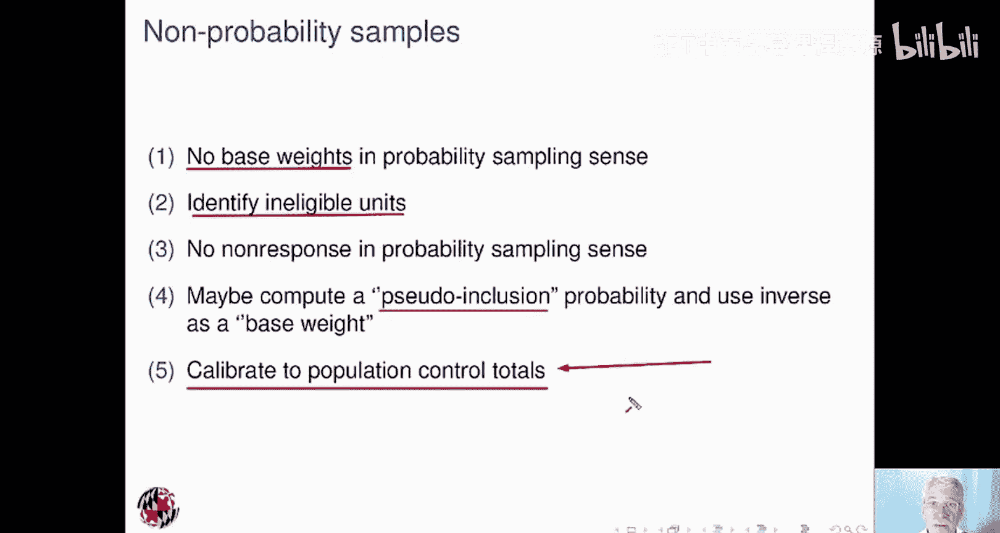
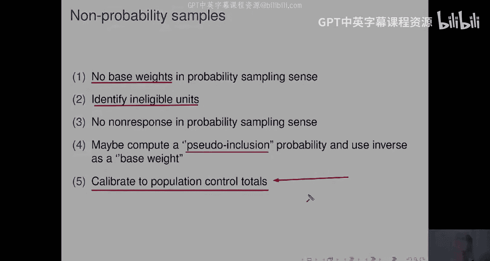

# 密歇根大学《调查数据收集和分析（2-6：方法、社调问卷设计、抽样、缺失数据、分析）｜Survey Data Collection and Analytics》 p130 7_概述.zh_en -BV1fw4m1e7Zh_p130-

We'll start module2 now， this gives specific waiting steps。

 so I'll give you an overview in this first little video。

Steps that we go through in probability sampling are the following。We've usually。Have four steps。

 and some surveys make this more elaborate， but these are the four basic ones。

The first thing that we want to do is compute what are called base weights。

 so those are inverse selection probabilities， and those do apply to probability samples。

As you'll see in a second， they don't apply in the same way to non probability samples。

So then we adjust base weights to account for any units that have got unknown eligibility。

We talked about this earlier in the previous course。

 but the idea there is there are some units that you may not be able to determine whether they're eligible or not because you can't contact them for example。

 and we make an adjustment for that。Then we adjust for nonre， some units don't cooperate。

 so we try to represent them by making a weighting adjustment。

 and then finally we calibrate population controls。

Now this is a flow chart of the steps that we go through to implement those four steps in the earlier slide so that we start up here。

 the first step is compute base weights in step one here。

 so those are going to be the inverse of the selection probabilities soon we've got to keep track of those and then we drop down to this diamond which is a decision point and you ask yourself。

Do I have units with unknown eligibility if I do then I head down this channel and make an adjustment。

 if I don't， then I go down here， I skip that adjustment for unknown eligibility step and I go to the next step。

So let's suppose we do have units with unknown eligibility what we do is we。

Adjust the weight of the ones whose eligibility is known as the KNs here。And。

As part of the operation， you need to。Have an audit trail， so what do we do。

 we store the file of unknowns and we store a file of ineligibles if I find any of those and you keep track of those that's important because if you have to go backwards and reex any of these steps。

You need to have the data available to do that。You know， you just don't want。

To remove the unknowns and the ineligibles and throw them away， that's the bad procedure。

So we make our adjustment， we store the file of response non response here in 2C。

And then we get another decision point do we have non-resding units if we do。

 then we head off down this way， make an adjustment for nonresponse， if we don't。

 we get to skip that step and drop down to the next one So if we do have nonreents。

 what we're going to do is adjust the weights of the eligible respondents。

And we store the file of non responds。In 3A here， again。

 because we're trying to make an audit trail where we could backtrack if we need to。

Then the output of this step is a stored file of respondents with adjusted weights for。

Both nonres and。Unknown eligibility。 if you had unknown eligibles。

Then we come to another juncture here， we've got the possibility of using auxiliary data to adjust for coverage errors and to improve precision。

 reduce variances， so if we do have such data then we head off down this track if we don't we go down this branch and store the file of respondents and we're done。

If we do have auxiliary data， then we use something called calibration estimation。

 which was step4 in the previous slide， and you need external control totals in order to do this。

 so it kind of a。Somewhat subtle point is if your external controls include units that you would consider to be ineligible。

 then what you do is you need to include those INs in your calibration estimation here because otherwise you'll be。

Adjusting weights to external controls that are too big。For just the eligible units。

So that may or may not happen， it depends on the source of your external controls。

So we do all that finally， we store the file of respondents and that summarizes all the steps that we've got to go through to。

Get this waiting process going。Now， non probability samples are a different story。

You can't do quite as many steps in those cases， for one thing。

 you don't have any base weights in the traditional probability sampling sense because you don't have a probability sample to start with。

So you don't have selection probabilities to invert。

You do need to identify ineligible units and get rid of those， those can still occur。There's。

No non response in probability sampling sense， you know。

 in the sense that you did a probabilist except selection of units and。

They some of them did not respond。 Some of them did。

What you have is a collection of data that you got some way in a non probability way。

 so you can't do quite the same sort of nonre adjustment。On the other hand。

There are methods out there where you can compute things called pseudo inclusion probabilities。

The sort of thing that's done in observational studies where you didn't have control over randomizing units into。

 say， control and treatment。But you try to estimate a quasi assignment probability for units。

 so that that's what。It's possible to do here。So you could use a pseudo inclusion probabil and invert those and get kind of a pseudo base weight。

The most important step probably in these non probability samples is to calibrate to population control totals。

The idea here is that you're really trying to make up for real problems in the coverage of your non probability sample。

That's one of the big functions of it， and it also can function that way in a probability sample。

So you get a subset。Of the steps in a non probability sample。

 So we're going to gear our discussion mainly to probability samples。

 but keep in mind that some of the same thinking applies for these non probability cases。

