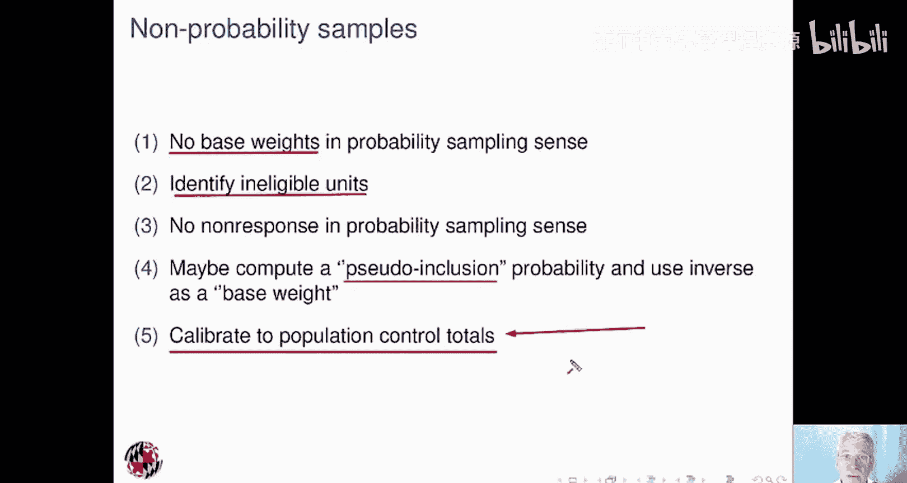
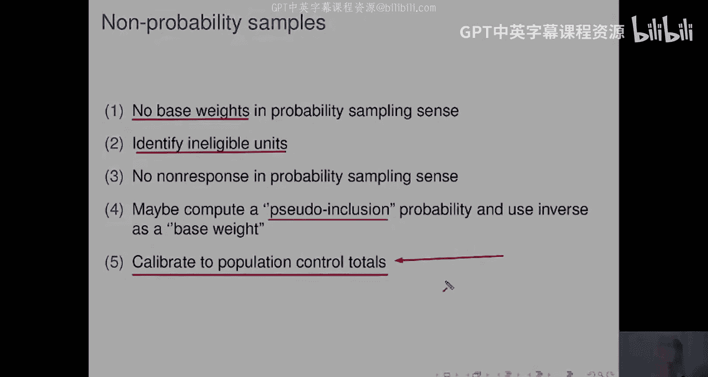

# 调查数据收集与分析：模块2：概率抽样权重调整概述 🎯

在本节课中，我们将学习概率抽样调查中权重调整的核心步骤。权重调整是确保调查结果能够准确代表目标总体的关键过程。我们将通过一个清晰的流程图来理解从计算基础权重到最终校准的完整流程。

## 权重调整的四个基本步骤

上一节我们介绍了权重调整的重要性，本节中我们来看看其具体实施的四个基本步骤。虽然某些调查可能设计得更复杂，但这四个步骤构成了核心框架。

以下是概率抽样中通常遵循的四个步骤：

1.  **计算基础权重**：这些权重是**选择概率的倒数**（公式：`基础权重 = 1 / 选择概率`）。此步骤仅适用于概率样本。
2.  **调整未知资格单元**：对因无法联系等原因而无法确定其是否合格的单元进行权重调整。
3.  **调整无应答单元**：对符合条件但未参与调查的单元进行权重调整，尝试通过加权来代表它们。
4.  **校准总体控制**：利用外部辅助数据（如人口统计总量）对权重进行校准，以修正覆盖误差并提高估计精度。

## 权重调整实施流程图解

理解了基本步骤后，我们通过一个流程图来具体看看如何实施这些步骤。这个流程图清晰地展示了决策路径和数据管理要求。

流程始于第一步：计算基础权重。随后进入一个决策点。

**如果存在未知资格的单元**，则进入调整通道。在此过程中，需要调整已知合格单元的权重。同时，必须保留审计追踪记录：

以下是关键的数据管理操作：
*   存储未知资格单元的文件。
*   存储不合格单元的文件（如果发现）。

完成调整后，在步骤2C存储无应答文件。接着进入下一个决策点。

**如果存在无应答单元**，则调整合格应答者的权重，并在步骤3A存储无应答者文件。此步骤的输出是存储一份应答者文件，其权重已针对无应答和未知资格（如果存在）进行了调整。

随后流程来到另一个节点，评估是否使用辅助数据进行校准。

**如果不使用辅助数据**，则直接存储最终的应答者文件，流程结束。
**如果使用辅助数据**，则进行第四步：校准估计。这需要外部控制总量。一个需要注意的细节是：如果外部控制总量中包含了您认为不合格的单元，则必须将这些单元也纳入校准估计中，否则校准目标会偏大。

最后，存储完成所有调整后的最终应答者文件。

## 非概率样本的权重调整

之前我们详细讨论了概率样本的流程，本节中我们来看看非概率样本的情况。非概率样本的权重调整步骤有所不同，且更为有限。

首先，在传统概率抽样意义上，**非概率样本没有基础权重**，因为起始点就不是概率样本，因此没有选择概率可供求逆。

尽管如此，仍需识别并剔除不合格单元。在概率抽样中，“无应答”指被概率抽中的单元未作答；而在非概率抽样中，数据是以非概率方式收集的，因此无法进行完全相同的无应答调整。

不过，存在一些方法可以计算**伪包含概率**，类似于观察性研究中估计准分配概率的做法。从而可以得到一种伪基础权重。

对于非概率样本，**最关键的一步可能是校准到总体控制总量**。这主要是为了弥补非概率样本在覆盖范围上的固有缺陷，同时也能起到提高精度的作用。在概率样本中，校准也能发挥类似作用。

因此，非概率样本的权重调整只包含完整步骤的一个子集。我们的讨论将主要针对概率样本，但请记住，部分思路同样适用于非概率情况。

## 总结

本节课中我们一起学习了调查权重调整的完整流程。我们首先介绍了概率抽样的四个核心调整步骤：计算基础权重、调整未知资格、调整无应答以及校准总体控制。接着，我们通过流程图详细剖析了每一步的实施路径和必要的数据管理操作（如保存审计追踪文件）。最后，我们对比了非概率样本在权重调整上的不同之处，指出其步骤更少，且校准总体控制是其中尤为关键的一环。掌握这些步骤是进行严谨调查数据分析的基础。