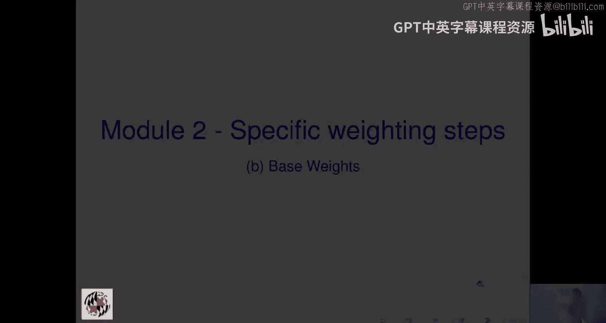
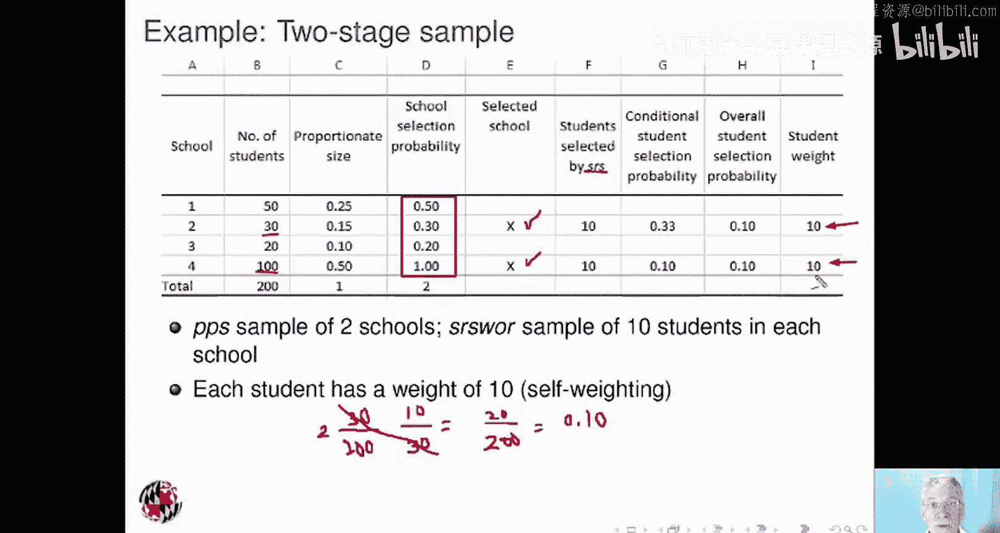

# 密歇根大学《调查数据收集和分析（2-6：方法、社调问卷设计、抽样、缺失数据、分析）｜Survey Data Collection and Analytics》 p131 8_基础权重.zh_en -BV1fw4m1e7Zh_p131-

Next， let's look at some examples of how we would calculate base weights。

So the first one I've got here is a stratified， simple random sample of。Establishments。

 so I've got five straightta here， manufacturing， retail， wholesale service and finance。

And I've got the number of establishments in a strattum。Listed here。They range from 600 or up to 2。

300。You can see that the sample size as shown in this column is the same。

50 establishments from each strum and I'm drawing those by simple random sampling。

 so I calculate the base weight as follows， I take the population size。600。

 it's capN H divided by the sample size 50 in this case， which comes out to be 12。

Over in this column。 So I go down through every straight I'm doing this。 The finance， for example。

 is 500 divided by 50， which is 10。And。We get the set of base weights。In this column。

That means each one of these 50 units in stratum 1 gets a base weight of 12。

 each one of the 50 units in stratum 2 gets a base weight of 24 and so on。

Now one thing to note about this is if I sum up the base weights across all sample units and all the straight。

 I'm going to get exactly capped in。And what wine does that happen？

I've got a base weight of 12 for each unit in the first strum， there are 50 of them。

 12 times 50 is 600， it works the same way in each of the strata and when I sum across all these I'm going to recover the population count 5。

000。Now， that is not always exactly true。Generally。

 what we're going to have is that the sum of the base weights is going to be an estimate of the population size may not be exactly cap in。

 although in stratified simple random sampling and simple random sampling that will be。Exactly true。

So let's look at another example， this one is probability proportional size。So I've got a really。

 really small example here， I've got my entire population is four schools， there they are， one， two。

 three， four。And I've listed off the number of students in each school。 So this goes 50，30， 20，100。

 And I the first thing I do is calculate the proportionate size in。Column C here。

 so if I take 50 over 200， that's  one4 or 0。25， 100 over 200 is 0。5。

Now I calculate the selection probability in this particular。

PPS method of selecting samples as the sample size times the proportionate measure size。

 so in my little example。What I'm saying is that we'll。Just do sample size two right here。

So in this column， I take two times the proportionate size， so 0。2 times or2 times 0。25 is 0。

5 and so forth。So you'll see the last one's got to select a probably a selection of one。

 which just means that it's so big。That we're sure to hit it when we take a p sample。

And I calculate the base weights as the inverse of these selection probabilities， so 1 over 0。5 is 2。

1 over 0。3 is 3。33， and I've done this forever all four units in the population。

 but I'm only going to select a sample of two。So suppose that schools two and four are the ones that I pick。

So I've got。One school with a base weight of 3。33 another with a base weight of1， if I add that up。

 I get 4。33 is shown here now that's not equal to the population size of four。

You know it's sort of in the neighborhood， but not exactly， and this is typical in PPS samples。

 the you know what it amounts to is selecting proportional to size is not a very good way of estimating the total of a 001 characteristic typically。

All right， finally， let's look at an example of a two stage sample， so I'm going to take my。

School example from the last page and just add on another stage of sampling so I've got just repeating my school selection probabilities here in a sample of size two there they are and I I say that。

I'm going to select the same two schools， number two and number four here。

And then within each school， I'm going to select 10 students by simple random sampling is stated here。

 so I've got 10 selected here， 10 selected there。So I'm picking 10 out of the 30 that are in school2 and 10 out of 100 that are in school4。

So the conditional selection probability in school two is 10 over 30 or one3。

And the conditional selection probability of a student in school4 is 10 over 100 or 0。

1 is shown here。Now when I take the overall student selection probability， I'm going to get 0。

3 times the third is the 0。1 in school 2 and one times 0。1 is。Point1 in school4， I invert those。

And sure enough， you see I get exactly the same base weight。In these two。Cases。Now。

That's not an accident， so we can just sketch out the calculation here if I look at school2。

Let's do that one I've got。A selection probability of two times and the proportional size of school 2。

 So that's 30 out of。 you see， I've got the grand total here of 200。In the universe。

 so two times 30 over 200。 and then within the school。

 I'm going to pick 10 out of the 30 that are there。So the 30s cancel out and I get what？20 over。200。

And what is that， that's just one10 that's shown above。So。You can write this out in symbols。

But what happens is you're always going to get this cancellation。

So regardless of whether the schools are different sizes or not。

 my 30 is going to cancel with 30 down here。I'm going to have100 canceling with 100。

If I had picked school 3 I to have 20 canceling with 20 and in all cases I'm going to get the same two times 10 over 200 calculation and that this as you may remember from。

The earlier course is called a self weighting sample where you end up with everything having the same weight so that you know that's a convenient way to do things and it could be efficient if there's no reason to think that certain students are worth more in the sense of reducing the variance of what you're trying to estimate than others。

