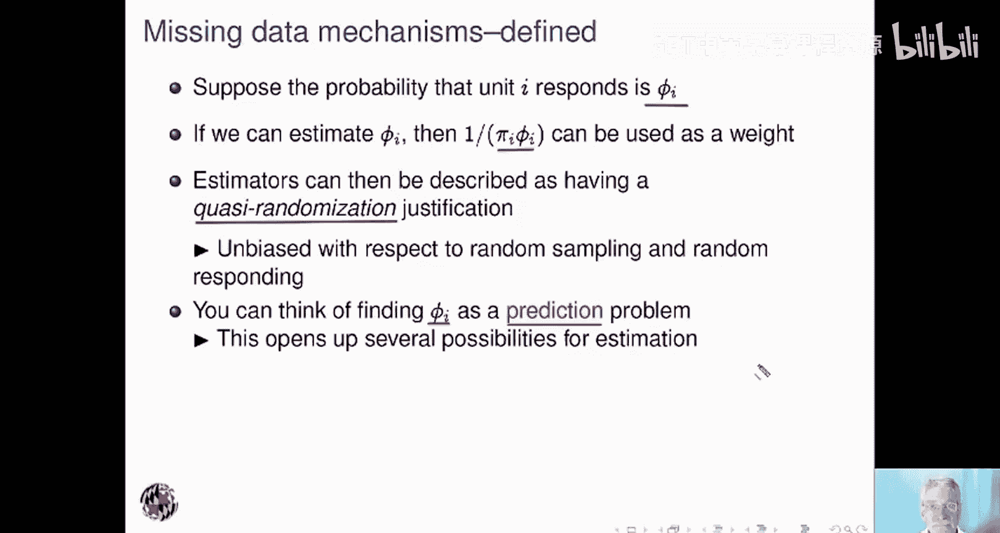

# 密歇根大学《调查数据收集和分析（2-6：方法、社调问卷设计、抽样、缺失数据、分析）｜Survey Data Collection and Analytics》 p132 9_无应答调整.zh_en -BV1fw4m1e7Zh_p132-

In this video， we'll talk about the introductory ideas associated with non response adjustments。

So the first thing that we need to think about are some missing data mechanisms。In the。

3 that I'm going to describe in more detail a bit are missing completely a random M car。

 missing ant random， M I R， and non iorable non response N I N R。Now。

 whether a unit responds or not is treated as a random event when response is categorized as one of these。

Now you could， in contrast， set up the whole thing as being deterministic。

 that is a unit is either going to respond or it will not or will not respond。With probability one。

 the world is divided into two kinds of units， respondents， non respondents。

 they're always like that。 There's no randomness in whether a unit responds to a given survey request or not。

The methods that we use in practice。Ourre。The ones where we model things as being random or stochastic response。

We can work out the math in a useful way in that sense。Now， you know。

 certainly you can probably think of people or businesses or schools。

Whose chance of responding to a survey is essentially zero。you know。

 hardcore non respondsents they're just never going to cooperate we can still do this stochastic kind of thinking if we're willing to say that well。

 you know， a hardcore nonresent is kind of exchangeable in in some sense。

With somebody who is willing to respond。So， you know， if you've got a。A 45 to 50 year old。

African American male who。Would never respond to a survey if that person is replaceable or exchangeable in some statistical sense with another。

Person in that age and race， ethnicity category。 then you're okay and you can use this sort of thinking。

 So that that's the reasoning that we go through to do what we're going to learn about。

So let's think more about what these terms mean。Mcar is a。

Cannerization that says every unit's got the same probability responding。

That means you can think of responding as just another stage of sampling。

It is a kind of a Bernoulli sampling in which you draw a unit in the sample。

 and then it has a random probability of or possibility of responding。嗯。

That means we could have just drawn the smaller size sample right off the bat。

And treated it like it was a random sample， so that's the easy case。

You don't need any weight adjustment in。Means because if you make the same weight adjustment for everybody。

 it's just going to cancel out top and bottom and a weighted mean。

You do need to make one overall adjustment for totals in order to get the scaling of the weights correct。

But that's easy to do。Now， this one， M car。We basically figure never happens， you know。

 it's just too simple。The world's a more complicated place than that。

 and we need to account for co areas。So that's where these next two categories come in。

 one is called missing at random。And what does that mean。

 it means the probability ability of responding depends on some covariates。

So if the probability responding。Diffs from。Age group to race ethnicity， to educational level。

But we can account for that in our estimation， then we're okay。 know。

 we've got those covariates on both the respondents and non respondents， as it says here。

Then we can concoct an adjustment that makes statistical sense。

Now the bad one is this one right here， non iorable non response。

Idea there is not only does response depend on covariates。

 but it also depends on the things you're trying to measure。So for example， if。Nonre depends on age。

 race， and sex。And you're doing a poll to see who a persons going to vote for in the next presidential election。

And whether they respond depends on who they're going to vote for。

 That's dependent on the analytic variable。Because the analytic variable is just the outcome are you going to vote for candidate A or candidate B？

This one is tough to deal with because we typically don't have enough information to account for that。

Dependence on the wise。So， we。Basically do the best we can with the known covariates and hope that that takes care of everything。

So I should mention that these ideas， these missing data categories are due to little in Reuben。

 who have both written quite a bit on missing data problems。Now。We've defined those mechanisms。

 so what do we do？Suppose that the probability that unit I responds is called PI。

If we can estimate that FiI， then what we can do is just take one over。

The selection probability of unit times that estimated response probability and use that as a weight。

And that would have a。What we call is a quasi randomization justification。

 so your estimators will be unbiased or approximately slow。

 so when we think about averaging over both the random sampling mechanism。

And this random response mechanism。Now how do we estimate fee that's the the next analytic problem it's a prediction problem you know we're predicting a 01 variable and this opens up several possibilities for estimation that you may know about already。

 but we'll give you the details。Of how you estimate fee for each unit in upcoming videos。

