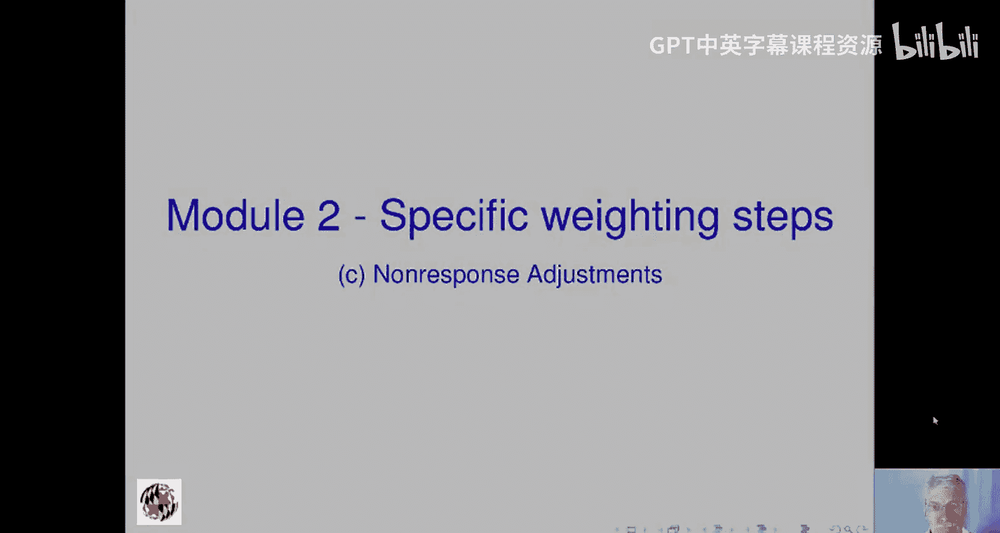
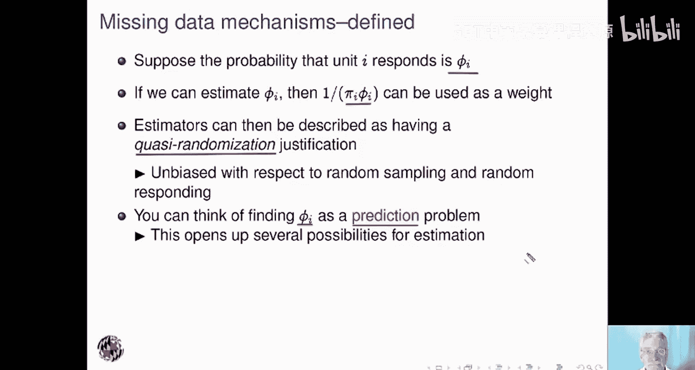

# 调查数据收集与分析：9：无应答调整入门 🧩

在本节课程中，我们将学习调查数据分析中一个关键问题：无应答。我们将探讨数据缺失的几种机制，理解它们对调查结果的影响，并初步了解如何通过权重调整来应对无应答问题。

## 数据缺失机制

上一节我们介绍了调查中的无应答现象，本节中我们来看看如何从理论上理解它。首先，我们需要了解数据缺失的几种机制。这些机制描述了调查对象不回答问题的原因与我们所收集数据之间的关系。

以下是三种主要的数据缺失机制：

*   **完全随机缺失**：每个调查单位（如个人、企业）的应答概率完全相同。你可以将应答过程视为抽样的另一个阶段，类似于伯努利抽样。在这种情况下，应答者样本本身就可以被视为一个随机样本。
*   **随机缺失**：应答概率依赖于一些已知的协变量（如年龄、种族、教育水平）。只要我们在估计时能考虑到这些协变量，就可以进行合理的统计调整。
*   **非随机缺失**：应答概率不仅依赖于已知的协变量，还依赖于你试图测量的分析变量本身。例如，在政治民意调查中，一个人是否愿意回答可能取决于他打算投票给谁。这种情况最难处理，因为我们通常没有足够的信息来应对这种对分析变量本身的依赖。

## 随机性与确定性视角

在实践方法中，我们通常将单位是否应答视为一个随机或随机性事件。这与确定性视角形成对比，后者认为一个单位要么总是应答，要么总是不应答，概率为1。通过采用随机性思维，即使面对那些“坚决不合作”的应答者，只要他们能在统计意义上与某些愿意应答的群体进行“交换”，我们仍然可以运用数学工具进行有用的分析。

## 无应答调整的基本原理

我们已经定义了这些机制，那么具体该怎么做呢？假设单位 `i` 的应答概率为 `π_i`。

如果我们能估计出这个 `π_i`，那么我们可以创建一个调整后的权重。这个新权重的计算公式是：

`调整后权重 = 1 / (选择概率 * 估计的应答概率)`

这种方法被称为“准随机化”调整。当我们同时考虑随机抽样机制和这种随机应答机制时，使用此权重的估计量将是无偏或近似无偏的。

接下来的核心分析问题就是：如何估计每个单位的应答概率 `π_i`？这本质上是一个预测问题，即预测一个二值变量（应答=1，不应答=0）。在后续的视频中，我们将详细介绍估计 `π_i` 的具体方法。

## 总结

本节课中，我们一起学习了调查中无应答调整的入门概念。我们首先区分了三种数据缺失机制：**完全随机缺失**、**随机缺失**和**非随机缺失**，并理解了随机性视角在分析中的重要性。最后，我们介绍了无应答调整的基本原理，即通过估计每个单位的应答概率来调整原始权重，以获得更可靠的总体估计。掌握这些基础概念，是学习具体调整方法的关键第一步。