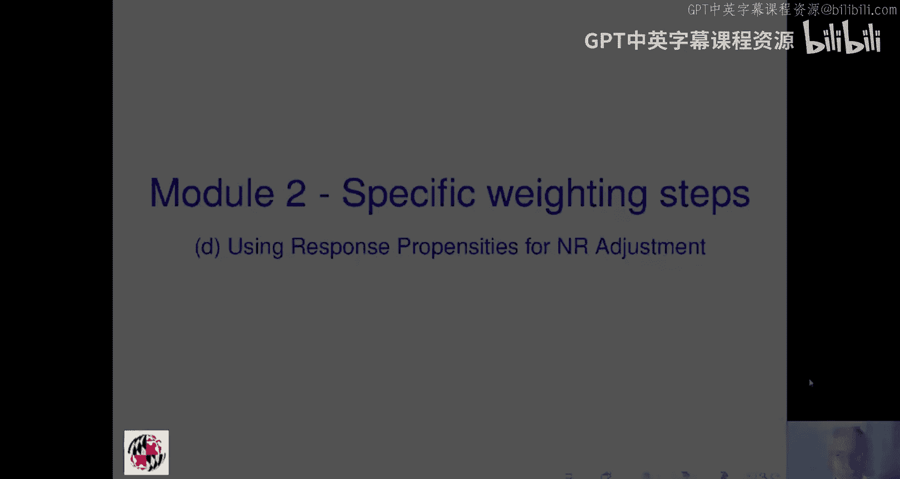
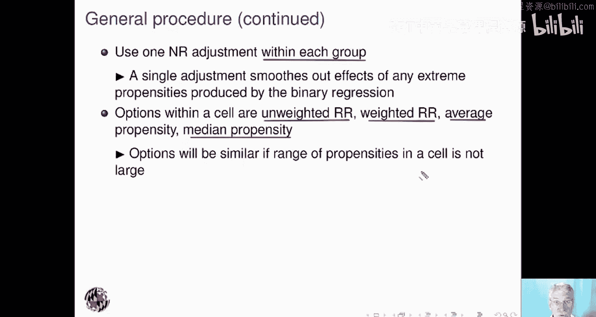

# 密歇根大学《调查数据收集和分析（2-6：方法、社调问卷设计、抽样、缺失数据、分析）｜Survey Data Collection and Analytics》 p133 10_应答倾向.zh_en -BV1fw4m1e7Zh_p133-

In this video， we'll talk more about how to estimate those response propensities for non response adjustment。

Now the general procedure， one general procedure is this， we can do a binary regression。

 so we regress our response variable on covariates。

And logistic regression is the typical thing that gets used， but you could use other things。

 Probit complementaryary log log。They'll all tend to give similar predicted probabilities of response。

So we've got to have。On each unit， whether it responded or not。

And on both the respondents and non respondsents， we've got to have the covariate values， you know。

 no missing data there to fit this model。So we get all these propensities estimated for both the non respondents and the respondents。

 and we form groups at that point。So we sort the responds and non respondents for a low to high based on estimated response propensity and then we。

Divide them into groups。 So in the the。Group of low response propensity units。

 We put respondents and non respondents into this group that have the lowest。

Propeensity and then down among the high ones， we've grouped ones that are similar in the sense of having similar response propenssities。

And we've the nice thing about this is we've created this one variable that we can use for sorting that is kind of an amalgamation of the different covariates。

 so this is a nice summary method of doing things。So you divide the file into groups， as I said。

 five is popular for the number of groups， but it doesn't have to be five。

You knowIf you've got a big sample， you can certainly create more than that and it'll make more homogeneous groups in the sense that the range of propenssities is pretty small。

So you know， you may recognize this as the same sort of thing that people use for analyzing observational data where。

You know idealally， you'd like to have had a designed experiment where you randomize people to be treated or not。

 but you've just got found data and you want to。YouEstimate a。

Can a be pseudo assignment probability to treatment？Control。Same sort of thing。

This idea is just playing off the developments by Rosenbaum and Reuben。

For observational data analysis。So the general procedure then is use one non response adjustment within each group。

So what it does by using a single adjustment， it smooths out the effects of any extreme propensities produced by binary regression。

So that's usually thought of as being good because we don't necessarily trust the model completely。

 so if we form five classes that means we've just got five nonre adjustments。So within a cell。

 what do we do， we could use the unweighted response rate。

 could use the survey weighted response rate， we could use the average of the propensities。

OrWe could use the median propens。All those will be quite similar if the range in each cell is pretty small。

 so that's one reason why。嗯。Creating a lot of cells is a good idea if you've got the sample to support it。

So later on， we'll see some software that will actually do this for you。

