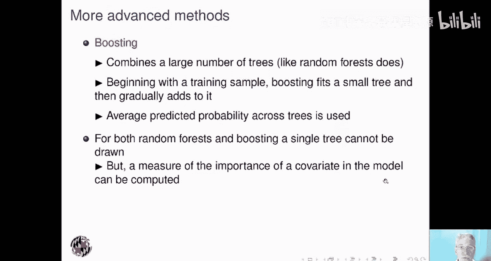

# 密歇根大学《调查数据收集和分析（2-6：方法、社调问卷设计、抽样、缺失数据、分析）｜Survey Data Collection and Analytics》 p134 11_树算法.zh_en -BV1fw4m1e7Zh_p134-

Another option for estimating propensities for non response adjustments are tree algorithms of various kinds。

And these are nice， they have some real advantages that I'll tell you about。So the general idea is。

You。Again， regressive binary response variable on covariates。

You do it in a kind of a stepwise fashion where the algorithm。Starts with response or non response。

 It picks what it thinks is the best Covariate， splits the data set into。Ss。Subss。

Successively splits each of those subsets until finally you get down to this tree structure。

 and I'll show you an example with what are called a set of terminal nodes。

And those nodes are your non response adjustment sales。So it's really flexible。

Method and one of the nice things about it is that these tree algorithms select the covariates to use and it's got that the nice feature of automatically creating interactions that are important among your variables if you're doing a logistic regression you pretty much have to。

Give the regression algorithm all the interactions you think are important up front。

 you could use some sort of stepwise method to let the regression reduce down to the set that it thinks are most important。

But you don't even have to do that in these tree algorithms。 It will do the。

Interacting implicitly for you。So the。Probably the simplest or most straightforward one is called the classification and regression tree or cart。

It successively splits the data into two parts based on covariates or a particular covariate that maximizes a log likelihood for a binary variable。

And at each step， the algorithm may pick out a different covariate if you've got a bunch available。

 or it could do a different split on a previously used covariate。

 it's quite flexible on how it will work。Here's an example using a data set called kyphosis。

 which is part of the R part package。This has to do with abnormal use of the spine。

So the idea in this example is to model whether abnormal curvature is still present after corrective surgery。

So we've got just two variables here， one is called start。

 which is the number of topmost vertebra that were operated on。And the other is age。

 age and months at which the surgery occurred。So the way you read this chart。

 the algorithm went through the selecting of covariates and predicting whether the abnormality is there or not after corrective surgery。

And here's how split things out。The way you read this is。As we go to the left。

 this is the label it applies， so this says start is greater than or equal to eight and half。

 which means。Nine vertebra or more were operated on。

 going this way fewer than nine vertebra were operated on。So the。This is the the simple one。

 So let's think about it first。 if you operated on more than。N topmost vertebrarate？

What's found in this data set is that all the cases where。That occurred。

 still had the abnormality present after corrective surgery。那。As we go down this channel。

 what happens first we split on number of vertebra that were operated on and then we do it again。

 so this has start greater than or equal to 14 and a half so what does that mean if you operated on 15 or more vertebra that since those people off this way and the majority of them had。

The abnormality absent after corrective surgery。And then we get some more splits over here。

 we get splits based on what the age was at which the surgery occurred。In the。This is in months。

 so age less than 55 is over here。In that terminal node。

 the majority of the cases were absent of the abnormality and finally over here。We do get one。

Additional terminal node right here where the majority of the cases had the abnormality still present after corrective surgery。

So that's the idea now how would this apply a non response adjustment。

 we start at the top with our set of respondents non respondents and we want to predict response。

So it。Based on the available covariates， we'll draw this sort of picture and these terminal nodes or bins down at the end would be our non response adjustment cells。

Now there are advantages and disadvantages of trees and cars in particular。

They're easy to understand and explain。 I mean， you can draw pictures。

 which is really nice if you're trying to。Tell somebody what you did。

The selection of which covariates and interactions of covariates to use is done automatically。

 so that's great， you don't have to think about it。The variable values。

 whether they're categorical or continuous or grouped automatically。

 so the covariate variable values， so you don't have to worry about exactly how to code your data when you start with one of these algorithms。

Now。Those are the green up arrows。The red down arrow， which is。That。

Other algorithms may make more accurate predictions， so that's the downside of cart in particular。

The way the other methods work is they cut down on the prediction of variants associated with trees。

 what happens is。And then a lot of empirical examples。You fit a tree to a particular set of data。

 works really well， you try to take it to another set of data。

 doesn't work so well in terms of predicting。The zero1 variable in。

The other algorithms are designed to cut down on that shrinkage。In various ways。

So I'll list some of those for you and these were。All developed。By。

Various people in Stanford and Berkeley universities， the Friedman， Bman。

There's some other names associated with this。 Those are two the bigger developers of these。

 and then there have been many people who followed up with。Improved methods or variations。

So randomand forest works this way， you fit a whole bunch of trees by drawing bootstpped training samples from your initial sample。

 know and that's a subsample selected with replacement。

And then you for each tree that you fit to those bootstrap samples。

 you also pick a random subset of covariates。 The idea there is to reduce the correlation among the trees if you gave each data。

Boottrap data set， the same set of covariates to work with it it'll tend to pick out the strongest ones right off the bat so you won't get much difference between different trees。

And why is that good if you get a bunch of trees that have less correlation and you follow with this step。

 you get the average predicted probability， then the average is going to be more precise than if those correlated those predictions are more correlated across the trees so that's the idea and you use the average predicted probability as your。

Non response propensity estimate。Now another method is called boosting and the way it works is it combines a large number of trees。

 just like our random forest does。You start with a training sample。

 and then you fit a small tree and then you gradually add to it， you know， you make it better。 again。

 you use the average predicted probability for each case across all the trees that you fit。

The kind of a negative of these two boosting random forests is you can't draw a picture of the cells that you created。

 but you do get a predicted average predicted propensity for each unit in your sample。

 so that's really what you need for nonre adjustments。

These algorithms do give you a measure of importance of the covariate so you can see what's driving the predictions。

 and that's useful。So in later videos， what we'll do is look at software that allows you to do this。

And in our next video， we're going to give you an overview of calibration。

 which is the fourth step that I outlined earlier for weight adjustments。

