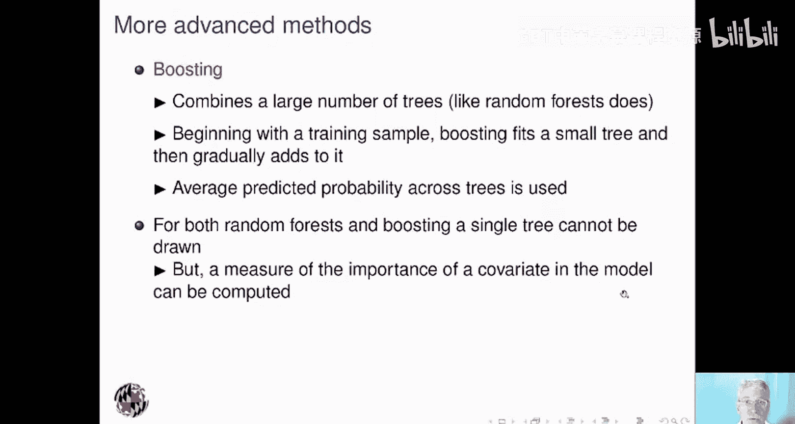

# 调查数据收集和分析：2-6：树算法 📊

在本节课中，我们将学习一种用于估计无回答调整倾向得分的替代方法：树算法。我们将探讨其基本思想、工作原理、具体算法（如CART）以及更高级的变体（如随机森林和提升法），并分析其优缺点。

---

## 树算法的基本思想 🌳

上一节我们介绍了使用逻辑回归估计倾向得分。本节中，我们来看看另一种灵活的方法：树算法。

树算法的核心思想是，将二元响应变量（如回答/无回答）在协变量上进行回归，但以一种逐步的、分而治之的方式进行。算法从响应或非响应状态开始，选择它认为最佳的协变量，将数据集分割成子集，并持续分割每个子集，最终形成一个树状结构。这个结构的末端称为**终端节点**，这些节点就构成了无回答调整的单元格。

这种方法非常灵活，其一大优点是能自动选择使用的协变量，并隐含地创建变量间重要的交互作用。相比之下，逻辑回归需要你预先指定所有可能重要的交互项。

---

## 分类与回归树 📈

最直接简单的树算法是**分类与回归树**。它基于协变量，以最大化二元变量对数似然的方式，逐步将数据分割成两部分。在每一步，算法可以从众多可用协变量中选择一个，也可以对之前使用过的协变量进行不同的分割，方式非常灵活。

以下是一个使用R语言`rpart`包中`kyphosis`数据集的例子。该数据集涉及脊柱异常弯曲，本例目标是建模矫正手术后异常弯曲是否仍然存在。我们使用两个变量：
*   **Start**: 手术涉及的最顶端椎骨数量。
*   **Age**: 手术发生时的年龄（月）。

算法通过选择协变量来预测术后异常是否存在，并生成如下分割：
1.  首先根据`Start`（手术椎骨数）是否 ≥ 8.5（即9块或更多）进行分割。
2.  对于`Start` ≥ 8.5的分支，所有案例术后均存在异常。
3.  对于`Start` < 8.5的分支，进一步根据`Start`是否 ≥ 14.5（即15块或更多）进行分割。
4.  在`Start` < 8.5 且 `Start` < 14.5的分支中，再根据`Age`（年龄）是否 < 55个月进行分割。
5.  最终，算法生成多个终端节点，每个节点代表一个预测类别（异常存在或缺失的多数情况）。

**如何应用于无回答调整？**
我们从顶部的回答者和无回答者集合开始，希望预测“回答”这个状态。基于可用协变量，算法会绘制类似的树状图，底部的这些终端节点或“分箱”就是我们的无回答调整单元格。

---

## 树算法的优缺点 ⚖️

以下是CART树算法的主要优缺点：

**优点：**
*   **易于理解和解释**：可以绘制图形，便于向他人说明。
*   **自动选择变量和交互项**：无需手动指定。
*   **自动处理变量类型**：无论协变量是分类、连续还是分组数据，算法都能自动处理，无需担心初始编码方式。

**缺点：**
*   **预测准确性可能不如其他算法**：这是CART的一个主要缺点。在许多实证例子中，一个树模型在特定数据集上拟合得很好，但应用到新数据时预测性能可能下降（即方差较大）。
*   其他算法通过各种方式旨在减少这种预测方差。

---

## 更高级的树算法 🌲

为了克服CART的缺点，发展出了多种改进算法，主要由斯坦福大学和伯克利大学的学者（如Friedman, Breiman等）开发。

以下是两种主流的高级树算法：

**1. 随机森林**
这种方法通过以下方式工作：
*   从初始样本中抽取大量**Bootstrap训练样本**（有放回的子样本）。
*   为每个Bootstrap样本拟合一棵树，并且在构建每棵树时，**随机选取一个协变量子集**。
*   这样做的目的是降低树与树之间的相关性。如果所有树使用相同的协变量集，它们会倾向于首先选择最强的变量，导致树之间差异不大。
*   最终，对每个样本单元，**使用所有树的平均预测概率**作为其无回答倾向得分估计。由于树之间的相关性较低，这个平均值的精确度会更高。

**2. 提升法**
提升法的工作方式是组合大量树，类似于随机森林：
*   从一个训练样本开始，先拟合一棵小树。
*   然后逐渐添加树木，不断改进模型。
*   同样，对每个案例，使用在所有拟合的树上的**平均预测概率**。

**随机森林和提升法的注意事项：**
这两种方法的一个小缺点是，你无法像CART那样绘制出清晰的、代表调整单元格的树形图。但是，它们能为样本中的每个单元提供一个预测的倾向得分，这正是无回答调整所需要的。此外，这些算法还能提供**协变量重要性度量**，让你了解是哪些变量在驱动预测，这非常有用。

---

## 总结与预告 📝

本节课我们一起学习了用于无回答调整的树算法。我们从基本的CART算法开始，了解了其通过递归分割形成调整单元格的原理和直观解释。接着，我们讨论了CART的优缺点，并介绍了为提升预测稳定性和准确性而发展的更高级算法——随机森林和提升法。

在后续视频中，我们将介绍可以实现这些算法的软件。在下一个视频中，我们将概述**校准**方法，这是我之前 outlined 的权重调整四个步骤中的第四步。