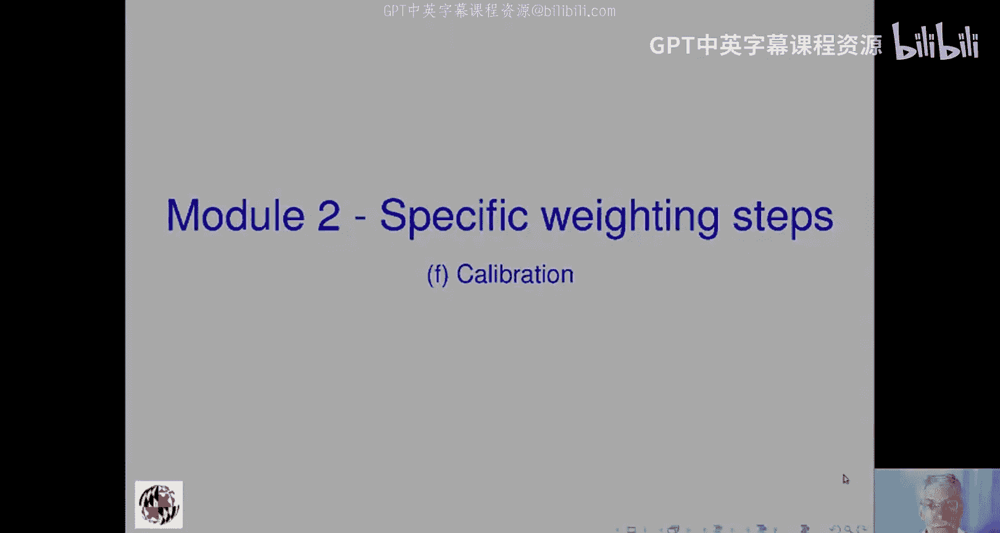
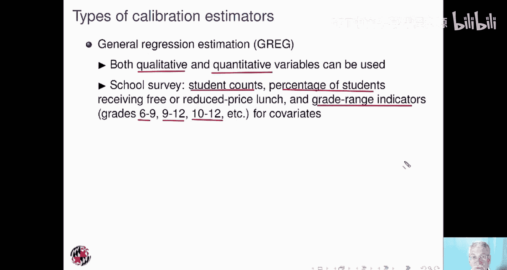

# 密歇根大学《调查数据收集和分析（2-6：方法、社调问卷设计、抽样、缺失数据、分析）｜Survey Data Collection and Analytics》 p135 12_校准方法.zh_en -BV1fw4m1e7Zh_p135-

The last general step in waiting is called calibration， which I'll sketch for you in general here。

The idea is to use covariate data。To correct for。Both coverage errors and to reduce standard errors。

may have that effect， that joint effect， and the idea is to use population or census totals for the covariates。

In order to do this。One thing that is an advantage of this is the individual values of covariates need to be known only for the sample respondents。

Not for the non responding units or the non sample units individually。

 we do need to have grand totals across the population。

 but we don't need to know specifics on those units we didn't actually see in the sample。Now。

 why is that an advantage， it allows a larger set of covariates to be used for calibration that does for nonresponse adjustment。

 because remember in nonresponse adjustment， we had to know the covariates for both the responds and the non-resnders。

And oftentimes you don't have a very big set of covariates that for which you know their values for both the respondents and the non respondents。

On the other hand， you may know quite a bit based on census count and values for different covariates。

没。How do we pick the covariates， they should be related to the likelihood of being covered by the frame。

And they also should be related to the analytic variables， in other words。

 good predictors of the analytic variables。Or ideally both would be what you'd shoot for。

So here' are some examples of particular methods that are fall the calibration class。

Post stratification is probably the simplest one。 you classify the response into groups。

 as we call post stta， because you do it after the sample is selected， the data are collected。

And then you adjust weights so that they sum to the pop totals of the covariates within each of the post rate。

So the definition of the posttra constitute the covariates。So for example， we could have age by race。

 ethnicity by gender in a household survey。To do the post stratification。

 we've got to have census counts in that three way cross and we've got to have them for a time period that's pretty close to the survey period。

 Otherwise we are adjusting to totals that are really not comparable to our。Survey data set。Now。

 another method is raking， which only requires marginal counts。So you see in post stratification。

 I've got this three way cross， if I rate， I could get by with just the marginal census counts for age。

 race， ethnicity， and gender without having the full cross of those variables。

So as a practical matter， there's some advantages to raking because even if you've got pop counts in the three way cross。

 you might have a pretty small sample or no sample in some of those cells。

But that wouldn't prohibit you from raking to the marginal counts where your sample sizes may be fine。

Another example of a calibration estimator is called the general regression estimator。

 so the idea there is essentially use regression to predict values for the nons sampleamp units。

The advantage of it is you can use qualitative and quantitative variables if you've got those for your covariates in a school survey。

 for example， we might use for our covariates， student counts and percentage of students that receive free or reduced price lunch。

We could use grade indicators for each school。If they cover grades 6 through9，9 through 12。

 10 through 12， some other combination， you could have indicators for those as covariates so you can mix up qualitative and quantitative。

 which makes the Greg estimator a pretty flexible choice in this。

