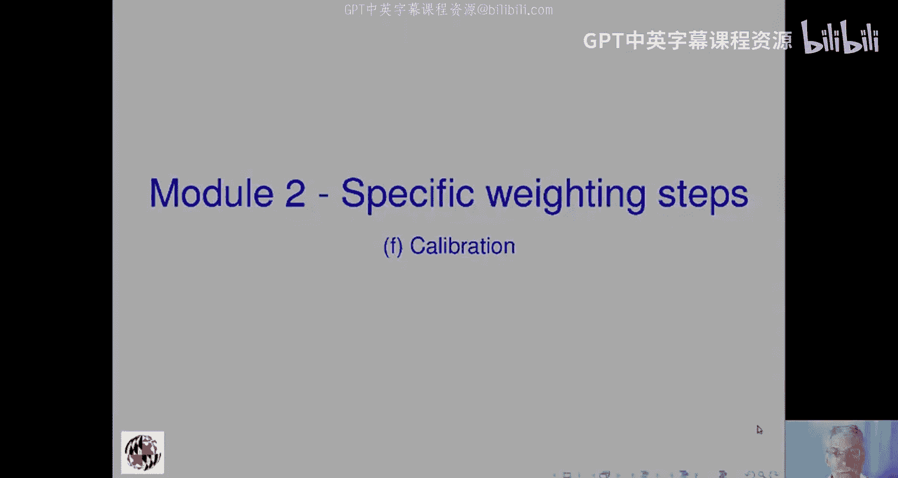
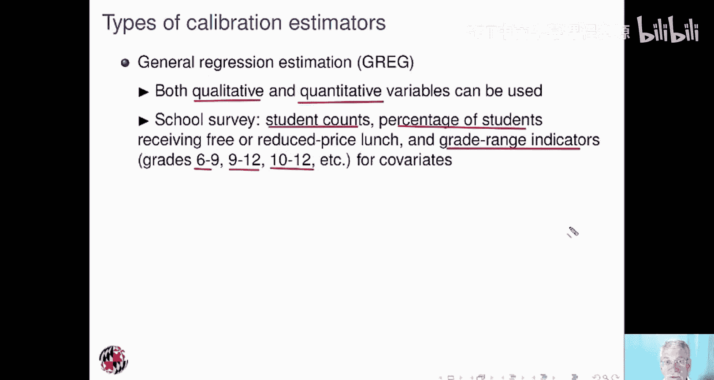

# 调查数据收集与分析：2-6：校准方法 📊

在本节课中，我们将要学习调查数据处理流程中的最后一个通用步骤——**校准**。校准是一种利用辅助变量数据来修正抽样框覆盖误差并降低估计标准误的方法。我们将介绍其核心思想、优势以及几种具体的校准方法。

## 校准的核心思想与优势

上一节我们讨论了无回答调整，本节中我们来看看校准方法。校准的基本思想是利用辅助变量的信息，对调查权重进行调整。其目的是同时修正因抽样框未能完全覆盖目标总体而产生的**覆盖误差**，以及降低估计量的**标准误**。

为了实现这一点，校准方法需要使用已知的总体或普查总量数据作为基准。这种方法的一个关键优势在于：我们只需要知道**样本中回答单元**的辅助变量具体值，而无需知道那些未回答单元或未被抽中单元的具体信息。我们只需要这些辅助变量在**整个总体**上的总和即可。

为什么这是一个优势？因为它允许我们使用比无回答调整更广泛的辅助变量集合。回想一下，在进行无回答调整时，我们必须同时知道回答者和无回答者的辅助变量值。然而在实际中，我们通常很难获得一个既全面又同时包含回答者和无回答者信息的辅助变量集。相反，基于普查数据，我们可能掌握许多辅助变量的总体总量信息。

## 如何选择辅助变量

以下是选择校准辅助变量的两个主要原则：

*   **与覆盖概率相关**：辅助变量应该与单元被抽样框覆盖的可能性有关。
*   **与分析变量相关**：辅助变量应该是调查中我们关心的分析变量的良好预测因子。

理想情况下，我们应选择同时满足以上两个条件的变量。

## 常见的校准方法

了解了校准的原理和变量选择后，我们来看看几种具体的校准方法。以下是三种常见的校准技术：

### 事后分层法

事后分层法可能是最简单的校准方法。在样本被抽取、数据被收集**之后**，我们将回答单元按照某些辅助变量特征（如年龄、种族、性别）划分成不同的组（即“事后层”）。然后，调整每个层内样本单元的权重，使得调整后的权重之和等于该层在总体中对应的已知总量。这里，事后层的定义本身就构成了用于校准的辅助变量。

例如，在一项家庭调查中，我们可以按“年龄×种族×性别”进行交叉分层。要进行事后分层，我们必须拥有这个三维交叉分类在普查中的对应计数，并且普查数据的时期应与调查时期相近，否则我们调整所依据的总量将与调查数据集不可比。

### 边缘加权法

另一种方法是**边缘加权法**。与事后分层法需要完整的交叉分类总量不同，边缘加权法只需要各个辅助变量的**边缘总量**。

继续上面的例子，进行边缘加权时，我们只需要年龄的总体分布、种族的总体分布和性别的总体分布，而不需要知道“某个特定年龄的特定种族的男性”在总体中有多少。这在实践中有很大优势，因为即使你拥有三维交叉的总体计数，你的样本在某些交叉单元格中的数量可能非常少甚至为零。而边缘加权法可以避免这个问题，因为你的样本在各边缘分类上的数量通常是足够的。

### 广义回归估计量

第三种校准方法是**广义回归估计量**。其基本思想是使用回归模型，基于辅助变量来预测那些未被抽中或未回答的单元的分析变量值。

这种方法的优势在于，它能够同时处理**定性**和**定量**的辅助变量，使其成为一种非常灵活的选择。

例如，在一项学校调查中，我们可以使用的辅助变量包括：学生总数、享受免费或减价午餐的学生百分比。我们还可以使用代表学校年级段的指示变量（例如，是否覆盖6-9年级、9-12年级等）。这些定性（年级段指示变量）和定量（学生数、百分比）的变量可以混合在同一个回归模型中使用。

## 总结

本节课中我们一起学习了调查数据加权过程的最后一步——**校准**。我们了解到，校准通过利用已知的总体辅助信息来调整样本权重，能够同时处理覆盖误差并提高估计精度。其核心优势在于仅需样本回答者的辅助变量具体值，降低了数据需求。我们介绍了三种主要的校准方法：简单直观的**事后分层法**、对数据要求更宽松的**边缘加权法**，以及能灵活处理混合类型变量的**广义回归估计量**。理解这些方法有助于我们根据实际拥有的辅助信息类型，选择最合适的工具来改进调查估计。