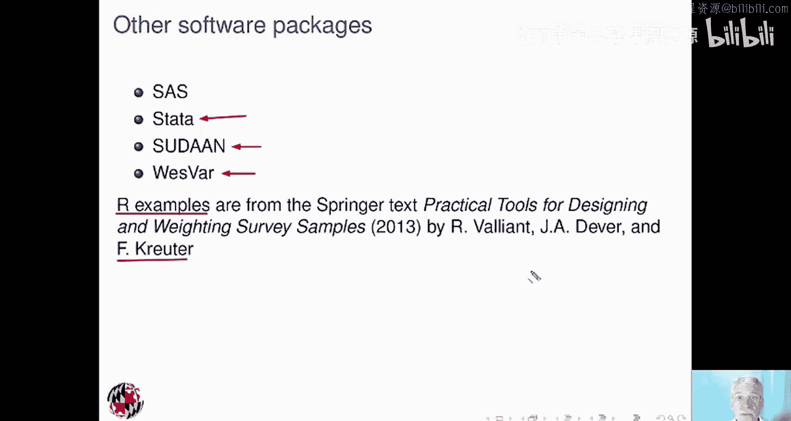

# 密歇根大学《调查数据收集和分析（2-6：方法、社调问卷设计、抽样、缺失数据、分析）｜Survey Data Collection and Analytics》 p136 13_软件工具.zh_en -BV1fw4m1e7Zh_p136-

Now that you've learned about the general steps in waiting。

 what we'll do in module 3 is move on to how you actually do those。

 and I'll give you a number of software examples， so I want to start out with an overview the software that's available。

Now the one we're going to emphasize in this course is R and some packages that are available within R。

 so the great thing about R is that it's free。The price is right and you can download it at this website。

 ourproject。org。That includes both the basic packages and the anon packages that users have written。

So as of this spring 2016， there were over 8，000 user written R packages that。

Are out there on the Crran comprehensive R archive network for free download。

And they'll do a lot of really useful things。 we're going to be using three of them in this course。

 one is called sampling。Another one is called surveyve and another one is called PraC Tos。

So it will show you examples using all those。Now how do you edit code files and R there are some options there。

 one that is very popular and good is called our Studio。

 another one is the Shaware package called WinEDT， which is pretty common because you can also edit lateAC files in WinEDT and compile them。

In order to get the most good out of Win EDT， you should download the Rwin EDT R package， which。

Causes when EDT and R to be closely linked together。Highlight code in your editor window。

 send it directly to the A console for execution， and our studio does that too。

T0 R is another one that's out there， it's also a shareware package。

And it's got some of the same capabilities， so you can decide which one you like best and make a choice。

Now there are other commercial software packages that are available。

 SAS is a wellknown very large operation， it has some survey capabilities。

 Stata is another good package that's commercial， it has got more capabilities than SAS。

 and in fact it's got quite a lot of analytic capabilities that you won't find in other packages。

Many of them built off of econometric modeling routines。Another good package is Sudan。

 the usual way that that's used is in conjunction with SAS。

So you most conveniently will have to have a Sas license and a sudan license in order to do this。

WestVar is a free piece of software that is built around replication variance estimation。And it's。

Written by Westatt， which is a commercial company in the Washington D。 area。

 it's available for download for free at the Westat co website。

Now we're going to be doing a lot of our examples in the coming videos and many of those are based on this Springer text that I've listed here。

 practical tools for designing and waitinging survey samples published in 2013 so I happen to know this book well since I'm the first author this was written in conjunction with。

Jill Deer and Fr Croyer， who， as you know by now， is also a coin in this Coursera sequence of oneserv methods and data collection。

