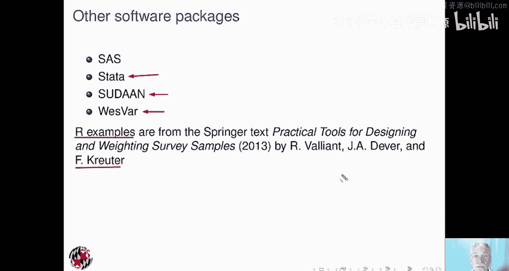

# 调查数据收集和分析：13：软件工具 🛠️

在本节课中，我们将学习在调查数据收集与分析中可用的软件工具。我们将概述多种软件选项，并重点介绍本课程将使用的核心工具及其相关资源。

## 软件概览

上一节我们介绍了调查设计的一般步骤，本节中我们来看看如何实际执行这些步骤。我将提供多个软件示例。

首先，我想概述一下可用的软件。本课程将重点强调 **R** 及其内部可用的一些软件包。

## 核心工具：R 及其生态

R 的一大优点是它是免费的。价格合适，您可以在 `r-project.org` 这个网站下载。这包括基础包和用户编写的附加包。

截至 2016 年春季，在 CRAN（综合 R 档案网络）上已有超过 **8,000** 个用户编写的 R 包可供免费下载。它们能完成许多非常有用的任务。

本课程将使用其中的三个包：
*   `sampling`
*   `survey`
*   `PracTools`

我将展示使用所有这些包的示例。

## R 代码编辑器

那么，如何在 R 中编辑代码文件呢？有以下几种选择：

以下是几种流行的 R 代码编辑器选项：
*   **RStudio**：非常流行且优秀。
*   **WinEDT**：这是一个共享软件包，相当常见，因为您也可以在 WinEDT 中编辑 LaTeX 文件并进行编译。为了充分发挥 WinEDT 的优势，您应该下载 `RWinEdt` 包，它能使 WinEDT 和 R 紧密链接在一起。您可以在编辑器窗口中高亮代码，然后直接发送到 R 控制台执行。RStudio 也具备此功能。
*   **Tinn-R**：这是另一个共享软件包，具备一些相同的功能。

您可以决定最喜欢哪一个并做出选择。

## 其他商业软件

现在还有其他可用的商业软件包。

以下是几种商业调查分析软件：
*   **SAS**：这是一个知名的大型软件，具备一些调查分析功能。
*   **Stata**：另一个优秀的商业软件包，其功能比 SAS 更多。事实上，它拥有许多在其他软件包中找不到的分析功能，其中许多功能建立在计量经济建模例程之上。
*   **SUDAAN**：通常与 SAS 结合使用。因此，最方便的方式是同时拥有 SAS 许可证和 SUDAAN 许可证才能使用它。
*   **WestVar**：这是一个围绕复制方差估计构建的免费软件。它由华盛顿特区的一家商业公司 Westat 编写，可在 Westat 公司的网站上免费下载。

## 课程示例与参考资源

在接下来的视频中，我们将进行大量示例演示，其中许多基于此处列出的 Springer 教科书：**《Practical Tools for Designing and Weighting Survey Samples》**（2013 年出版）。我恰好对这本书很熟悉，因为我是第一作者。这本书是与 Jill Dever 和 Frauke Kreuter 合著的，正如您现在所知，Frauke Kreuter 也是这门 Coursera 序列课程“调查方法与数据收集”的联合讲师。

---

本节课中我们一起学习了调查数据分析中可用的主要软件工具。我们重点介绍了免费的 R 语言及其强大的包生态系统，并简要概述了其他商业和免费软件选项。了解这些工具将帮助您在后续课程中更有效地进行数据分析和样本加权。