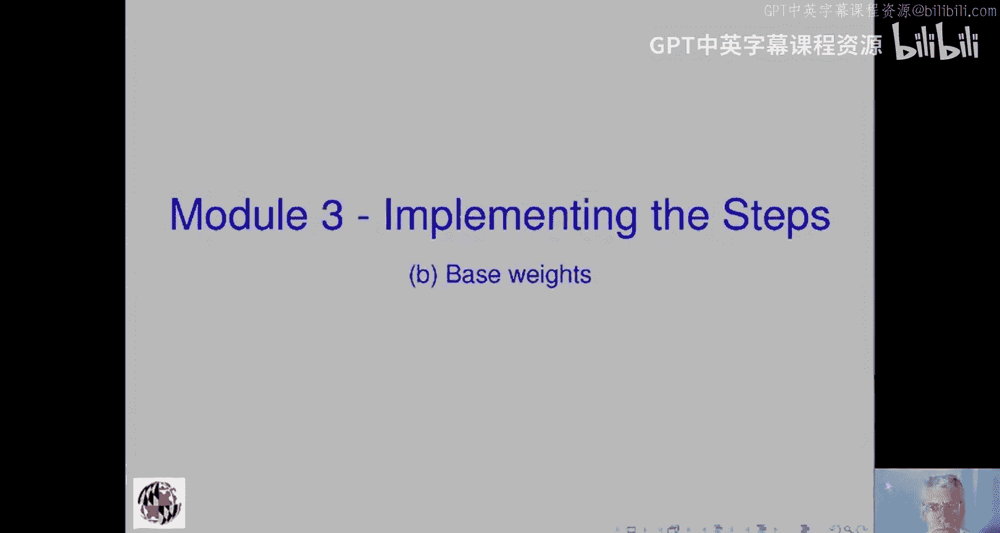
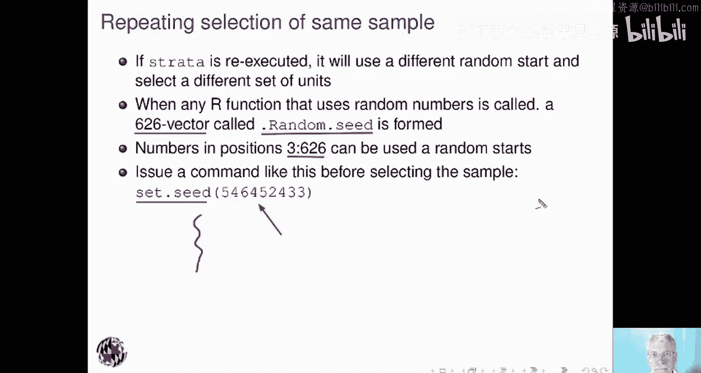

# 密歇根大学《调查数据收集和分析（2-6：方法、社调问卷设计、抽样、缺失数据、分析）｜Survey Data Collection and Analytics》 p137 14_基础权重详解.zh_en -BV1fw4m1e7Zh_p137-

In this video， we'll see a software example of how to select a stratified simple random sample and then get the base weights。

So what I'm going to do is use the R sampling package。

So this one is written by two Swiss statisticians named TA and Mattte。

 and it's got a lot of nice capabilities for selecting samples。

So here's how to use it in this particularicular case。First in R to。

 you've got to get the package installed。And then to make it available， you've got to load it。

 so the way I'm doing it here is with the require statement。

 there are other equivalent statements you can do。or issue to do this and then I'm using this p tools package。

 which has got a data set in it that I want to draw a sample from。

So I require both sampling and PR tools and then to make the data available that I've got in mind。

 which is called NHIS for National Health Interview Survey。

 it's a survey done in the US and this is a subset， small subset of one of the years of the NHIS。

And I'm going to use a variable in there called education。

And here's the name of the variable in the data EDA underscore R。

 so if you're going to use something for a straightum you better check to make sure that you've got something in every level of that variable and you don't have any missing data so here's my first little initial tabulation I issue the table statement I do that on the variable EDuc underscore R within the HIS data so I can do this with NHIS。

 the data name， Do sign and then the variable name。

And to make sure that it counts up missing values if there are any， I say use DNA equals always。

 so this is good practice。So you'll see missing data if they're there， if you omit this。

 the table statement will just not show you whether there's any missing or not and you'll never know。

So I've got four levels of education one two， three， four here and here's the counts。

 so those are a you know reasonably good size for strata and。Critically。

 there's no missing data N is the R。Name for missing values and we've got zero there。 so that's good。

 that's what we want to see。Now， this is an alternative， so I wouldn't have to。

Type this NHIS dollar I could attach that data set and then I can just refer to variables within it or column names directly so if I say table EDuc underscore R use a equals always I get exactly the same table。

So those are equivalent after I do the attached statement。So you may or may not like using in。

Now the sampling package will easily select a simple random sample， stratified simple random sample。

 which is what I'm after here。And here's how you do it。

 first you should order your data set by the statum variables。And how do I do that I？

I look at the NHIS data set and then in brackets， I in the row position。

 I put order of EDuc underscore R。 so this what this amounts to is causes the data set to be sorted。

By educational level。And I just resa it under the same name。

 you could save it under a different name if you wanted to。

And now I use the strata function in sampling to draw my sample， so I do it from the data set in HIS。

 the next parameter here is straightta names equals， and then in quotes。

 you put the name of the column or the field that holds the stratum values， so it's ED underscore R。

And then I tell it，How I want to pick。So what I'm doing is I'm replicating the number three four times。

So I've got four rate。I'm going to pick three persons in this case， pertrateum， that's all that says。

And then what method am I using within strata， simple random sampling without replacement。

 SRSWOR in description equals true just says。Print me some little housekeeping details of what you did after you did sampling This also is good。

Practice to get some documentation for what you did。 So here's the entire sample here。So the。

These are the unit numbers in the population that actually get picked here。

So you can see it spread them all over the place， but the straight and variable these Zductuc underscore R。

 you see in this column。That I've got three units picked from each of those four straight。 So 1，1，1。

2，2，2， so forth。And here ID underscore unit just repeats the unit numbers。

 so this column is just the same as this。Or a row name column here。

And then another critical thing for what we're doing right here is。The prob column。

 that gives the probability of selection of each of the units。So if notice here in the first strum。

 they're all the same。Well， what is that， it's the number I picked。

 which is three divided by the pop count in that stratum。

That's going to be the probability of selection。 And then I get a similar thing for strum two and then three and4。

So I'll use those to calculate base weights。Now I saved that。

 as you may have noticed on the last slide in an object called STS so I can refer to the prob column with STCM dollar Pro。

 I just take one over the selection probabilities and those are my base weights。Well。

 I can do the little checks that I suggested earlier。

 I can sum all the weights up and what do I get3911。 You can go back and check that that is the。

Total number of units in this NHIS data set in that little mini population。

Another good thing to do is to。Sum those up by strum。 So I can use the by statement to do that。

 So I'm saying here by the variable I'm summing are weights。

 which I assign here is one over the S Sam Pro and I'm。Doing that over this index， which is the。

E duckuck underscore R or my stratum。And what function am I using some？

So it gives me this output here in a list format so you can go back and check and sure enough。

 these sum up to exactly the pop counts that I got in that table statement。In a couple of slides ago。

 so that's exactly as it should be in a stratified， simple random sample。

 that's one of the designs where your weights ought to sum exactly to population counts。Now。

 one little side issue that's nice to know about。A lot of times you'd like to repeat the selection of the same sample because you're testing things and you want to get the same set of units out so you can do various summaries with them that this is a special useful and a complicated program。

So there's a way to do that。嗯。If you just reexecute that straightest statement。

A new set of sample units。Of size 12 will be selected， it won't get the same one again。

It seems said again。But you can make it pick the same set again， and here's how you do it。

In R any time。A function is invoked that uses random numbers。

There's a 626 vector that's called dot random dot seed。 and that's a catar on random。 You know。

 you can type at the console dot random dot seed， and you can see the whole thing。

The numbers in positions three through 626。Can be used as random starts。If you want to。

Do something over again。 So what you need to do before selecting a sample is issue the set dot seed command。

 And what I did here， this， this long number is one of those potential see that I copied out of the dot random dot seed that happened to get generated at one point when I was。

Preparing these slides。If you issue that command and then。You know downown below。

 you issue the same stta statement to select。A sample。Over and over and over again。

 it'll select the same set of sample units for you。

 so this is a very handy thing for repeatability and testing in particular。

