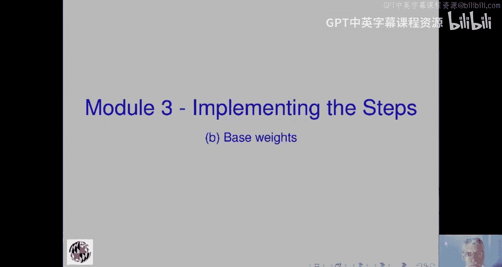
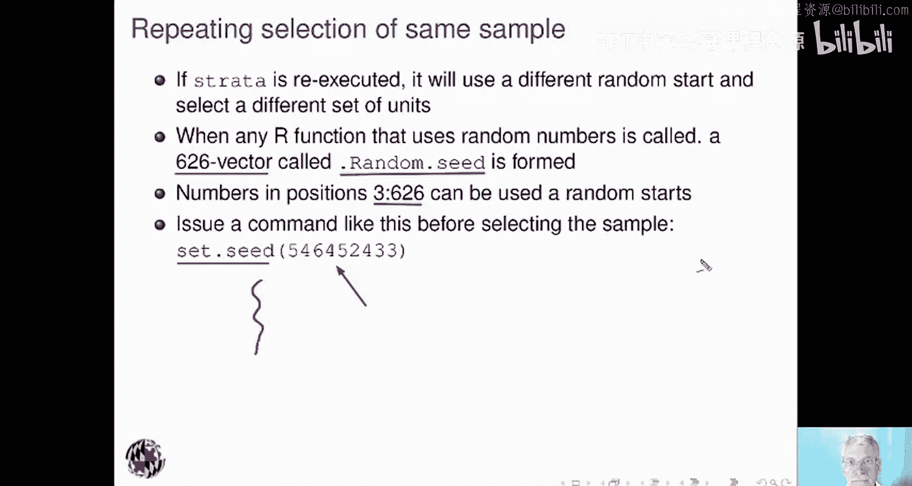

# 调查数据收集与分析：14：基础权重详解 🧮




在本节课中，我们将通过一个软件示例，学习如何选择分层简单随机样本，并计算其基础权重。我们将使用R语言及其`sampling`包来完成这一过程。

## 概述

我们将使用R语言中的`sampling`包，该包由两位瑞士统计学家Tillé和Matei开发，提供了丰富的抽样功能。具体步骤包括：安装并加载必要的包、准备数据、执行分层抽样、计算基础权重，并进行验证。

## 数据准备与检查

首先，我们需要安装并加载`sampling`和`PracTools`包。`PracTools`包中包含一个名为`NHIS`的数据集，这是美国国家健康访谈调查的一个小型子集。

```r
# 安装并加载必要的包
require(sampling)
require(PracTools)

# 加载数据
data(NHIS)
```

我们将使用数据集中的`educ_r`变量（教育水平）作为分层依据。在分层之前，必须确保该变量没有缺失值，并且每个层级都有足够的观测值。

以下是检查变量分布和缺失值的代码：

```r
# 检查educ_r变量的分布，并显示缺失值
table(NHIS$educ_r, useNA = "always")

# 另一种等效的检查方式（在attach数据后）
attach(NHIS)
table(educ_r, useNA = "always")
```

执行上述代码后，如果输出显示缺失值（`NA`）数量为0，并且每个教育层级都有合理的观测数量，则说明数据适合用于分层抽样。

## 执行分层简单随机抽样

接下来，我们需要按分层变量对数据集进行排序，然后使用`sampling`包中的`strata`函数进行抽样。

以下是具体步骤：

首先，按教育水平对数据进行排序。

```r
# 按分层变量对数据集进行排序
NHIS <- NHIS[order(NHIS$educ_r), ]
```

然后，使用`strata`函数进行分层抽样。我们设定从每个层（教育水平）中抽取3个样本单位，采用不放回简单随机抽样方法。

```r
# 执行分层简单随机抽样
set.seed(123) # 设置随机种子以保证结果可重复
samp <- strata(NHIS, stratanames = "educ_r", size = rep(3, 4), method = "srswor", description = TRUE)
```

参数说明：
*   `stratanames`: 指定分层变量的名称。
*   `size`: 一个向量，指定从每个层中抽取的样本数量。`rep(3, 4)`表示从4个层中各抽3个。
*   `method`: 抽样方法，`"srswor"`代表不放回简单随机抽样。
*   `description = TRUE`: 要求输出抽样的详细信息。

函数执行后，会输出一个包含样本单位ID、所属层以及**每个单位被抽中的概率**的数据框。这个概率是计算基础权重的关键。

## 计算基础权重

基础权重是每个样本单位代表总体中多少个单位的度量，其计算公式为样本单位入样概率的倒数。

在R中，我们可以直接从抽样结果中提取概率并计算权重：

```r
# 计算基础权重：权重 = 1 / 入样概率
samp$weight <- 1 / samp$Prob
```

现在，`samp`数据框中新增了一列`weight`，即为每个样本单位的基础权重。

## 权重验证

计算权重后，进行验证是良好的实践。我们可以通过两种方式验证权重的正确性。

**1. 权重总和应等于总体单位数**

对于分层简单随机抽样，所有样本权重的总和应恰好等于总体中的单位总数。

```r
# 检查权重总和是否等于总体单位数
sum(samp$weight)
```

如果输出结果等于原始`NHIS`数据集的行数（例如3911），则验证通过。

**2. 各层权重总和应等于各层的总体单位数**

我们还可以按层分别汇总权重，其总和应等于各层在总体中的原始数量。

```r
# 按层汇总权重，检查是否等于各层总体数量
by(samp$weight, samp$educ_r, sum)
```

执行此命令后，输出的每个层的权重总和，应与最初`table(NHIS$educ_r)`命令显示的该层观测数量完全一致。

## 确保结果可重复性 🔁

在测试或需要复现相同样本时，设置随机数种子至关重要。R使用一个名为`.Random.seed`的向量来生成随机数。

在每次执行抽样代码前，使用`set.seed()`函数并指定一个相同的数字，可以确保每次抽到的样本完全相同。

```r
# 在抽样前设置随机种子
set.seed(20231027) # 可以使用任意整数

# 然后再次执行相同的strata函数
samp_repeat <- strata(NHIS, stratanames = "educ_r", size = rep(3, 4), method = "srswor")
```

这样，无论运行多少次，`samp_repeat`中的样本单位都会保持一致。这对于调试代码和确保分析的可重复性非常有用。

## 总结

本节课中，我们一起学习了在R环境中实现分层简单随机抽样并计算基础权重的完整流程。关键步骤包括：
1.  **准备与检查数据**：确保分层变量无缺失且分布合理。
2.  **执行抽样**：使用`sampling::strata`函数，按设定数量从各层抽取样本。
3.  **计算权重**：基础权重 = **1 / 入样概率**。
4.  **验证权重**：检查权重总和与分层总和是否符合预期。
5.  **确保可重复性**：使用`set.seed()`函数固定随机数种子。



掌握这些步骤，你就能为复杂抽样设计的数据分析打下坚实的基础。