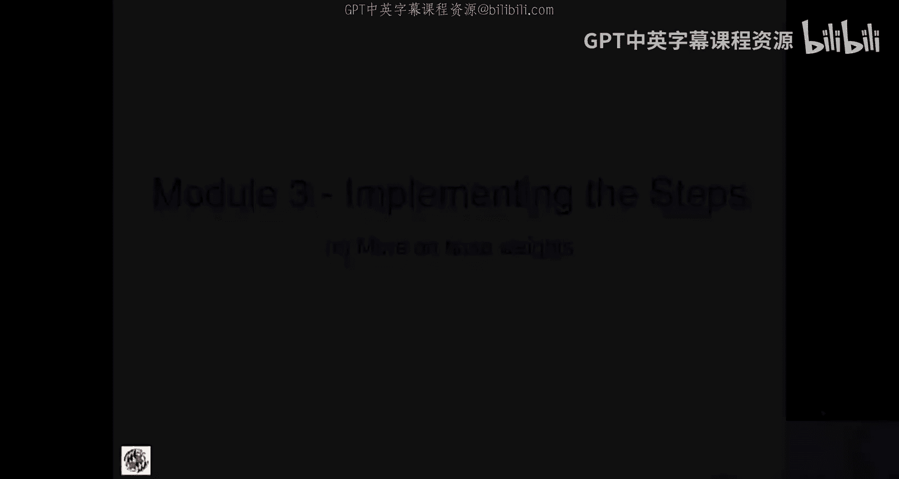
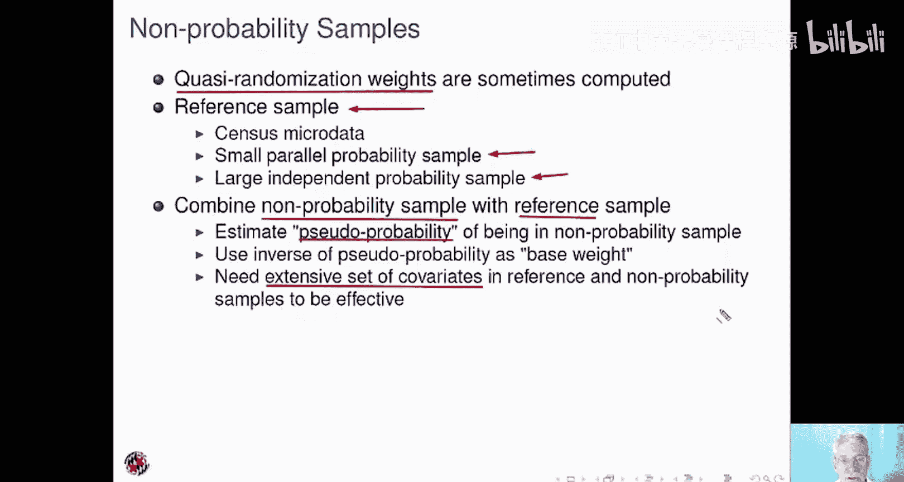

# 密歇根大学《调查数据收集和分析（2-6：方法、社调问卷设计、抽样、缺失数据、分析）｜Survey Data Collection and Analytics》 p138 15_基础权重进阶.zh_en -BV1fw4m1e7Zh_p138-

In this video， I'd like to give you one more example on computing base weights and then make a comment。

R two on what you might do for non probability samples when it comes to base weights。

So we're going to look at an example here。From。Something called the SMMHO population in the Pra Tool package。

 this stands for surveyve mental health organizations。And I'm going to use PP sample。

 it can be very efficient if the frame has got a measure size that's a good predictor of the variables you're collecting。

So in our case， let's suppose that in this small population。

 I'm going to estimate total expenditures。By these populations and this scale on the Y axis for these graphs is in millions of dollars of expenditureend。

And then on the X axis， I've got the number of beds in the hospitals。

So not every hospital has inpatient beds， some of them have zero。

 that's why you see some points down here， but we'll take care of that problem in a minute。

What I've done though。Ploot separately for different types of hospitals。

 psychiatric residential or veterans， general hospitals。

 and then multi service and substance abuse hospitals。

And what you see here is you know the dots are all over the place in psychiatric。

 but this is a nonparmetricic smoother that's been run through the scatter plot。

 it's like a fancy way of taking your pencil and drawing a line through the points。

 sort of an eyeball regression line except this is pretty formal。

 it's a smoother called low S which is available in R。

And you'll see it's quite straight and there's a fairly good relationship between beds and expenditures here in psychiatric hospitals。

Likewise， there's a relationship in residential or veterans hospitals and you can see I made the scale the same in these plots。

 goes from zero to 200 here and there and in the other two so you can get a feel for how the expenditureends。

 the range of them are different in these groups。But at least according to the nonparmetric smoother。

 there's a pretty nice relationship。 So beds might be a decent measure of size。

 if I'm using or if my target。Variable is expenditures。So I'm going to use the。Sampling package。

 and I need two packages here。Prac tools， which has got that SMHO data set and sampling which draws samples for me。

And the particular data set in pra tools is called。SMHO 98， S 98。

So the first thing I want to do is recode hospitals with zero beds because if I use hospitals as a measure size to draw a PP sample。

 some of them have got zero， they're going to have zero chance of being picked and don't want that。

So this syntax here says first。Assigned to the size variable， S 98 beds。

 Those are the number of inpatient beds in each hospital。 And then I say。

Size less than or equal to phi that creates a boolean that's true or false。

 depending on whether beds is less than or equal to5 or not。And。For those cases where your size is。

Five or less， I'm going to recode it to five， so that takes care of the zeros。

 and then it also scoots the one， two， threes and fours up to five。Now。

Next I compute selection probabilities in a PPS sample。

 and I'm assigning those to a variable named PK， and I'm using the function inclusion probabilities。

Which is in the sampling package。So here's my measure of size， size， here's my sample size 10。

 so it'll go through and it'll calculate。10 times the relative measure of size for each of these hospitals and a nice thing about the inclusion probabilities function is it will sort through your data and if you've got some units that are so big。

 they're going to be picked with probability one， it'll find those。

And then it'll redo the relative sizes for everything else。

So that's a nice feature of this in this case I don't have any certainties because I mentioned sure the sample size was little at 10。

I can do a summary on PK just to see what it looks like。

 so there's quite a range we are doing just an example here。

 you might not want this big range in practice。PK goes from a minimum of 00067 to a maximum of 03231。

 so relatively that's a big increase from smallest to largest。

Now I use my set seed statement to make this repeatable。So here's the seed that I picked out to。

Fix the random number generator at something， and then the function in sampling is called UP systematic。

Which in whatever order the population is given， it will pick a random starting place and then skip down systematically among the non units to select a sample。

 and then it will also pick off any certainties that you have。

So this S 98 has only got 875 hospitals in it， this creates a vector of 875 zeros and wands。

0 means you're not in sample。 One means that you are。

And then samplings got another nice function called get data。So from the population file， SMHO98。

I retrieve the sample units。I set the result of UP systematic equal to Sam。

So this just extracts the sample data， so it's easy。And now I want to append the weights。

 and I write my own statement for that。 So I'm going to。In the Samd object。

 I'm going to sea bind or column bind。SMD， which I just extracted with get data。

And then I'm going to add a column that's labeled weight W T。 and what's it equal to。

 it's equal to1 over Pk， those selection probabilities。

 but only for the units where Sam is exactly equal to1。

 That's what the Sam equal equals one does is extract those。Spots from PK that are in the sample。

And then here's the first three。Sample units。So I've got units， 36， 103， 156。

These are from one of the variables in the file it's called Stratum。Here are my beds。

 here's the expenditure total， and here's the weight， you know， 72。27，53。55 and so forth。

And the sampling package will select a number of different kinds of multist samples too。However。

 one way to do this， which is pretty straightforward and easy to keep track of。

Use sampling to select first stage units， clusters。You extract。Sample data for those sample clusters。

 use the GETS data set statement， and then you can treat those first stage units or clusters as st up。

And select a stratified sample using stratum function or straight function。嗯。

From those sample clusters， and that works fine。And you can keep track the selection probabil。

In the sense， it's a straightforward way to think about it。

Possibly more straightforward than some of the multist routines that are offered in the package。

Now there are other pieces of software around， certainly， SAs is one。

It's got a procedure called PRC Survey select that will select quite a few samples。

 simple random number B newly， Poisson， PP。You can do stratified samples of those types so it's。

Got some features you may like。In Stata， it's easy enough to select simple random sample using the code and the basic package。

 there are also user written packages。Or you can develop your own code to pick other types of samples。

There are some good examples at this website at UCLA， University of California， Los Angeles。

 in the US。And I'd recommend this as a good source for information on all sorts of。Software。

 statistical software questions and usages they have got。Pages that cover Sta SAS。

 are the R package in general， the R survey package， it's quite a nice selection of things。

Now non probability samples， what do we do about those？As I said earlier。

 you don't really have base weights in the sense of being inverse selection probabilities because you don't have a probability sample。

You can compute quasi randomization weights， at least that's one approach people have taken to dealing with these things。

So。One way to do that is to have something called a reference sample。

So that could be different things， could be census micro data。

 say if you've got that available in your country。Then you select a small parallel probability sample。

In a large。Or a large independent probability sample。

 so in other words here you'd select your own reference sample here you'd use one that exists out there already and that this last one is a handy choice because you don't have to spend any extra money as long as it meets your needs。

Now， what do you do at that point， you combine your non probability sample with the reference sample。

 whatever it is。And then you run a logistic regression， basically。

 to predict the probability of being in the non probability sample。

And that's a kind of a pseudo selection probability or pseudo probability。

 it says a being in the non probabilityability sample。

 so you could use the inverse of that as a base weight or pseudo base weight if you wanted to。

Based on empirical things that people have done， it seems like you need quite an extensive set of covariates in both your reference and non probability samples to be effective。

If you're doing a household survey， you can't get by with just age race and gender， for example。

 you need things like education level， income level。

 and maybe a number of other things to get realistic。Sudo probabilities for use。

So in the coming videos， we'll give you some more software examples of how to fill in the steps including non response adjustment and calibration。

