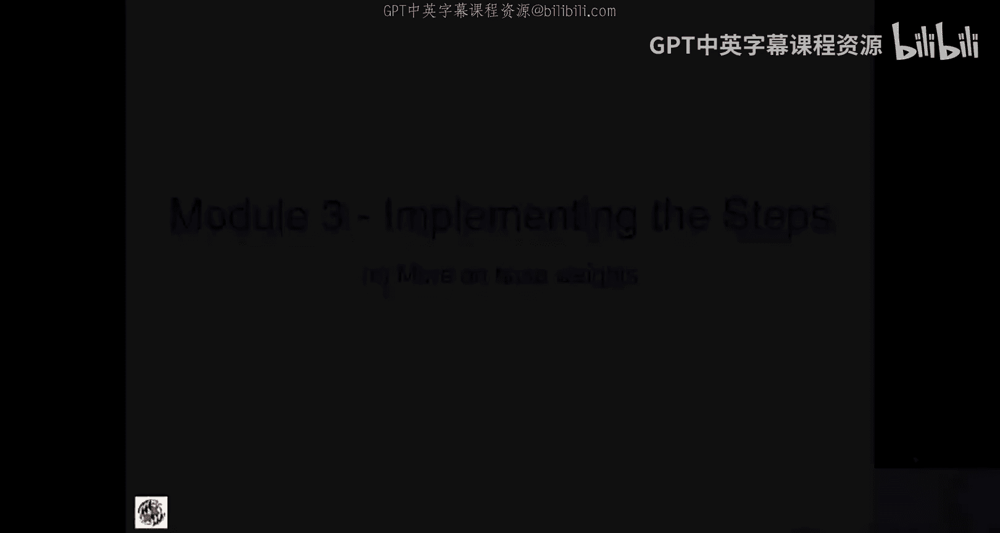
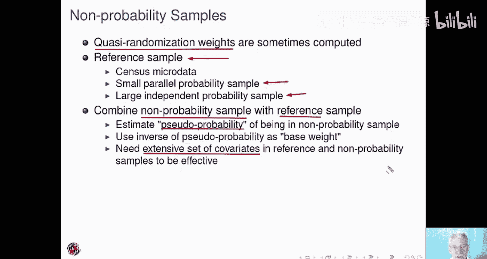

# 调查数据收集与分析：2-6：基础权重进阶




在本节课程中，我们将通过一个具体示例，深入探讨如何计算基础权重。我们将使用R软件，基于一个包含医院床位和支出数据的真实数据集，演示如何执行与规模成比例的概率抽样。此外，我们还将简要讨论如何处理非概率样本的权重问题。

## 示例：SMMHO人口数据集

上一节我们介绍了基础权重的概念。本节中，我们来看看一个具体的计算示例。我们将使用R语言中的`PracTools`包，它包含一个名为“SMMHO”的数据集，代表“调查心理健康组织”。我们将从这个数据集中抽取一个与规模成比例的概率样本。

首先，我们需要加载必要的R包并查看数据。

```r
# 加载必要的包
library(PracTools)
library(sampling)

# 加载数据集
data("SMHO98")
```

该数据集包含了多家医院的床位数量和支出总额信息。我们的目标是估计这些医院的总支出。Y轴代表支出（百万美元），X轴代表医院的床位数。值得注意的是，并非所有医院都有住院床位，有些床位数可能为零。

## 准备度量规模变量

在PPS抽样中，我们需要一个度量规模的变量。这里我们使用“床位数”。然而，对于床位数小于或等于5（包括0）的医院，我们需要进行重新编码，以确保它们有被抽中的机会。

以下是处理步骤：

```r
# 将床位数赋值给变量‘size’
size <- SMHO98$beds

# 将床位数小于等于5的医院，其规模变量重新编码为5
size[size <= 5] <- 5
```

这样处理确保了所有医院都有非零的被选概率。

## 计算入样概率

接下来，我们使用`sampling`包中的`inclusionprobabilities`函数来计算每个医院的入样概率。我们设定样本量为10。

```r
# 设定样本量
n <- 10

# 计算入样概率
pk <- inclusionprobabilities(size, n)

# 查看入样概率的摘要
summary(pk)
```

函数会自动处理那些规模过大、入样概率为1的“必然入样”单位，并重新计算其余单位的相对规模。在本例中，由于样本量较小，没有出现必然入样单位。

## 抽取系统PPS样本

为了确保结果可复现，我们设置随机种子，然后使用`UPsystematic`函数进行系统PPS抽样。

```r
# 设置随机种子以确保结果可复现
set.seed(12345)

# 进行系统PPS抽样
sam <- UPsystematic(pk)

# 从总体中提取样本数据
samd <- getdata(SMHO98, sam)
```

## 计算并附加基础权重

基础权重是入样概率的倒数。我们为样本中的单位计算权重，并将其添加到样本数据框中。

```r
# 计算权重：1/入样概率，仅针对样本中的单位
samd$weight <- 1 / pk[sam == 1]

# 查看前几个样本单位及其权重
head(samd, 3)
```

现在，样本数据框中包含了每个样本医院的标识、床位数、支出以及计算出的基础权重。

## 关于多阶段抽样的说明

`sampling`包也支持多种多阶段抽样设计。一种清晰易懂的方法是：
1.  使用该包抽取第一阶段单位（群）。
2.  提取这些样本群的数据。
3.  将这些群视为“层”，使用`strata`函数在群内进行分层抽样。
这种方法在概念上更直接，便于追踪各阶段的入样概率。

## 其他软件选择

除了R，其他统计软件也提供了抽样功能：
*   **SAS**：拥有`PROC SURVEYSELECT`过程，可以抽取多种样本类型。
*   **Stata**：基础包可以轻松抽取简单随机样本，也有用户编写的包支持更复杂的抽样设计。
*   **UCLA统计咨询网站**：这是一个极佳的资源，提供了关于SAS、Stata、R（特别是`survey`包）等软件在各种统计应用中的详细教程和示例。

## 非概率样本的权重处理

对于非概率样本，由于没有明确的入样概率，我们无法像概率样本那样计算基础权重。一种处理方法是计算“准随机化权重”。

以下是主要步骤：
1.  **获取参考样本**：这可以是人口普查微观数据、一个独立抽取的小型概率样本，或一个现有的大型概率样本。最后一种选择通常更便捷经济。
2.  **合并样本**：将你的非概率样本与参考样本合并。
3.  **运行逻辑回归**：以合并后的数据，建立一个逻辑回归模型，预测一个观测值属于**非概率样本**的概率。
4.  **计算伪权重**：将这个预测概率视为一种“伪入样概率”，其倒数可作为非概率样本的“伪基础权重”。

需要注意的是，根据经验，为了使这种方法有效，参考样本和非概率样本都需要包含**广泛且一致的协变量**（如教育程度、收入水平等），而不仅仅是年龄、种族和性别。

## 总结



本节课中，我们一起学习了基础权重的进阶应用。我们通过一个R语言实例，完整演示了如何为PPS抽样计算和附加基础权重。我们还简要介绍了在其他软件（如SAS和Stata）中实现抽样的方法，并探讨了处理非概率样本权重的“准随机化”思路。在接下来的视频中，我们将进一步学习无回答调整和校准等步骤的软件实现。