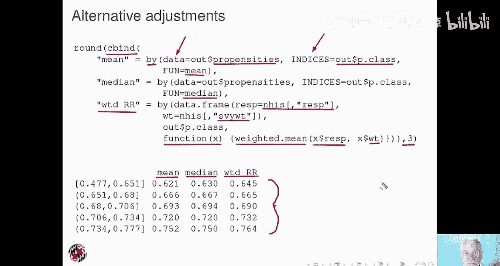

# 密歇根大学《调查数据收集和分析（2-6：方法、社调问卷设计、抽样、缺失数据、分析）｜Survey Data Collection and Analytics》 p139 16_无应答调整方法.zh_en -BV1fw4m1e7Zh_p139-

In this video， let's talk about making non response adjustments using response propensity classes。

So the idea here as we've summarized before is。Estimate response propensities and I'll use logistic regression in this case to do it。

 you sort the propensities from low to high， and then you divide the sample into classes with about the same number of cases per class。

All the sample cases， both the respondents and non respondponents are classified and a critical thing here is equal size classes means the same total of respondents plus non respondents。

Is in each class roughly set the same total count of initial sample units now。

It definitely does not mean the same number of respondents。

 non respondents are in each class because we're trying to create classes where the response propensity varies。

 you know is' fairly different across the classes。It's just the grand total count of。

Initial sample units， respondents plus non respondents that should be about the same。

So then we adjust the weights for each respondent in a class。

Multiply the base weight or whatever the incoming weight is by this non response adjustments。

So we can apply this to probability samples， but you could use the same sort of algorithm to compute quasi randomization weights in a non probability sample。

 so keep that in mind as we go through the details here。Now how will I do this。

 I'm going to use the PR Tools package， so I require the package right here。

And I make the data available by setting data in HIS。 So this is the。

The same data set that we used in an earlier example。And now I issue the P class。

A function call P class is a function in prank tools。So it takes a few parameters。

 the first one is the formula for the model。So in this case， I'm regressing REESP。

 which is a01 variable for response or not on age factor， and I've coerced that to or sex。

 and I've coerced that to be a categorical factor。嗯。Hispanic。

 whether you're Hispanic or not coerced to be a categorical variable。

 and then the variable race also coerced to be categorical。The data set is in HIS。

 and I'm running an unweighted regression。If your input data set has got survey weights or some sort of input weights。

 you can say weighted here and then it'll do a weighted lease or weighted logistic regression fit。

And then the particular link that's being used is logit， so that says give me a logistic regression。

 you can also ask for compliment log log or probebit。

If you like those better and then you tell it the function。

 how many classes that I want to create so I created five here you know you can do more if you like five certainly。

I'd say a minimum number to create。All right， so we save that in the object called out。

And you'd better look at what you did， so I'm doing a table on out。P dot class is。

One of the variables or components of the output of P class。

So I'm just counting up how many cases were assigned to each propensity class。

 and I've got five of them。So the table gives you the range of propensities that are in a class and the number of cases in each class。

So you can see the ranges。know spreads things out pretty well。

 the algorithm did the count is not quite the same but similar in the classes。

 you know there's some because of the discreteness of the data you can't make these exactly equal。

And then critically use this， use equals always to make sure you got everything assigned to a class and sure enough we've got zero missing values。

 so that's what we want to see。You can use the summary function on。Another piece of the output。

 which is there's a component called propensities。And that's within the output object out。

 so these go from a minimum of 0。4769 up to a maximum of 0。7765。So， you know， there's some spread。

 the propensities， which means that the classes should have different response rates within them。Now。

 just to examine things further， I've done a box plot on these propensities and I'm doing it by P class to see what those things look like。

So here's my box plot。And。What you see here is I've got five boxes for the five propensity classes。

The higher four for higher the higher response rates or response propenssity these are pretty tight in terms of the spread。

The distance between first and third quartile is pretty short here on these boxes。

 What you do see in the lower。Category is a string of outliers down here。

 So these go down to somewhat below 0。5。 This is the 0。47 number， that minimum down here。

And they go up beyond 0。65。So there's quite a range in this lower category more so than in the other propensity classes。

 and this is one reason why people gravitate toward a single value adjustment for within a propensity class rather than using the individual propensities because they don't really trust the model as being that perfect。

 so you might in this picture use the median， which is this black line in each box as your single adjustment。

But there are some alternatives， which I'll show you in a second。So we could。

Within a propensity class do。Any of several things we could。Do the things listed here。

 you could use the unweighted mean response propensity from the model。

 you could use a weighted mean response propensity from a model with the weights being the base weights or the input weights。

And could use a median， the thing I pointed to in the box plots could use the unweighted response rate。

Within a propensity class the number of respondents divided by the grand total sample size。

You could use a weighted response rate with the base weights。

So you pick one of those and then you multiply your input weights by the inverse of which are one of those you pick out。

Rather than using individual propensities， which is as I said， seems chanceier。You know， if you。

Your model is not that great a fit then it makes sense to limit the number of different。

Non response adjustments you're going to use。So here's some code just to look at alternatives。

What I've done here is I've used the sea bind function to put things together in columns just so it's easy to look at them。

And then I've used the round function to round these things off。

 here's the peri on round three places。So what。What if I got inside。

 this labeled mean is I use the buy function， I operate on the propensities。

 my indexes for the buy classes are PDO class。And the function of usinging is mean。So。

One comment just on style of how you do these things in R。

 if you're you've got a function that takes a lot of parameters。

 I'd recommend actually putting the parameter name in here followed by equal in the value。

 so data indices fun。To remind you what those things stand for， you can do it without those。

 you know， I can omit data equals， I could omit indices equal like an omit fun equal。

 and it would work fine。But if you forget what order the parameters have to be in。

 then you can really get confused and so I'd recommend this just as a documentation。

 put the actual name of the parameter on the left side of the equal sign followed by the name in your data set that you're filling in for that parameter value。

All right， so I do the same thing for the median and I label it median。And then in the by function。

 I here I'm calling the fun equals and I left out fun equals here。Defining the function。

Which is going to operate on。This。Placeholder hold variable x is actually a built in function called weighted dot mean。

 so you have to。Tell weighted not mean what it's going to handle here， so I'm using the rest value。

 which is zero1 for response。The weight value， which is the survey weight。

 so this is going to give you a weighted response rate。And。What's my。啊。Input data。

The by Ne data frame。 So I'm extracting just the one column risk from NHIS and。

I'm just to make sure that by understands this is a data frame。

 I coerce it to be data frame with data dot frame。And then the。Next parameter I send it is。

In the data frame， I bind in the weight survey weight variable， SVY weight。

 which is on that NHIS data set。These are the indices here， out dollar P class。And so you see。

 I've violated my own。Advice by not putting indicesies equal in front of this thing。

So that's weighted response rate。And here's what comes out of that I've got in this column mean in this column median in this column weighted response rate。

 and I've got those separately for each of the five response propenssity classes。

And you scan across here， there's some difference， but they're not tremendous。

So the biggest difference is in that first one that had a string of outliers in there。So you might。

 in this case。Pick maybe the median response rate， would certainly be a。

Intermediate choice between the waiter response rate and the mean， at least in that first。Response。

 propensity class。But that it's partly a matter of taste。

There is some theory or some empirical evidence that says you might just want to use the unreoided response rate。

But it's a choice that you make as an analyst。So that covers what I wanted to say about non response adjustments in the non response software that's available to do it。

The other algorithm I mentioned earlier was regression trees。

 so I haven't given you a numerical or software example of that。

 but that's certainly still a good option and you should keep that in mind。

