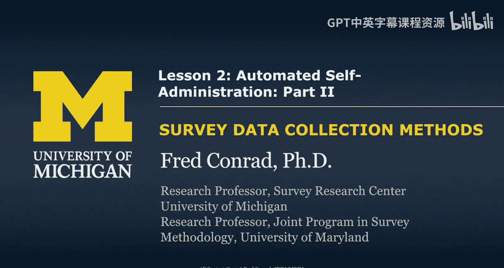
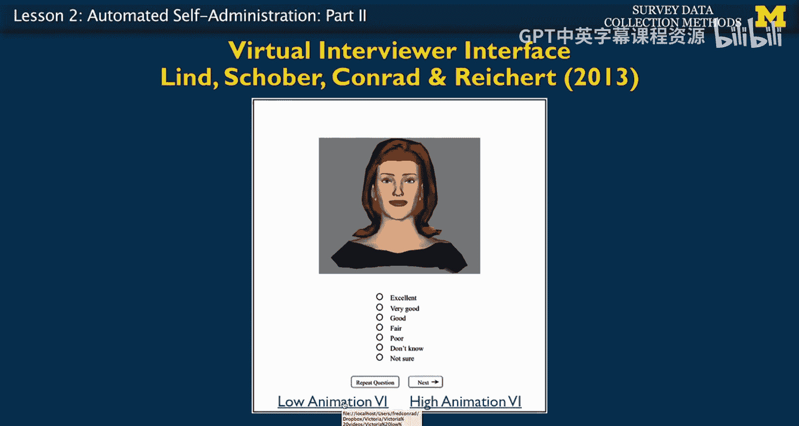
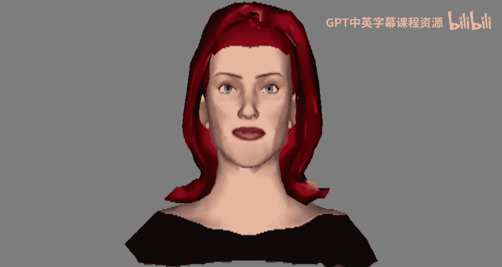
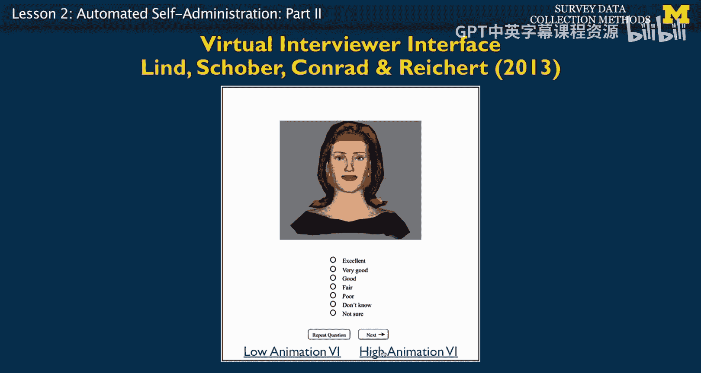
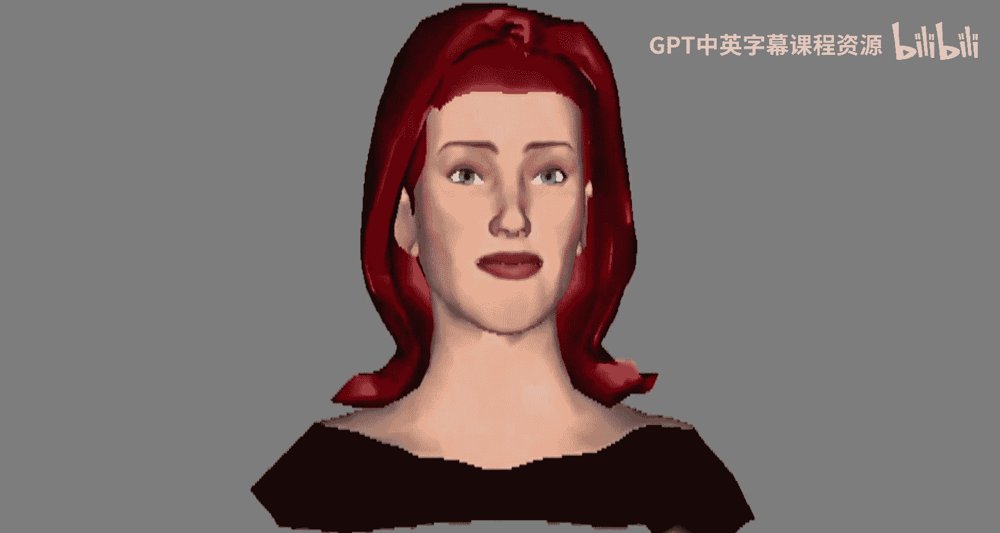
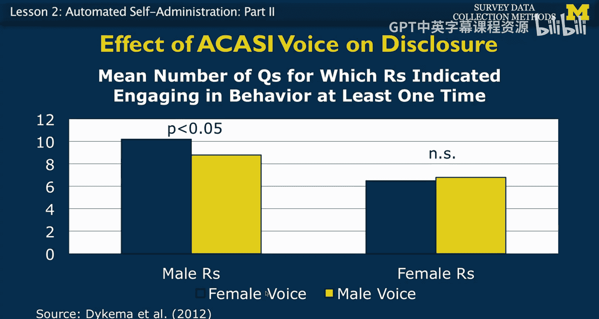
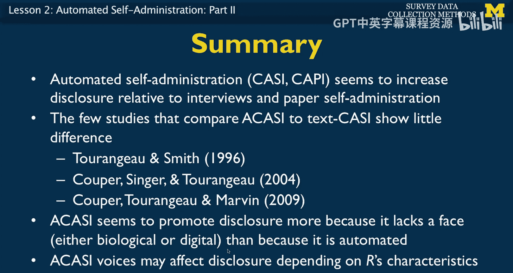

# 密歇根大学《调查数据收集和分析（2-6：方法、社调问卷设计、抽样、缺失数据、分析）｜Survey Data Collection and Analytics》 p14 13_2.1.2 ACASI系统深入.zh_en -BV1fw4m1e7Zh_p14-

So we've just reviewed some of the evidence that self administration。

 in particular audio Cassie and Cassie increase disclosure over and above interviewer administered questions and even paper self administration via paper。

 but what is it about。Cassie and in particular Acassie that increases disclosure really with respect to interviewer administration where the differences are largest。

 Lyn and her colleagues addressed this question in an experiment that compared the prevalence of undesirable answers in four modes face to face interviewing。

And then two modes that we refer to as virtual interviewer modes in which an animated computer animated interviewer asked the questions one had higher animation than the other so that was known as the high animation condition and there was a low animation condition and finally there was an audio cassie condition in which the recorded speech from the two virtual interviewer conditions was all that was presented was there was no visual information and really the choice of these。

Four different modes was to see what extent it the presence of a human interviewer versus the presence of a face that's responsible for the amount of disclosure。

And so they examined the disclosure patterns for the virtual interviewers in 10 items questions for which they had observed a difference between face toface interviews and acassie。

 so the question was， how did virtual interviewers affect disclosure。

 did the results look more like face to-face interviewing or did which would suggest that it's actually the presence of a face rather than the presence of a human interviewer that's responsible for reduced disclosure or did they look more like acassie in which case it would be this would make the argument for the absence of a human interviewer is what's promoting disclosure under self-administ？

The question was really do the automated modes lead to uniformly more disclosure than faceto-face interviews。

 which is what the Taranjo and Smith findings that we just reviewed would suggest。

 but if virtual interviewers create social presence if they feel like someone is there。

 this could inhibit disclosure producing results more like face- toface interviewing and so just to give you a sense of what the virtual interviewers looked like。

 this is Victoria in particular the low animation version in which you'll see she doesn't move her head much or her eyes that much and her mouth doesn't move that much。

Hi， I'm Victoria。Thank you for agreeing to participate in our survey today。

I'm going to be asking you various questions about your life and you can answer either by clicking with the mouse or typing with the keyboard。

All of the answers you give today will be kept strictly confidential。

 so please feel free to answer honestly。Are you ready to begin？

And here's the high animation version of Victoria in which there is more movement and the lip movement is more in line with the sounds that are actually being produced at that time。

Hi， I'm Victoria。Thank you for agreeing to participate in our survey today。

I'm going to be asking you various questions about your life and you can answer either by clicking with the mouse or typing with the keyboard。

All of the answers you give today will be kept strictly confidential。

 so please feel free to answer honestly。Are you ready to begin？

So the main findings from the Led all study were that the most common pattern was。

Less disclosure in modes with than without a face， that is in more of the questions in eight out of the 10 questions in which there was a difference between disclosure in face to face and acassie。

The two virtual interviewer conditions produce results much more like face to face than acassie。

 so there more disclosure when a face was present than when not。

 and respondents disclosed less in face to face than the three automated modes for only four of the 10 questions。

 so the more common pattern was the one which supported the idea that it's the presence of a face rather than the presence of a human that reduces disclosure in these different modes。

The authors also looked at respondents' kind of subjective state at the time of the interview and how that might affect disclosure。

And what they found was that respondents' comfort level kind of interacted with the different modes in the extent to which they produced more undesirable answers than which they disclosed more。

 so these bars indicate the Y axis corresponds to the probability that the respondents indicated not at all when in the past year when asked a question about offering their seat on a bus or subway in a public or in a public place to a stranger so saying not at all in response to a question like that is considered socially undesirable。

 so a higher bar indicates more disclosure， higher probability of giving an undesirable answer。

 and as you can see the pattern when they indicated yes。

 they were comfortable at the start of the interview is the kind of classic pattern of disclosure under self-adist versus face to face。

But when they were not comfortable， the modes really had no effect。

 so there is more to the story than just increased privacy， increases disclosure。

 it really has to do with how respondents feel what their subjective state is at the start of the interview and during the interview。

Just another feature of audio cassie is that it contains a voice in a way。

 one of the surprising features of audioCassie is that it does increase disclosure relative to。

Interviewer administered questions even though it has this strong social cue of a voice。

 so how does the particular voice， how do the characteristics of voice affect respondents disclosure there hasn't been too much in the way of systematic study of this question。

 but one study by a Diccomma and her colleagues suggest that at least for some respondents in particular male respondents。

 the gender of the recorded interviewer's voice makes a difference in particular Diccomma reports that when male respondents were asked sensitive questions by a recorded female voice。

 they were more likely to disclose to report sensitive information than when the voice was a male。

But for female respondents， the gender of the recorded interviewer's voice made no difference at all。

Okay， to summarize our discussion of automated self administration in particular Cassie and audio Cassie。

 there seems to be an increase in disclosure relative to interviews and relative to paper self administration。

The few studies that compare acassie to text cassie show little difference。

AAsie seems to promote disclosure more because it lacks a face， either biological or digital。

Than because it's automated， and finally， acasie voices may affect disclosure depending on the respondent's characteristics。

In our next segment， we will shift to web surveys， which is the topic we'll devote the rest of this lesson to。

 and we'll look first at the error properties of web surveys， in particular coverage。

 how coverage and sampling and non-response， and measurement effect the quality of the estimates that come out of web surveys。

