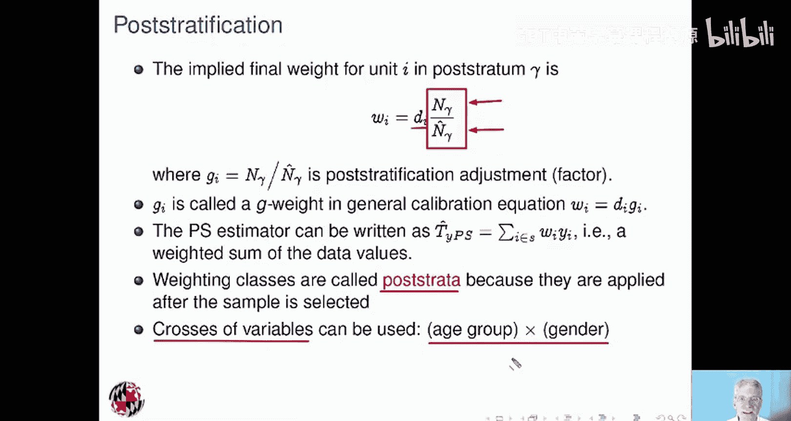

# 密歇根大学《调查数据收集和分析（2-6：方法、社调问卷设计、抽样、缺失数据、分析）｜Survey Data Collection and Analytics》 p140 17_校准实例.zh_en -BV1fw4m1e7Zh_p140-

嗯。

In this video， we'll talk about calibration with an emphasis on post stratification。

So the idea in calibration is we start with a set of sample input weights。

And then we're going to adjust those， calibrate them in a certain way。

The input weights in a probability sample can be the base weight suggested for non response and possibly for unknown eligibility also if you have any of that to correct for。

In a non probability sample。We don't have these repeated sampling weights。

So you can start by setting all the weights to one， that's a possibility。

 or you could use the quasi randomization weights that we talked about earlier and either one of those will get the process started。

So the idea in calibration is to use auxiliaries to reduce variances or to correct for coverage errors。

And in order to do that， we need population totals for each auxiliary variable that we use。

So we've got several examples that we can think about。Doing is being in the class of calibration。

Post stratification is probably the simplest one and is often used Raking is similar and I'll explain the difference between those in a minute and then the Greg is in a sense。

 more general than raking or post stratification because you're able to use both qualitative and quantitative variables。

So the usual implementation of post stratification and rankingking is that those are based on categorical or qualitative variables。

Now here's a formula for the post stratification estimator just to show you what it looks like。

 if we're estimating a total， here's the way we would do it。G or gamma here。

 which runs from1 to capital G。Defins the posttrata。

 So those are non overlapping groups that are created that exhaust the entire population。

And we'll need to know control totals for those。 so the cap ins sub gamma is the population control。

 which we have to get from a census or some external data set。

T hat Y sub gamma is the estimated total for the analysis variable Y， whatever it happens to be。

Based on the input weights and in hand。Subgamma is the estimated count of units。

In that post freedomum。So just specify those more clearly。

T hatt Y sub gamma is the sum over the sample。Yun。Poststr of gamma。 So this notation here。

 summ ancient sign and on the side of it， S sub gamma means some over the units that are in this set。

 S sub gamma。 And those are the set of sample units in poststrum gamma。

And then I take the input weight call it D for unit I times the data Yi， and I sum those up。

 and that's an estimated total for。The units in post rateum gamma only。So when I take。

This ratio here。I estimate the total of the wise divided by an estimated total number of units。

 This is just an estimator of the mean per unit， in poststratum gamma。So when I take the mean。

 I inflate it by cap in sub gamma， the pop count， I get an estimate of the total。

 I sum across all the posttra that's an estimate of the total for the grand total population。

And in sub gamma is defined down here。 It's just the sum of。The input weights within。

P freedom and gamma。It looks just like T hat Y gable， except they take out the Y。So remember。

 any time you sum the weights for a subset of units， the way we've got the weights scaled。

 that is going to be an estimate of the total count of units in whatever group you're summing over。

In this case， a postorum。So that's the form of the estimator。And。

A post ratified estimator has an implied weight， which is a useful thing。It's defined here。

 so I take my input weight。And I adjust it by what's called post stratification ratio。

 So the pop control total for poster gamma divided by my estimate of the count。

In post rate and gamma。 So you can see that if I've got under coverage。This estimate。

 based on my sample， is going to tend to be less than。The pop control。

 So this ratio will be bigger than one。 I'll inflate my input weight sum。

 and I'll make up for that under coverage。It could work the other way too if you've got to overca original tend to deflate the input weight。

 so intuitively it's going the right direction to correct coverage errors。

And why dot we call these waiting classes posttrata。

 it's because we apply them after the sample is selected and in fact after the data are collected。

If we had used these to design the sample， they wouldn't be posterated。

 they would just be regular design straightum。Now， another thing to note about post stratification is you're not limited to posttra based on one variable like age。

 you could actually create your own。Composit or interaction variable， say age group by gender。

And call this。Crossed group here， the posttrata。 So it's。

 it's a fairly flexible technique in the sense that you can get as complicated as you want with the definition of the posttrata。

You will be limited by your sample sizes， so you don't want to create a poster that's only got a few units in it。

 a good number might be at least 30， but people's taste don't differ on that。So in the next video。

 we'll look at how to actually do this using some R software。

