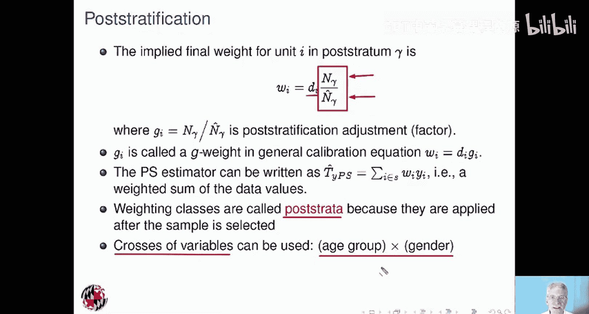

# 密歇根大学《调查数据收集和分析》：2-6：校准实例 🎯


在本节课中，我们将学习校准方法，重点介绍**事后分层**。校准的核心思想是，我们从一个初始的样本权重集合出发，然后以特定的方式调整这些权重，以利用辅助信息减少方差或修正覆盖误差。

上一节我们介绍了校准的基本概念，本节中我们来看看一个具体的校准方法——事后分层。

## 校准的起点与目标

校准过程始于一组**输入权重**。
*   在概率样本中，输入权重可以是考虑了无回答和未知资格情况的基础权重。
*   在非概率样本中，由于没有重复抽样的权重，我们可以将所有单元的初始权重设为1，或者使用之前讨论过的**准随机化权重**。

校准的目标是利用**辅助变量**来减少估计的方差或修正覆盖误差。为了实现这一点，我们需要知道所使用的每一个辅助变量的**总体总量**。

以下是几种常见的校准方法：
*   **事后分层**：最简单且常用的一种。
*   **边缘加权**：与事后分层类似，但处理方式不同。
*   **广义回归估计**：更为通用，因为它能同时处理定性和定量变量。通常，事后分层和边缘加权主要基于分类或定性变量。

## 事后分层估计量

现在，我们来看事后分层估计量的公式。如果我们想估计一个总体总量，可以这样做：

**公式：**
\[
\hat{T}_{ps} = \sum_{\gamma=1}^{G} N_\gamma \left( \frac{\hat{T}_{y\gamma}}{\hat{N}_\gamma} \right)
\]

**代码解释：**
```r
# 假设有G个事后层
# N_gamma: 第gamma层的已知总体单元数（控制总量）
# T_hat_y_gamma: 基于输入权重估计的第gamma层中变量y的总量
# N_hat_gamma: 基于输入权重估计的第gamma层单元数
# 事后分层估计的总量即为各层调整后估计量之和
```

其中：
*   \( \gamma \) 从1到 \( G \)，代表**事后层**。这些层是互斥且覆盖整个总体的分组。
*   \( N_\gamma \) 是第 \( \gamma \) 个事后层的**总体控制总量**，我们需要从普查或其他外部数据源获得。
*   \( \hat{T}_{y\gamma} \) 是基于输入权重对分析变量 \( y \) 在第 \( \gamma \) 层中总量的估计。
*   \( \hat{N}_\gamma \) 是基于输入权重对第 \( \gamma \) 层中单元数量的估计。

更具体地定义：
*   \( \hat{T}_{y\gamma} = \sum_{i \in s_\gamma} d_i y_i \)，即对属于第 \( \gamma \) 层样本 \( s_\gamma \) 中的所有单元，将其输入权重 \( d_i \) 与数据 \( y_i \) 相乘后求和。
*   \( \hat{N}_\gamma = \sum_{i \in s_\gamma} d_i \)，即对第 \( \gamma \) 层中所有样本单元的输入权重求和。

在这个公式中，比率 \( \frac{\hat{T}_{y\gamma}}{\hat{N}_\gamma} \) 估计的是第 \( \gamma \) 层内**每个单元的平均y值**。然后，将这个平均值乘以该层的已知总体单元数 \( N_\gamma \)，就得到了该层调整后的总量估计。最后，将所有层的结果相加，就得到了对总体总量的估计。

## 事后分层的隐含权重

事后分层估计量对应着一组**隐含的调整后权重**，这非常有用。其定义如下：

**公式：**
\[
w_i^{ps} = d_i \times \left( \frac{N_\gamma}{\hat{N}_\gamma} \right) \quad \text{对于 } i \in \text{事后层 } \gamma
\]

这个调整因子 \( \frac{N_\gamma}{\hat{N}_\gamma} \) 被称为**事后分层比率**。它的作用很直观：
*   如果样本存在**覆盖不足**（即 \( \hat{N}_\gamma < N_\gamma \)），这个比率将大于1，从而**放大**输入权重，以弥补覆盖不足。
*   如果存在**覆盖过度**（即 \( \hat{N}_\gamma > N_\gamma \)），这个比率将小于1，从而**缩小**输入权重。

因此，这种方法能直观地朝修正覆盖误差的方向调整权重。

## 注意事项与灵活性

关于事后分层，有几点需要注意：
*   **“事后”的含义**：之所以称为“事后”层，是因为这些分层是在样本被抽取之后，甚至在数据被收集之后才应用。如果在设计样本时就使用了这些分层，它们就只是常规的设计层，而非事后层。
*   **分层的灵活性**：事后分层不仅限于基于单一变量（如年龄）进行分层。你可以创建**复合的或交互的**分层变量，例如“年龄组×性别”的交叉分组，并将这些交叉组定义为事后层。这在定义上提供了相当大的灵活性。
*   **样本量限制**：这种灵活性受到样本量的限制。你不应该创建一个只有少数几个样本单元的事后层。通常认为每层至少有30个样本单元是比较好的，尽管这个标准因人而异。



本节课中我们一起学习了校准的核心思想，并深入探讨了**事后分层**这一具体方法。我们了解了其公式、隐含权重的计算方式以及在实际应用中的注意事项。在下一个视频中，我们将学习如何使用R软件来具体实现事后分层校准。