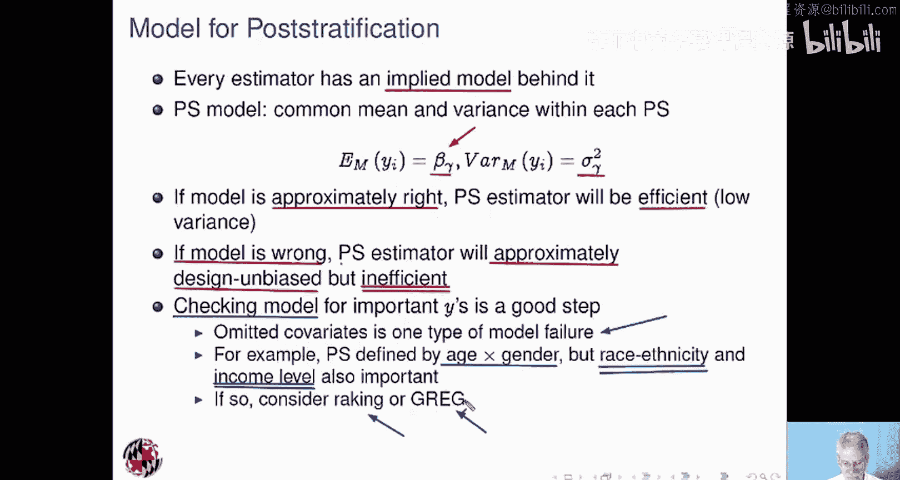
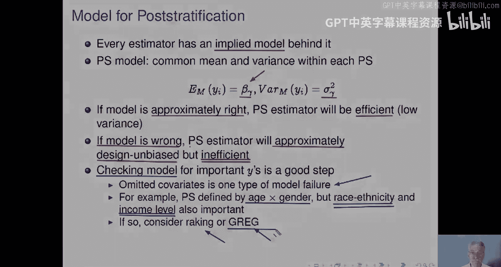

# 密歇根大学《调查数据收集和分析（2-6：方法、社调问卷设计、抽样、缺失数据、分析）｜Survey Data Collection and Analytics》 p141 18_事后分层软件实现.zh_en -BV1fw4m1e7Zh_p141-

Now let's take a look at how you actually implement post stratification using some software that's in R。

So the package I'm going to use is the R survey package， which has got a lot of capabilities。

This is the one that's written by Thomas Lomley at the University of Auckland in New Zealand。

And there's a data set in there called Amic Perance indexdex API， which I'll use。

 so I require the survey package and then I alert R that this is the data I want by saying data API。

And then you define a design object。So with any of the software that handle survey data。

 you've got to inform what the design features are。Now I'll talk more about this in。Coourse 6。

 the meeting of the survey design。Function and how you do it in other packages。

 but I'll sketch it here the first thing you need to tell are is what the first stage units are。

So the parameter in R is ID。In this case， I'm saying that D numb is the。嗯。

PSU or cluster definition and in this case， denome is short for district number。

So I'm sampling schools， I have a sample of schools。

 and theyre the first age units though were districts。

The weight variable it's got to keep be specified and in this data set。

 PW is the field that holds the weights。And the data set itself I'm using is called API plus1。

It does use an F PCC， So I specify that here。 Now that one thing to notice is this use of the tilda in front of these variables。

The survey package in this SVY design function。Wants these definitions to be formulas。

 So the way you specify formula in R is you preface it with a t them。 So in the US keyboard。

 that's in the upper left hand side of your keyboard。And notice that the。First age unit is。

Treated as a form em， the weights are also the FPC is also the data set itself is not。

 you just specify that without a tilde。Now the next thing you have to do is specify the totals。

For the population auxiliary variables that I'm going to use。

 so what I've done here is I create a data frame using this data dot frame statement。

 The first column is going to be school type。So the labels for that are EH and M。

 which stands for elementary high school in the middle。

 and these are just different grade ranges that are used in the US。

And then I get the count of schools 44， 21， 755， 10， 18 in those three school types。Now。

 how do I post stratify， I just invoke this command， post stratify。Notice here that。

That's a capital S。Our is case sensitive， so if you use the lower case， it is there。

It would bark at you until you couldn't find function。

So you've got to be careful to see exactly how your function name is spelled。

 so I'm operating on this design object D plus1， I am post stratifying by these indexes。S type。

 and notice that's a formula again until then the front。And then I give it the control totals here。

 pop dot types， and I defined those back in the previous line。And that's all there is to it。

 you know， it goes through， it creates these post stratified weights， it saves that information。

And it's saved into this new object called D plus 1 PP for post stratification。

So just to take a look at the weights that came out of this， what I've done is I've。Roomebined。

A bind。A summary of the weights for the。Non post stratified design object D plus one。

 and then the weights for the D plus one object。 So this this thing。

 this weights function right here is an extractor kind of function。

 it'll pull the weights out of that design object and show them to you。

So what have I got if I look at the first row here that's the non post stratified object。

 you see all of the weights are the same， so I've got an equal probability sample in the second row those are the post stratified weights and you can see those are spread out from 30。

7 up to 53。93。And why is that， it's because the sample itself is not proportionally allocated among these school types。

So post stratifying， in a sense， corrects that。And we hope that that will reduce variances if I had coverage errors。

 we also hope that it will reduce those。So let's look at a couple of results just to see how the point estimates can change。

The first。Thing that I've called for here。Is the mean for a variable called enrollment。

So SVY mean is the function that I use to do that。In row is the variable。

 and it has a tde there again， has to be specified as a formula。

 And then here's the design object D plus one。 So this is the。

Before post stratification version of this。I get a point estimate of。549。

72 students per school enrolled， standard area of 5。19。

If I do the same thing on the post stratified object。

 you can see my point as of the mean changed sum。I'm up to 594。

27 and the standard error got bigger too。Now。Let's take a look at total。 So note this， you know。

 things can。Go in any direction， but if I compare。Standard error before post stratification and after actually made things worse in terms of the standard error。

The mean got bigger， the coefficient variation could be。Actually smaller， but in this case it's not。

言って。There's no guarantee that you're going to improve。Estimates of the mean。With post stratification。

Or of the total， although you may。 so let's look at the total and we can do that with the SVY total one enroll again。

 same variable。So here are the answers there， and I've got a total of about 3。

4 million standard error of 932，000 and some。And if I use the post ratified version， D plus 1 P。

 then what I get is。This line right here。So you see the。Total changed a bit。Tremendously。

 but standard error did change quite a lot if I compare these two values。Before post stratification。

 I went from 932，000 after post stratification， I go to 406，000。

 so I cut the standard error by over 50% just by post stratifying and that's on the estimated total。

Now I can look at CVs and。Function that will do that is called little Cv in the survey package。

 So here I just collect together the coefficient variation for the mean。

Of enrollment from the D plus one priest post stratified object and then from the post stratifying object。

So you see right here， I've got， I go from a CV of 0。082 to 0。0110。

 so either in terms of standard error or CV， I made things worse by post stratifying here。

If I look at totals here， on the other hand， and I do or compare the post stratified。

 the non pro stratified object。I go from。t2737 or so， to。1103。

 and in other words I gained quite a lot in terms of CV and standard error by post stratifying。

So notice also that。These two。Are the same。The C on the mean and the total。Now why I use that？

It's because when I。Divide by the sum of the weights to get mean。

I've forced the sum of the whites and the post stratified variable to equal to the population count。

 know that's going to be true in every sample， so there's no extra variation， that's like a constant。

After I post stratify that estimated pop count， so that what that leads to is。

Standard area relative to what you're estimating is exactly the same in the mean and the total。

Now how do you decide whether this posttraifying is a good idea or not。

 there's different ways of doing it， but one way to think about this is every estimator has an implied model behind it and by model I mean a structural model that relates why to whatever covariates you're using in your estimator。

So in the post stratification case， it's really simple。

 common mean in every post stratum call it beta sub gamma。

 common variance for every element in a given poststratum， call it sigma squared gamma。

If the model's approximately right， you get an efficient estimator。It's。

Efficient in the sense of low variance。You know， think of this as。The way I would predict。

An additional school within post straight of gamma。

 I take the mean of what I saw and predict that the next value would be the the equal to that mean if those are。

 if the mean common mean is a good predictor。Then you get variance reduction。If it's not， you don't。

And that's what this bullet says， the one thing about the post stratified estimator is it'll be approximately designed and biased。

Meaning in repeated sampling， if you do it over and over again， youll average out to the right thing。

 even if the model is wrong。That will be true。But。If you've got a poorly specified model。

 you're going to be inefficient in the sense of not having a small variance。

For your estimators of associated with whys。So it's a good idea to check the model。

You know anytime you're doing something， it implicitly involves a model。

 you ought see if the model's any good。And one way that you could have model failure here is that you left out some covariates that are important。

So， for example， if we defined our post stta as a cross of age by gender。So I cross age by gender。

 and that creates number of age groups times two or three posttra。

But suppose that you had two other variables that you should have considered race。

 ethnicity and income level， because those are good predictors of the whys that you're analyzing from your data。

Then you'll have the wrong model， post stratification will be less efficient than it could be。

How do you？Take up the slack for that or improve your estimator you could think about using raking where you included race ethnicity and income level as margins to rake to。

 or you could use the Greg。Whi will accommodate if you had quantitative income values。

 it would accommodate both those in these categorical age， gender， and race ethnicity variables。

So you can make post stratification fairly flexible。

 but if you do want to include both qualitative and quantitative。

Then your best choice may be this thing， the Greg。

