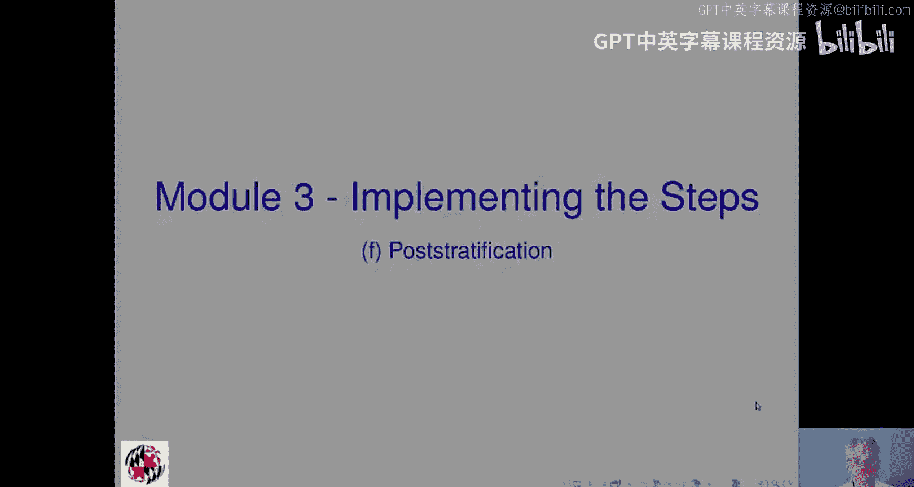
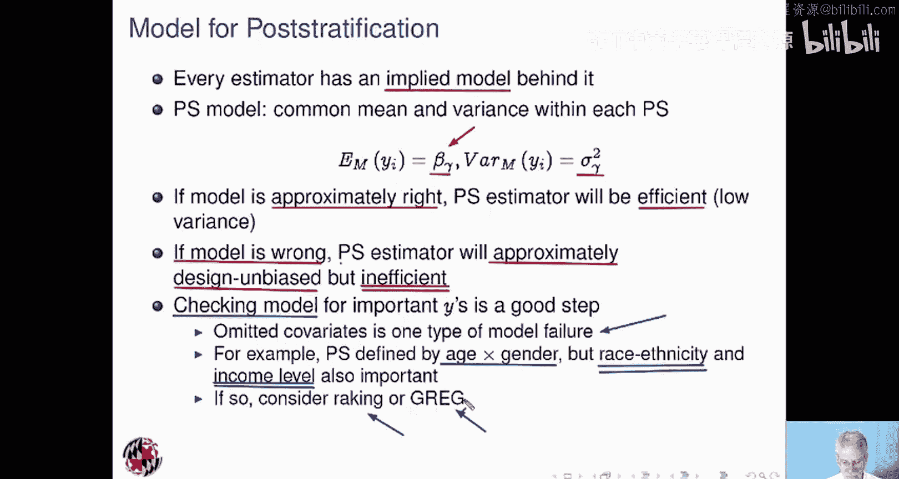
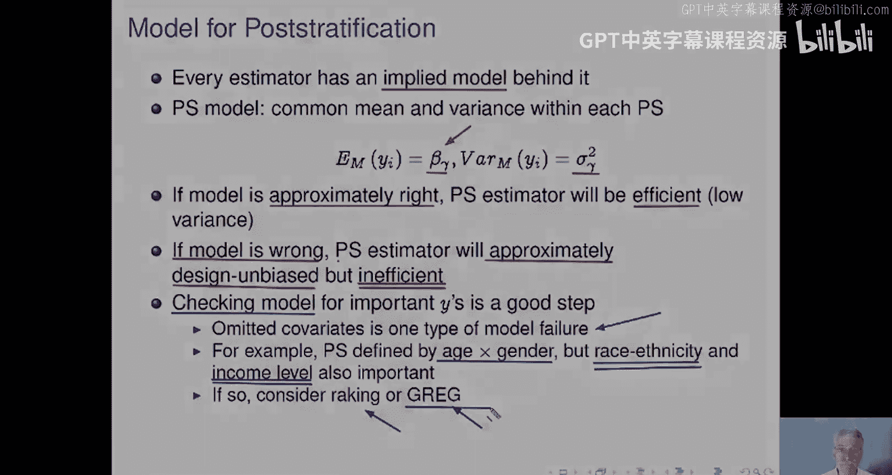

# 调查数据收集和分析：2-6：事后分层软件实现 📊




在本节中，我们将学习如何在R软件中实际实现事后分层。我们将使用R的`survey`包，通过一个具体的数据集示例，演示如何定义调查设计、计算事后分层权重，并比较分层前后估计值的变化。

## 概述

我们将使用R的`survey`包，对名为`apiclus1`的数据集进行事后分层。整个过程包括加载数据、定义调查设计对象、指定总体辅助变量的总数，最后应用事后分层并分析结果。

## 软件实现步骤

以下是实现事后分层的具体步骤。

### 1. 加载必要的包和数据

首先，需要加载`survey`包并指定要使用的数据集。

```r
require(survey)
data(api)
```

### 2. 定义调查设计对象

在使用任何处理调查数据的软件时，都必须告知软件调查的设计特征。在R的`survey`包中，我们使用`svydesign`函数来定义。

```r
dclus1 <- svydesign(id = ~dnum, weights = ~pw, data = apiclus1, fpc = ~fpc)
```
*   **`id = ~dnum`**: 指定初级抽样单位（PSU）或聚类变量。这里`dnum`代表学区编号。
*   **`weights = ~pw`**: 指定权重变量。
*   **`data = apiclus1`**: 指定使用的数据集。
*   **`fpc = ~fpc`**: 指定有限总体校正（FPC）变量。

**注意**：`~`符号在R中用于定义公式。`id`、`weights`和`fpc`参数需要以公式形式给出（前面加`~`），而`data`参数则不需要。

### 3. 指定总体辅助变量总数

接下来，需要为我们用于事后分层的总体辅助变量指定已知的总体总数。这里我们以学校类型（`stype`）为例。

```r
pop.types <- data.frame(stype = c("E","H","M"), Freq = c(4421, 755, 1018))
```
这创建了一个数据框，其中`stype`列是学校类型（E：小学，H：高中，M：初中），`Freq`列是每种类型在总体中的学校数量。

### 4. 应用事后分层

现在，我们可以对之前定义的设计对象应用事后分层。

```r
dclus1p <- postStratify(design = dclus1, strata = ~stype, population = pop.types)
```
*   **`design = dclus1`**: 指定要处理的设计对象。
*   **`strata = ~stype`**: 指定用于分层的变量（公式形式）。
*   **`population = pop.types`**: 指定包含总体总数的数据框。

执行此命令后，R会计算事后分层权重，并将所有信息保存到新对象`dclus1p`中。

### 5. 检查权重变化

为了查看事后分层对权重的影响，我们可以比较分层前后的权重。

```r
# 提取并总结分层前后的权重
weights_original <- weights(dclus1)
weights_poststratified <- weights(dclus1p)

summary(weights_original)
summary(weights_poststratified)
```
在原始设计对象`dclus1`中，所有权重可能相同（例如，这是一个等概率样本）。在事后分层对象`dclus1p`中，权重会根据样本在学校类型中的非比例分配情况进行调整，从而分散在一个范围内（例如从30.7到53.93）。这种调整旨在修正覆盖误差，并有望降低方差。

## 结果比较与分析

上一节我们完成了事后分层的实施，本节中我们来看看分层如何影响具体的估计值，例如均值和总值。

### 估计均值的变化

首先，我们使用`svymean`函数来估计变量`enroll`（注册学生数）的均值。

```r
# 分层前的均值估计
mean_before <- svymean(~enroll, dclus1)
print(mean_before)

# 分层后的均值估计
mean_after <- svymean(~enroll, dclus1p)
print(mean_after)
```
结果可能显示，事后分层后，估计的均值从549.72变为594.27，同时标准误也从5.19有所增大。**这说明了事后分层并不保证总能改善均值估计的精度。**

### 估计总值的变化

接着，我们使用`svytotal`函数来估计变量`enroll`的总值。

```r
# 分层前的总值估计
total_before <- svytotal(~enroll, dclus1)
print(total_before)

# 分层后的总值估计
total_after <- svytotal(~enroll, dclus1p)
print(total_after)
```
结果可能显示，估计的总值变化不大，但标准误从分层前的约932,000大幅下降到分层后的约406,000，降低了超过50%。**这表明对于总值的估计，事后分层带来了显著的精度提升。**

### 变异系数的比较

我们还可以通过比较变异系数（CV）来评估精度的变化。`survey`包中的`cv`函数可以用于此目的。

```r
# 比较均值的CV
cv_mean_before <- cv(svymean(~enroll, dclus1))
cv_mean_after <- cv(svymean(~enroll, dclus1p))
c(cv_mean_before, cv_mean_after)

# 比较总值的CV
cv_total_before <- cv(svytotal(~enroll, dclus1))
cv_total_after <- cv(svytotal(~enroll, dclus1p))
c(cv_total_before, cv_total_after)
```
您可能会发现，对于均值，CV从0.082增加到了0.110，意味着精度下降。而对于总值，CV从0.2737下降到了0.1103，精度得到改善。

**一个重要现象是：** 在事后分层后，**均值的CV和总值的CV变得相同**。这是因为在计算均值时，我们除以了权重的总和，而事后分层强制使权重总和等于已知的总体单位数。这个总体单位数在每次抽样后都是一个常数，因此均值估计和总值估计的相对变异程度就相同了。

## 模型视角与注意事项

每个估计量背后都有一个隐含的模型。对于事后分层估计量，其隐含模型非常简单：假设在每个事后层`g`内，`y`值有一个共同的均值`β_g`和一个共同的方差`σ_g^2`。

*   **如果这个模型近似正确**，那么事后分层估计量将是高效的（即方差较低）。
*   **即使模型是错误的**，事后分层估计量在重复抽样下也近似是设计无偏的，平均值会接近真实值。
*   **但如果模型设定很差**（例如遗漏了重要的预测变量），估计量就会效率低下（方差较大）。

因此，进行事后分层时，检查隐含模型是否合理是一个好习惯。如果发现模型可能遗漏了重要协变量（例如，在按年龄和性别分层时，忽略了种族和收入水平），可以考虑以下方法来改进估计：
1.  **使用边缘平衡（Raking）**：将种族、收入等变量作为需要平衡的边缘（margin）纳入。
2.  **使用广义回归估计量（GREG）**：它可以同时处理定性（如种族、性别）和定量（如收入值）的辅助变量，提供了更大的灵活性。

## 总结





本节课中我们一起学习了在R中实现事后分层的完整流程。我们使用`survey`包，从定义调查设计开始，逐步完成了指定总体总数、应用事后分层、以及比较分层前后估计值的变化。关键要点在于：
1.  事后分层通过调整权重，使样本在分层变量上的分布与总体一致。
2.  它**不一定能改善所有估计量**（如均值）的精度，但通常能显著提高**总值**估计的精度。
3.  事后分层估计量具有设计无偏性，但其效率取决于隐含模型是否正确。在实践中，需要根据情况考虑是否结合使用边缘平衡或广义回归估计量等更复杂的方法。