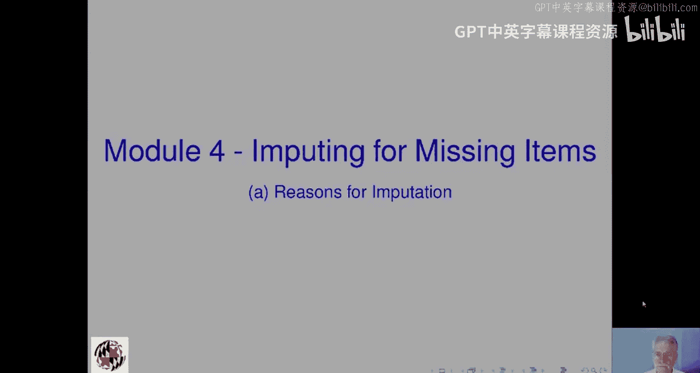
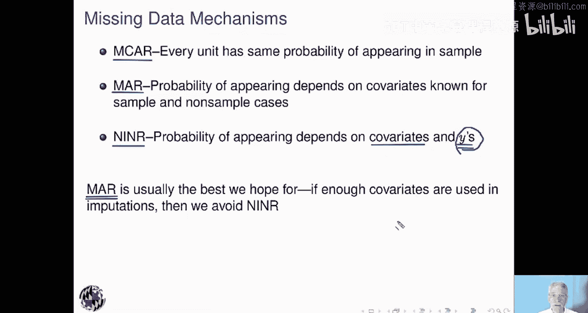

# 密歇根大学《调查数据收集和分析（2-6：方法、社调问卷设计、抽样、缺失数据、分析）｜Survey Data Collection and Analytics》 p142 19_插补的必要性.zh_en -BV1fw4m1e7Zh_p142-

In module four we'll talk about imputing for missing items， this is almost always an issue in survey。

We'll look at reasons for imputation first。 And throughout the the module， we'll talk about。

What sort of thinking do you use to do the imputing and what software is available to actually do it？

So to。Visit this problem in general。There are two kinds of missingness， at least。

 one is completely missing。You no date at all in the case。Now， when does that occur。

 it can occur for at least two reasons， one is we didn't sample a unit in the first place。

 so it's completely missing or we sampled it and it didn't respond at all。

Also completely missing and how do we handle that what we do is assign weights to the sample cases so we take the sample。

 project it up to the full universe so we。Indirectly are doing imputations through this waiting。Now。

 software will have different standards for how they code missing cases。

 so I've listed some of them here。The default code in R is in a for a missing value。

In SAS dot A to dot Z are used， just plain dot is a missing value。

 dot underscore is a missing value in SAS state is similar。

 dot A to dot Z and just plane dot are missing values。Also。

 particular surveys may use certain codes to distinguish types of missingness。In some surveys。

 it's important to put down a reason essentially for why it's missing。

 so you may see different codes on a single item being used。

99 is a popular one to denote missingness。 sometimes you'll see9 or8 as a code for missing。

 So one thing that you want to be sure of when you get a data set from somebody else is what special coding are they using for missingness。

You don't want to analyze a 99 or a minus9 as if it's a real data point when really it's just the survey code for not being not there。

All right， now how do we go about handling these cases， One is called complete case analysis。

So what that means is。If a case is missing on any variable， you just completely delete it。

 you know you treat it as not in the data set。Well， that's know that seems extreme。

 less extreme would be available case analysis， so for example。

 if you're running a regression of Y on a couple of x's。

You just use the cases that are complete on those variables。

Regardless of whether they're complete on the other variables。

 that would allow you to use more cases than complete case analysis。But still， it seems bad。 I mean。

 you're throwing away data that on cases that are partially complete。

Another way that we'll talk about here is just fill in those blanks， those holes。By imputation。

That way you get to use all your cases in every analysis， if you impute for every missing value。

 and it you certainly builds up the sample size available to do analysis。

Now there are implications of that， of course， that's not real data。

 so you ought to do something that accounts for the fact that it's not real data。

One thing that's a problem with complete case analysis， there are a number of problems。

 but if the units with missing data differ systematically from the completely observed cases。

 you could have biased estimates。If。You know， say men and women differ systematically on your y values and there are a lot more missing cases for men。

If you just throw them out， then you're。The distribution in your sample between men and women。

It not going to look like what's in the population。That means that， when you combine。Or do a。

Data set analysis， even with weights， you could have。Biaed estimates， so we'd like to avoid that。

Another problem with complete case analysis is if you've got many variables included in some model that you're trying to fit。

 there may be very few complete cases， you know， you'd be discarding a lot just for the case or the sake of a simple analysis。

So that's bad， another thing to be aware of in complete case analysis is。

You're not really ignoring those dropped cases。When you drop them out。

There's an implied imputation there。 So for many analyses like estimating means and totals。

 what you're doing is implicitly imputing those missing cases by the average of the complete cases。

Now that may be poor。You know that may be a poor imputation。

 so we'd like to think better ways of doing that。And it's good to go back to the missing data mechanisms that Ruuben and Little have defined。

The ones that we've seen earlier in the previous video are。Missing completely at random。

Every unit's got the same probability of appearing in the sample。

You can apply that down at the item level。Every item has got the same probability being filled in。

More realistic probably is the missing at random。MAR。

 that means that after you account for some covariates。

Then you may be able to make a sensible imputation for the missing cases。

The worst is non iorable non response that。The the。

A probability of appearing or not appearing depends on covariates and critically on the variables you're trying to analyze the Ys。

 so this is bad。You know， we may have covariates for both the complete and the missing cases。

 but we're not going to have Ys here。For the complete the missing， you know。

 we don't observe wise for the cases that have got missing data。So generally。

 Mar is the best that we hope for。You know， accounting for。As many covariates as as seems reasonable。

 we hope will give us a way of imputing。Intelligently for those missing cases。

 just as that sort of ma thinking。We hoped would give us a way of adjusting weights for nonre in a way that would produce approximately unbiased estimates。

So we'll fill in the details on this imputation in coming videos。

