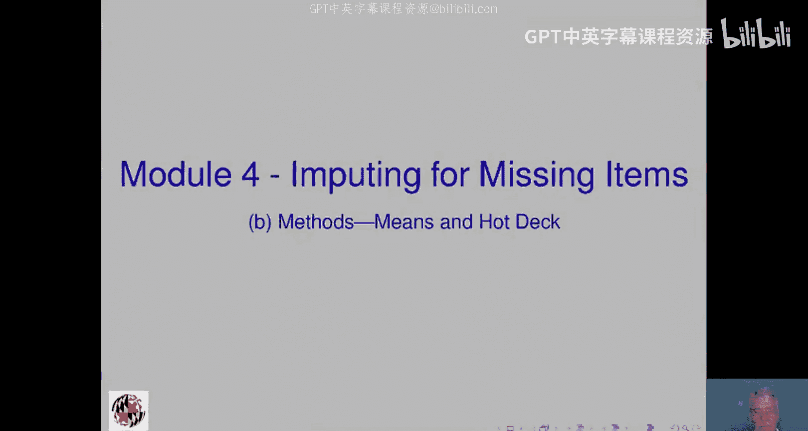
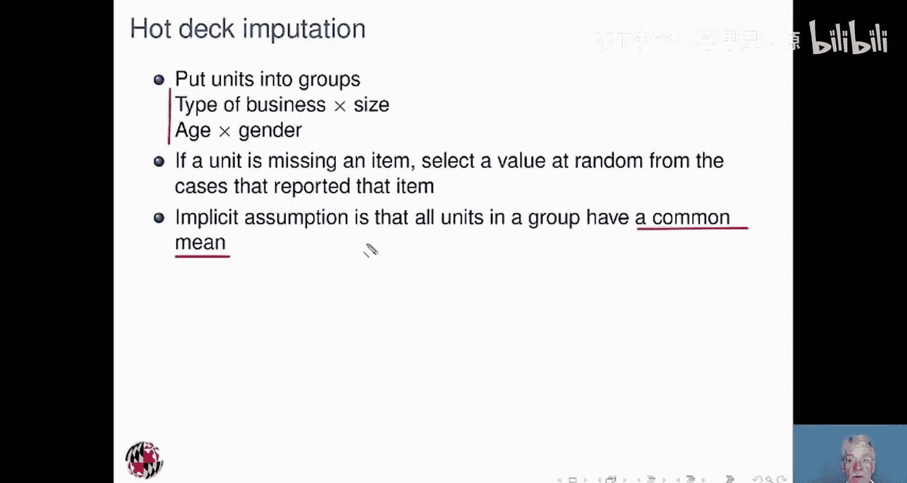

# 密歇根大学《调查数据收集和分析（2-6：方法、社调问卷设计、抽样、缺失数据、分析）｜Survey Data Collection and Analytics》 p143 20_均值与热卡插补.zh_en -BV1fw4m1e7Zh_p143-

Now that we've heard about some reasons for imputing， let's look at particular methods。

 so I'll talk about means and hot deck。In particular but。First。

 let's look at a list of all the possibilities that we've got that we'll cover in this course。

The first one here is imputation based on logical rules。Now that is。

Not normally what you think of as an imputation， it's more like an edit check。

And the idea there is if。Say at one point in the questionnaire you get somebody's date of birth later on。

 age is missing， then you can do a little calculation and fill in what age is。

 so that's a sort of fill in imputation。Another choice that we've got would be filling in a mean that's usually within some cells defined on characteristics that you need to know about all the units in your sample。

 and you may or may not add a random error to that。Third choice is what's called cold deck。

So the idea there is that you， this works if you've got a continuing survey where you've got a previous edition of the survey。

 if a unit。Responded in the previous version， then you go back。

 get that value or some possibly indexed forward value of it and fill it in for the current missing value。

 so it's called cold because you're referring back to a data set that is already in your hands it's not the current one that you're dealing with。

Now in contrast to that， it is something called hot deck and what that amounts to is。

You look at your current data set， if you've got a missing value。

 then you find a similar case that has complete data for the variable and you just grab that value and fill it in。

 so that's usually done within cells also。A fifth possibility is regression prediction。

 so based on covariates that are available for all the units。

 those that are missing and are not missing， you generate a regression prediction and you may or may not add a random error to that。

Now， somewhat related to that is a method called predictive mean matching。

You find a unit that's got the closest observed value to one predicted by regression for your missing case。

So you've got a missing case。Make a regression prediction based on some covariates so you got to fit that regression from the complete cases。

Then you look at that prediction， find。A complete case that actually has reported data that's close to that prediction and then you fill it in that value so it's got the virtue of taking advantage of any sort of regression relationship between covariates and your analysis variable and it also does not result in impossible values getting filled in because you're taking them from actual values in your data。

Now each one of methods two through six can be done sequentially。So you。

Find an item where there are the fewest missing values。 you fill all those in。

 you go to the an item with the next most missing。 you use your complete data plus the imputations you just made you。

Impute for the missing values for this new variable and you keep going in a sequential method。

A variation on that， which we'll get to later is called Iutation through chained equations and we'll look at some software that will do that for you。

Now looking specifically at mean imputation， one of the troubles with it is that if you've got a lot of missing values and you keep repeatedly filling in the mean you're going to introduce a kind of a spike and the distribution you know a lot of values at that one mean value so one way to work around that is to add a random error to the mean that would help reduce that distortion repeatedly imputing the same value so what's the error。

 the error could be normal with mean zero and a variance equal to the observed element variance of the non-missing values so you don't have to use normal I mean there's no law that says that that's the way data are distributed so you could certainly use distributions other than normal know if you looked at your complete data and you found that they were distributed。

Like a gamma or some sort of chi square distribution， then certainly that could be used。

The cells or subgroups that you form to do this for mean in imputation are a way of accounting for the possibility that the value depends on covariates。

 so in that case。You're really implicitly using a model and the regression model that is implicit in this is a kind of a nova model。

 analysis of variance， where all the covariants are categorical。

 those are the ones used to form the cells， and you're imputing a mean based on those categorical covariance。

NowHot deck imputation is somewhat different， usually you put things into cells， for example。

 if you've got a business survey， you might use type of business by size。

If you're doing a survey persons， you might use age by gender。So within each of those cells。

 if a unit is missing， what you do is find a non missing version。

 draw one of those at random and fill it in。you know，F in its value as the imputed value。

 so that that's got the advantage of not imputing impossible values because you're using observed values。

It does have as implicit assumptions that all units in a group have a common mean。

So it's got an aOva model type of assumption underlying it that's the case where。

It makes the most sense to use a kind of a hot deck amputation。So in the next section。

 we'll talk about more elaborate regression imputations。

