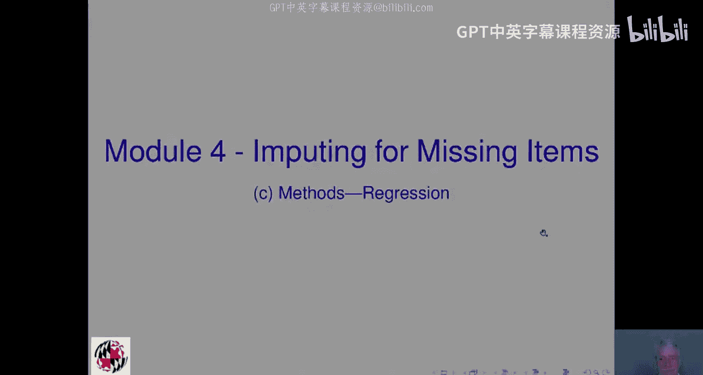
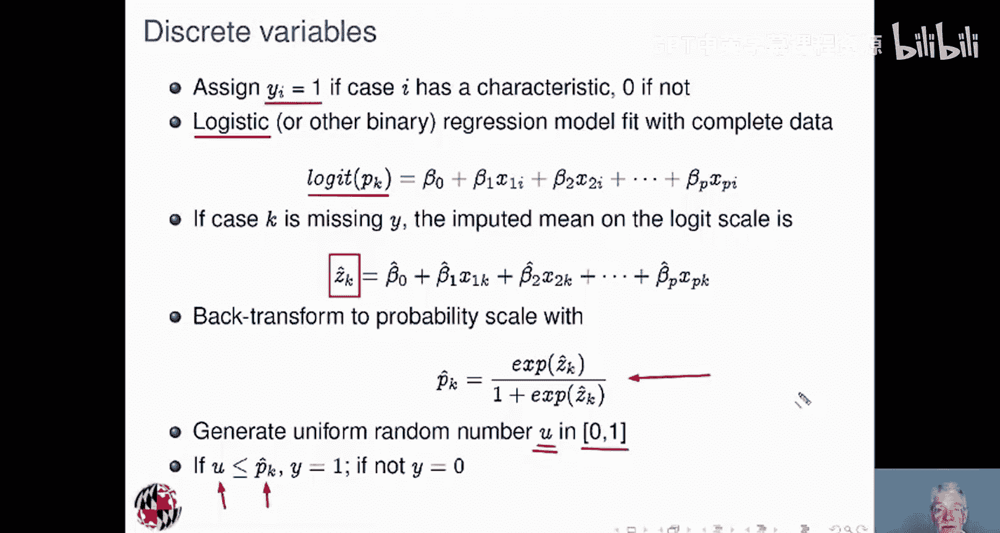
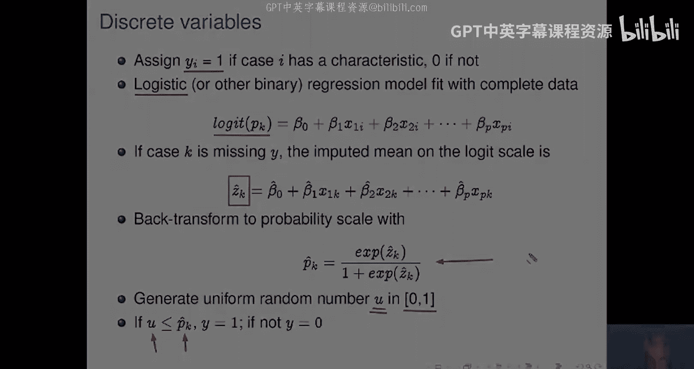

# 密歇根大学《调查数据收集和分析（2-6：方法、社调问卷设计、抽样、缺失数据、分析）｜Survey Data Collection and Analytics》 p144 21_回归插补.zh_en -BV1fw4m1e7Zh_p144-

In this video， we'll talk a bit about regression， imputation。So the idea there。

Is to use a model to fill in imputed values， so we've got two choices。

 continuous variables that we want to fill in the missing cases for and then discrete ones。

 so we'll talk about those separately。Now if we've got continuous variables。

 a possibility is to use this sort of regression equation here。So why is the value。

 the analysis variable that I'm interested in， I fit a linear regression model based on a bunch of covariates。

To that and if case K is missing， I impute it this way， let me call my imputation Y hat K。

So what I do is I just take my estimated regression parameters， beta hat zero。

 beta hat 1 and so forth， I multiply those against the values of the covariates for the missing case。

 that means I've got to have those covariates for the missing case and then I can add on an error term which。

Could be a random draw from the set of sample residuals， as it says here in the complete cases。

That gives you a kind of veraimilityity。Uses residuals that at least occurred in your data set。Now。

 another key thing。Is that all the exits have got to be present for the cases where you're doing the imputing。

So this is where the。Imputation through chain equations will come in where you sequentially fill in these missing values for different y variables and gradually build things up so that。

At a given imputation step for a particular why， you may be using accents that were imputed on the last step。

Now， as I noted in the last video， if the covariates include main effects and interactions for a set of categorical variables。

Then that's an example of mean imputation because you're essentially forming a bunch of cells and you're imputing a mean。

 a regression mean within each of those cells and the use of the covariates is just to define the cells。

ねや。Another version of this regression imputation is something called predictive mean matching。

And the way it works is。You use the complete data to regress y on the X's as before。

 so you get a fitted regression equation， you predict the mean for a case with a missing y based on that regression equation。

 so again you need complete covariates for the case that's got the missing value and then what you do is you hunt around and you find a respondent。

Whose observed value is closest to that predicted mean？And you fill that in for the missing case。

 So you're filling in an actual observed value， but you're。

Indirectly using this regression equation by matching up the predicted value from the regression to a real value in your complete data set。

 So that's called predictive mean matching。And that's available in one of the pieces of software that we'll look at。

Now for discrete variables， there would be different models you could fit。

 but let's think about the case where we code Y to be one if it's got a characteristic zero if it's not。

 so this is a binary characteristic， yes or no zero1 kind of thing。

And then we fit a binary regression， could be logistic。

 could be one of those other choices like Probit or complimentary log log。

So if we do it with logistic and we do it fit that model based on complete data on the logit scale。

 you may remember in a logistic regression， the logit is the log of the probability of having the characteristic divided by the probability of not having the characteristic。

 so it's the log of the odds， and that's linear in the axis。And if we have a missing case。

 what we do is we impute first on that logit scale， call that Zhat case。

 so I just use my estimated betas with the hats here and the covariate values for a missing case。

And then I back transform。To the probability scale。 So how do I do that。

 This is the the back transform right here。 I， I take。

The exponential of elogit valued divided by one plus the exponential of the same thing。

 and that gets me back on the P scale， the probability scale。Now。

 I'm not done because I don't want to impute that probability because I'm imputing a zero1 characteristic。

So what do I do， I generate a random number that's uniformly distributed。On the unit interval。

 it's called zero to one。Then I look at my value of u that I just distributed here。

 and if it's less than or equal to the predicted logit P hatt K or a predicted probability。

Then I impute y equals one。If U is bigger than P K， then I impute y equals zero。And that。

 as you can see， involves some randomness via this random number U。

So that'll be important later when we consider one of the techniques of variance estimation associated with this。

 which is called multiple imputation。

