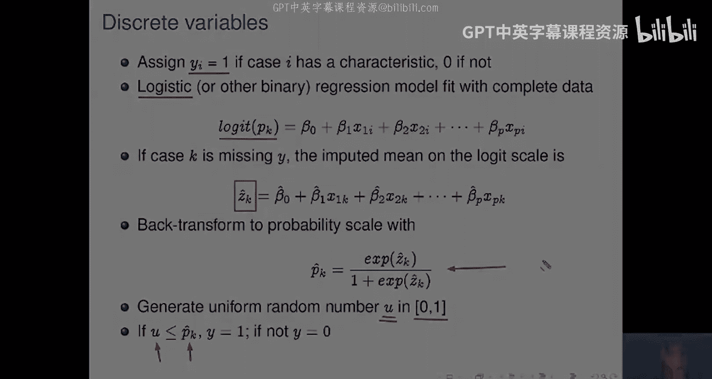

# 调查数据收集和分析：2-6：回归插补法 🧩

在本节课中，我们将学习一种处理缺失数据的重要方法——回归插补法。其核心思想是建立一个统计模型，利用已有数据的信息来预测并填补缺失值。我们将分别讨论连续变量和离散变量的处理方法。

## 连续变量的回归插补

上一节我们介绍了处理缺失数据的基本概念，本节中我们来看看如何使用回归模型为连续变量填补缺失值。

其基本思路是，将我们关心的分析变量 `Y` 作为因变量，与其他一系列协变量 `X` 建立线性回归模型。对于第 `K` 个缺失的 `Y` 值，我们通过以下公式进行插补：

`Y_hat_K = β_hat_0 + β_hat_1 * X_1K + ... + β_hat_p * X_pK + e_K`

其中，`β_hat` 是基于完整数据估计出的回归系数，`X_iK` 是缺失个案 `K` 的第 `i` 个协变量的值（**这意味着我们必须拥有缺失个案的协变量数据**）。`e_K` 是一个误差项，可以是从完整数据集的残差中随机抽取的一个值。这样做可以为插补值引入一定的变异性，并且使用的残差至少是数据集中真实出现过的。

以下是实施此方法时需要注意的关键点：
*   所有用于建模的协变量在需要插补的个案中必须是非缺失的。
*   在实践中，当多个变量存在缺失时，会采用“链式方程插补”法。该方法会按顺序为不同的 `Y` 变量填补缺失值，逐步构建完整数据集。因此，在对某个特定 `Y` 进行某一步插补时，可能会用到上一步中已插补好的协变量值。

此外，如果回归模型中的协变量包含一组分类变量的主效应和交互项，那么这本质上是一种均值插补。因为模型实际上是在为这些分类变量组合定义的每一个“单元格”内，计算并填补一个回归均值。

## 预测均值匹配

回归插补的一个变体称为“预测均值匹配”。

其工作原理如下：首先，像之前一样，利用完整数据建立 `Y` 对 `X` 的回归模型，得到一个拟合方程。然后，用这个方程预测缺失 `Y` 值的个案的均值。接着，在完整数据集中寻找一个受访者，其 `Y` 的**实际观测值**最接近这个预测均值。最后，将这个实际观测值填入缺失个案中。

因此，你填补的是一个真实观测值，但你是通过将回归预测值与完整数据集中的真实值进行匹配来间接使用回归方程。这种方法在某些我们将要了解的软件中是可用的。

## 离散变量的回归插补

现在，让我们将目光转向离散变量，特别是二分类变量（例如“是/否”，编码为1/0）的插补方法。

对于二分类变量 `Y`，我们可以拟合一个二元回归模型，例如逻辑回归、Probit回归等。这里以逻辑回归为例进行说明。

在逻辑回归中，我们是在 logit 尺度（即对数几率尺度）上建立模型。Logit 定义为 `log[P/(1-P)]`，其中 `P` 是拥有该特征的概率，它与协变量 `X` 呈线性关系。

对于第 `K` 个缺失的 `Y` 值，插补过程分为两步：
1.  首先在 logit 尺度上进行预测：`Z_hat_K = β_hat_0 + β_hat_1 * X_1K + ...`
2.  然后将预测的 logit 值转换回概率尺度：`P_hat_K = exp(Z_hat_K) / [1 + exp(Z_hat_K)]`

然而，我们最终需要填补的是一个具体的类别（0或1），而不是一个概率。因此，我们需要引入随机性。

以下是具体的随机插补步骤：
1.  生成一个在区间 `[0, 1]` 上均匀分布的随机数 `U`。
2.  比较 `U` 与预测概率 `P_hat_K`：
    *   如果 `U ≤ P_hat_K`，则填补 `Y = 1`。
    *   如果 `U > P_hat_K`，则填补 `Y = 0`。

可以看到，这个过程通过随机数 `U` 引入了随机性。这种随机性在后续我们学习“多重插补”这一方差估计技术时将非常重要。

---

本节课中我们一起学习了回归插补法。我们了解到，对于连续变量，可以通过线性回归模型预测缺失值，并可选择添加残差或使用预测均值匹配来增加变异性。对于二分类离散变量，则可以通过逻辑回归模型预测其概率，再通过随机抽样的方式决定填补的类别。这种方法为处理调查数据中的缺失问题提供了强有力的模型驱动工具。