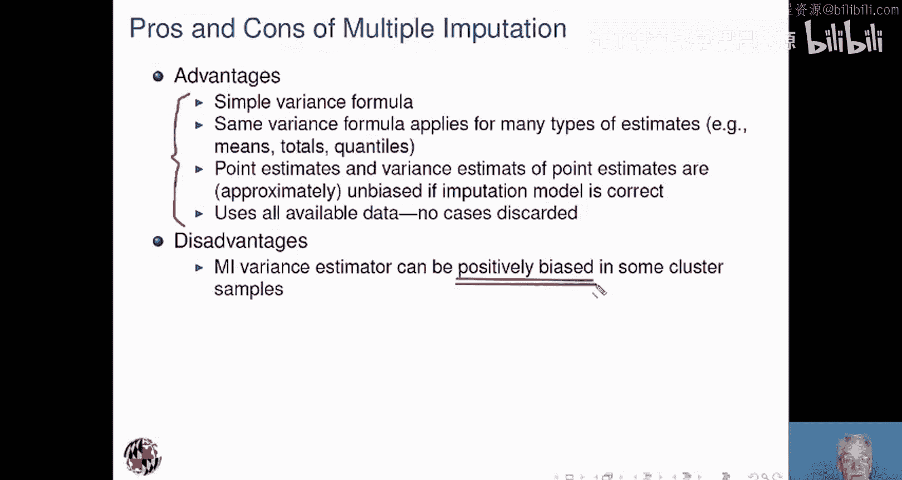

# 密歇根大学《调查数据收集和分析（2-6：方法、社调问卷设计、抽样、缺失数据、分析）｜Survey Data Collection and Analytics》 p145 22_方差影响分析.zh_en -BV1fw4m1e7Zh_p145-

In the previous videos， we looked at some methods for imputing missing values and the fact that you're making up data。

 those is not real data needs to be accounted for when you estimate variances。

 so that's what we'll cover in this section。Now， the typical effect is that imputations add variance to estimates。

As opposed to what you'd get if those were real data that were not generated by you。

So we don't want to treat those imputations as real data because you'll end up with standard error estimates that are too small for most estimates。

Now， how do we account for that added variance？There are different ways of doing it and there are different theoretical arguments that lead you in different directions here。

One approach will lead to specialized formulas that depends on how the imputations were made。

So those are inconvenient， at least in the sense that these specialized formulas are not available in most pieces of software that people use。

Another one that is more readily available is called multiple imputation。

And it is in some pieces of software and I'll give you an example of that one thing about it is that it does require some randomness in how imputations are generated。

But in the previous videos， we saw how you can do that， how you can add some randomness。

 so that's not a big hurdle here。Now， how do we do this multiple imputation？

The idea is you impute more than one value for each missing value。So in general。

 the usual notation is to say you impute little m values m equals5 as a popular choice。

 but you could。Certainly generate more than five if you've got a lot of data。There must be。

 as I said， some random element in how the imputation is made to allow that and then use a special formula to account for the imputation variance。

 so just in words what it looks like is the variance of your estimator。

That includes some imputed data is equal to the variance treating the imputations as real。Plus。

 the average of the variance between estimates using different imputed values。

So we'll see the exact formula in the next slide or so。So here's the idea we compute an estimate。

 call it cap Q of T for each of the T equals one through little M completed data sets。So。

If little M is5， you've got five estimates。And what does a completed data set mean。

 it means you take the real data that you observed， you keep it every time。

 and then for the missing data， you take the teeth imputed value and you fill that in it。

Then you generate a Q of T。So for the next value of T， number two。

 say you take all the complete data still， that stays the same。

 and then you just go up to the next imputed value， the second one for each item。

So we generate little M of these QTs， and then what's our estimate that we report it's just the average。

Across these QTs。Next we calculate a variance estimate， how do we do that。

 the first thing we do is we calculate a direct variance estimate。And call that use of T。

 that's from the teeth completed data set。So use of P can be many different things， you know。

 it's any variance estimate that's appropriate for your sample design and estimator。You know。

 it could come from。An exact formula could come from linearization。

 approximate formula could come from a replication variance， all those are possibilities。

So for example， if you get a stratified simple random sample without replacement and my Q of T is really the stratified sample mean。

 call it Y bar T。Then what I do is I calculate use of T is equal to the usual formula for the variance of a stratified mean。

I sum over the strata， this is WH is the proportion of the population in stratum H。

 I've got one minus the sampling fraction in that stratum。And then this S squared sub。

HT is the estimate of the unit or population variance among your Y variables in straightum H based on the teeth completed data set。

And literally in Subage， as usual， is the number of。

Cases are units that we sampled in straight of age。

So that includes cases that may have imputed data or missing data。Now。

 what do I do with those UTs and the QTs to get a final variance estimate？

I put them together this way。 I want the variance of my Q bar estimate。

 remember Q bar is how we combine the littleium。Complete data set estimates。

 I take the mean of the use。The mean of mind direct estimates。And then I add on one plus1 over m。

 the number of imputations times a factor capital B， and once U bar。

 U bar is just the mean of the direct estimates of variance， B is the variance among the QTs。

The completed data estimates that's completed in past tense with the D on the end of it。

So this includes the imputations that I've made。For the teeth data set。

And this is a variance that's going to be positive， so I get if I had no imputations。

 this U bar would be just kind of a replicated estimate of the variance。

B term is the increment that accounts for the imputation variance。

And you can see that if I make a whole lot of imputations， one over m is going to be a small number。

 so this factor here would be close to1， otherwise for m equals5。

 say it doesn amount to something and it needs to be included to get an approximately unbiased variance estimate。

So this formula is nice because of its generality， you know you could have mean imputation with a random error。

 you could have a hot deck with random draws from complete units。

 you could have regression with a random error， you could have predictive mean matching。

 all of things involve some randomness， all of them can be inputs to this multiple imputation variance formula。

Now， the pros and cons of multiple imputation， there are a lot of advantages。That are listed here。

It's got a simple variance for formula。The same variance formula applies to many types of estimates。

Means， totals， quantiles， other things， regression parameter estimates。

In contrast to some other competing methods， you don't have to derive any formula for every different type of estimator that you're looking at。

The point estimates and variance estimates of point estimates are approximately unbiased。

 if the imputation model is correct， it uses all the available data， you don't lose any cases。

 so that's good。One disadvantage of the MI variance estimator is it can be positively biased。

 too big in some kinds of cluster samples。Now this may or may not be a serious problem depending on。

Your particular application， but generally。Having a positively biased variance estimate is considered conservative and not a terrible error to be making。

 so that that's a disadvantage that is may have less weight than these advantages do because of the generality of multiple imputation。

