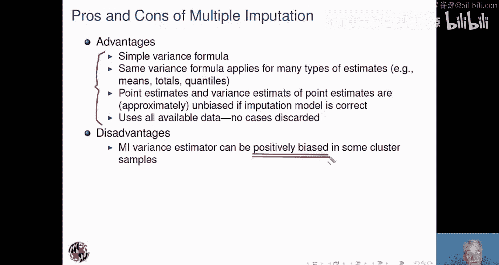

# 调查数据收集与分析：2-6：方差影响分析 📊

在本节中，我们将学习如何处理缺失值填补后带来的额外方差。填补数据并非真实观测值，因此在估计方差时必须考虑这一因素。本节将介绍一种名为多重填补的方法，它能有效解决这一问题。

## 多重填补的基本思想

在之前的视频中，我们介绍了几种填补缺失值的方法，并指出这些填补的数据并非真实数据。因此，在估计方差时，我们需要考虑填补过程引入的额外变异性。典型的效应是，填补会为估计值增加方差，这与使用真实未填补数据得到的结果不同。我们不能将填补值当作真实数据处理，否则大多数估计的标准误会过小。

那么，如何考虑这额外的方差呢？有多种方法，其理论依据也各不相同。一种方法依赖于专门的公式，这些公式取决于具体的填补方式。但这种方法不太方便，因为大多数常用软件并未内置这些专门公式。另一种更易实现的方法叫做多重填补，它已被部分软件采纳。这种方法要求填补过程包含一定的随机性，而我们在之前的视频中已经学习了如何引入这种随机性，因此这不是一个大的障碍。

## 多重填补的操作步骤

以下是多重填补的具体操作流程。

多重填补的核心思想是为每个缺失值填补多个值。通常，我们用符号 **m** 表示填补值的数量，**m=5** 是一个常见的选择，但如果数据量很大，当然可以生成更多。如前所述，填补过程必须包含随机元素，然后使用一个特殊公式来考虑填补方差。

用文字描述，包含填补数据的估计量的方差等于“将填补值视为真实数据时的方差”加上“使用不同填补值得到的估计值之间的平均方差”。我们将在下一页看到具体公式。

其思路是，我们为每一个 **t = 1, 2, ..., m** 个“完整数据集”计算一个估计值，记作 **Q̂_t**。所谓“完整数据集”，是指每次分析都保留所有观测到的真实数据，而对于缺失数据，则填入第 **t** 组填补值。这样，我们就得到了 **m** 个 **Q̂_t** 值。我们最终报告的估计值就是这些 **Q̂_t** 的平均值，记作 **Q̄**。

接下来计算方差估计。首先，我们为每个完整数据集计算一个直接的方差估计，记作 **U_t**。这个 **U_t** 可以是任何适用于你的抽样设计和估计量的方差估计，例如来自精确公式、线性化近似或复制方差法。

例如，如果你采用的是分层简单随机抽样（不放回），且 **Q̂_t** 是分层样本均值 **Ȳ_t**，那么 **U_t** 就是分层均值方差的常用公式：
`U_t = Σ_h [ W_h^2 * (1 - f_h) * (s_{ht}^2 / n_h) ]`
其中，**W_h** 是第 **h** 层的人口比例，**f_h** 是该层的抽样比，**s_{ht}^2** 是基于第 **t** 个完整数据集估计的第 **h** 层内 **Y** 变量的总体方差，**n_h** 是第 **h** 层的样本量（可能包含已填补的缺失数据）。

## 最终方差估计公式

那么，如何利用这些 **U_t** 和 **Q̂_t** 得到最终的方差估计呢？我们按以下方式组合它们：

最终估计值 **Q̄** 的方差估计公式为：
`V(Q̄) = Ū + (1 + 1/m) * B`
其中：
*   **Ū** 是 **m** 个直接方差估计 **U_t** 的平均值。
*   **B** 是 **m** 个完整数据集估计值 **Q̂_t** 之间的方差，即 `B = Σ_t (Q̂_t - Q̄)^2 / (m-1)`。

**Ū** 部分可以看作是对方差的重复估计。**B** 项则是为了考虑填补方差而增加的增量。可以看到，如果进行大量填补（**m** 很大），**1/m** 会很小，这个因子就接近 1。对于 **m=5** 的情况，这个增量也需要被包含进来，以获得近似无偏的方差估计。

这个公式的优点是通用性强。无论是带有随机误差的均值填补、从完整单元中随机抽取的热卡填补、带有随机误差的回归填补，还是预测均值匹配，只要填补过程包含随机性，都可以使用这个多重填补方差公式。

## 多重填补的优缺点

多重填补有许多优点，同时也存在一些缺点。

**优点包括：**
*   方差公式简单。
*   同一方差公式适用于多种类型的估计量，如均值、总量、分位数、回归参数估计等。与其他一些方法相比，你无需为每种不同的估计量推导专门的公式。
*   在填补模型正确的前提下，点估计及其方差估计是近似无偏的。
*   它使用了所有可用数据，不会损失任何案例。

**一个缺点是：** 在某些类型的整群样本中，多重填补的方差估计量可能存在正偏（即估计值偏大）。这是否构成严重问题取决于具体的应用场景。不过，通常认为方差估计偏大是保守的，这种错误并不算太严重。因此，考虑到多重填补的通用性，这个缺点的权重可能小于其诸多优点。

## 总结

本节课中，我们一起学习了如何处理缺失值填补带来的方差影响。我们介绍了多重填补方法，它通过为每个缺失值生成多个填补值，并使用公式 `V(Q̄) = Ū + (1 + 1/m) * B` 来综合计算最终估计的方差，从而有效地纳入了填补过程的不确定性。这种方法公式通用、易于实现，是处理调查数据中缺失值问题的一个强大工具。