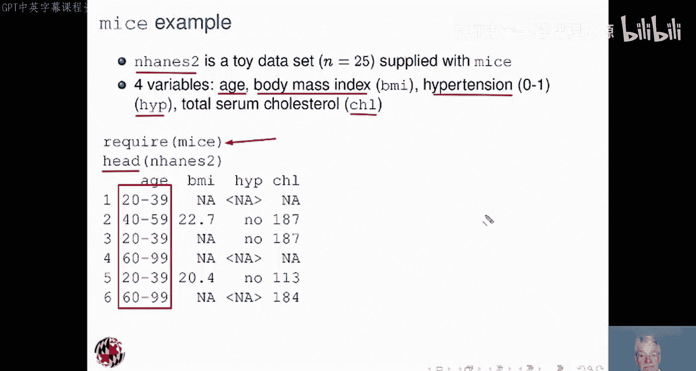

# 密歇根大学《调查数据收集和分析（2-6：方法、社调问卷设计、抽样、缺失数据、分析）｜Survey Data Collection and Analytics》 p146 23_MICE R程序包.zh_en -BV1fw4m1e7Zh_p146-

In this video， we'll look at one piece of software that will allow you to actually do multiple imputation。

So there are various choices out there that you might think about using in are there are a couple of packages。

 one is called the MI， the other is called mice and mice is the one that we'll be looking at here。In。

SS there are also a couple of options， one is a SAS macro that's written from the University of Michigan。

 it's called IVEware。In the main SAS， there is procM。

 and then in stta there's a procedure called MI impute， all those are possibilities。

So what we'll look at is an example using mice。The default method for continuous variables in mice is predictive mean matching。

 which we learned about in the previous video。For two level factors， zero1。

 yes or no kind of characteristics， the default is logistic regression and the parameter name is log Gregg for that。

It's possible though to use a different method of imputation and a different set of covariates for every variable that you're trying to do imputations for。

 so that's a nice piece of flexibility。You can impute all variables with missing values or you could impute just a subset that are most important to you。

The place to look to get a good description of this is by the authors of mice who are Van Buren and Groathaus Uhorn。

And I apologize to them if I butchered their names。

The article that you should read is in the Journal of Statistical Software in 2011。

 it's called M Multivariate Iutation by chain equations。

 so this is where the chain equations comes up。there's a tiny data that comes with mice that I'll use for illustration。

 it's called inHANS2， so inHAN stands for National Health and Nutrition Examination Sury。

 this is a big survey done in the United States， it's an important public health data set。

 it's a household survey of persons。And many different physical measurements are taken。

 blood samples are drawn， there's an interview done with the people who participate in the survey。

 and it's a very important data set in the US for measuring the prevalence of different kinds of health conditions。

There are four variables in this data set， one is age， another is body mass index， BMI。

 another is hypertension， yes or no， do you have high blood pressure and HYP is the variable name。

 total serum cholesterol is the final variable， that's a continuous one called CHL。

So to get access to the package， I require it， or I could say library here， it has the same effect。

And then another nice function in R is the head function。

 which by default will list out the first six records in an object。

There's a corresponding tail function that will list the last six。

 you can also put a parameter in here and list a different number like 10 or 20。

So we see the first six observations here， so you see that age is a categorical variable。

 you know it's coded in ranges here， BMI is continuous。

 it's got four missing values in the first six records， hypertension， it's categorical。

 it's got three missings here。Serium cholesterol has got two missings， otherwise it's continuous。

And we'll see in the next video how to go about actually imputing for those missing values。

