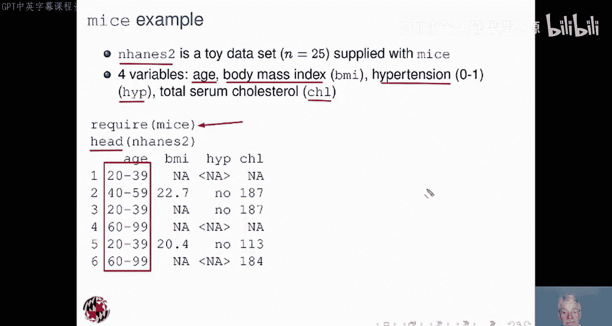

# 密歇根大学《调查数据收集和分析》：2-6：MICE R程序包 🐭


在本节课中，我们将学习如何使用R语言中的`mice`程序包进行多重插补。多重插补是处理调查数据中缺失值的一种强大方法。我们将通过一个简单的示例来了解其基本操作和核心概念。

## 概述

上一节我们介绍了多重插补的基本概念。本节中，我们来看看一个具体的软件工具——`mice`（链式方程的多变量插补）R程序包，它可以帮助我们实际执行多重插补操作。

## 软件选择

市面上有多种可用于多重插补的软件。以下是几个主要的选择：

*   **R语言**：有两个主要程序包，`MI`和`mice`。本节课我们将重点介绍`mice`。
*   **SAS**：可以使用密歇根大学编写的SAS宏`IVEware`，或者SAS主程序中的`proc MI`过程。
*   **Stata**：可以使用名为`mi impute`的程序。

## `mice`程序包简介

`mice`程序包由Van Buuren和Groothuis-Oudshoorn开发（作者名字如有误读，在此致歉）。关于此程序包的详细描述，可以阅读他们2011年发表在《统计软件杂志》上的文章，题为“MICE: Multivariate Imputation by Chained Equations”。文章标题中的“链式方程”正是该方法的核心理念。

该程序包具有很高的灵活性：
*   对于连续变量，默认使用**预测均值匹配**方法。
*   对于二分类变量（如是/否），默认使用**逻辑回归**方法（参数名为`logreg`）。
*   您可以为每个需要插补的变量指定不同的插补方法和不同的协变量集。
*   您可以选择为所有含缺失值的变量进行插补，也可以仅针对最重要的一个子集进行。

## 示例数据集：`nhanes2`

`mice`程序包自带一个名为`nhanes2`的小型数据集，我们将用它进行演示。`NHANES`代表“美国国家健康与营养检查调查”，这是一个在美国进行的重要家庭健康调查，通过访谈、体检和血液采样收集数据，对于评估各种健康状况的流行率至关重要。

`nhanes2`数据集包含四个变量：
1.  **`age`**：年龄（分类变量）
2.  **`bmi`**：身体质量指数（连续变量）
3.  **`hyp`**：高血压（是/否，分类变量）
4.  **`chl`**：血清总胆固醇（连续变量）

## 数据初步查看

首先，我们需要加载`mice`程序包并查看数据的前几行。以下是操作代码：

```r
# 加载mice程序包
library(mice)

# 查看nhanes2数据集的前6行
head(nhanes2)
```

执行`head()`函数后，我们可以看到前六个观测值。从输出中能观察到：
*   `age`是分类变量，以范围编码。
*   `bmi`是连续变量，在前六行中就有四个缺失值。
*   `hyp`是分类变量，在前六行中有三个缺失值。
*   `chl`是连续变量，在前六行中有两个缺失值。

`R`中还有一个对应的`tail()`函数，可以查看数据的最后几行。您也可以通过参数指定查看的行数，例如`head(nhanes2, 10)`。

## 总结



本节课中，我们一起学习了`mice`这个用于多重插补的R程序包。我们了解了其背景、灵活性以及自带的示例数据集`nhanes2`的结构。通过初步查看数据，我们确认了其中存在缺失值。在下一节，我们将具体学习如何使用`mice`程序包为这些缺失值进行插补。