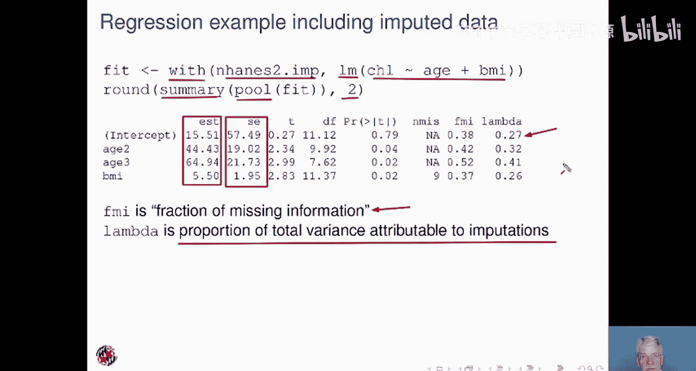

# 密歇根大学《调查数据收集和分析（2-6：方法、社调问卷设计、抽样、缺失数据、分析）｜Survey Data Collection and Analytics》 p147 24_MICE应用案例.zh_en -BV1fw4m1e7Zh_p147-

Let's continue now with the mice example for multiply imputing missing data。

Now this is what's called a margin plot which is a handy way of looking at at least small dataset sets and seeing the pattern of missingness so the first thing I do to draw one of these is require the VIM package and it has a function in it called margin plot which is nice。

 so you can find this example in the Van Buren paper that was referenced in the last video so I feed it the NHANS2 data set I'm going to plot total serum cholesterol and BMI I set some colors here using parameters that margin plot takes and then the CX parameters set the size of labeling in the plot PCH equals 19 is just a particular plotting character that gets filled in the color。

So what have I got here， I've got on the horizontal axis。

 I've got total serum cholesterol on the vertical axis， I've got body mass index。

And in the middle here， I get the plots。For cases that have got both BMI and serum cholesterol present。

Then。Along the sides， I've got two box plots， so the blue one here on the left。

This one right here is for。Cases。That all have BMI present。The red box plot right here is for。

Cases that have got BMI present but are missing serum cholesterol。

 and then you've got the corresponding sort of thing down here for cases that have got serum cholesterol present。

 but missing BMI。And we've got a total of nine cases that are。

Present on BMI missing serum cholesterol，10 cases that are。Present on cholesterol but missing BMI。

 and then we've got seven cases right here that are missing both。Now。

 another thing that is interesting to note from this plot is。

If I had MA missing completely at random， in other words。

 the missingness is just a random draw from the total sample。

 I would expect to see box plots that looked alike。

For the cases that have got me at BMI and have got a serum cholesterol。

 their box plot should look the same as the ones that have got BMI。

 but they're missing serum cholesterol。The box plot for BMI that is not the case here on either axis you know you can see on the vertical axis these two have drawn arrows to the box plot looks substantially different and the same thing down here on these two box plots so that that means I need to account for covariates to have any hope of getting。

Imutations that I would consider to be unbiased predictions of what the actual values are。

Now how do I do the imputation in this simple little example， it's easy， I call the micefunction。

 I send it in Hannes2， I set a seed for the random number generator in case I want to generate the same set of imputed values again。

And I store the whole thing in inHs2。imMP for imputations。

The summary function operating on this will print information about number of MIs。

 the imputation method for each variable， and the covariates's used to impute each variable。

If I want to look at the complete data sets one at a time， I can use the complete function。

So if I send complete inHs 2。m and then action equals k as a parameter。

 well retrieve the K completed dataset。So that's handy to see what you actually did。

Now let's take a look at what summary gives us， so there are a few things to note it echoes the call to the function here。

 the number of imputations by default is five， but you can control it。

 you can do more than five if you wanted to the number of missing cells or values for each column in the data is reported here。

And then it gives you in this row here the imputation methods that are used so age is not missing。

 so I don't use I don't need to impute for that BMI is continuous so the default is predictive mean matching。

 hypertension is categorical， the default is logistic regression。

 serum cholesterol is also continuous so I get predictive mean matching is the default there but you can control that you know if you've got a better idea of how to do it。

 you can use one of the other methods that are available。So the。

Visit sequence as it shows here is that I impute BMI first hypertension second serum cholesterol third。

In the sequence of imputing。Now the other piece of information here is a matrix that tells us what covariates were used to impute each variable。

 So what you see here is this row of zeros means that age did not need to be imputed。

 so nothing was used， no covariates there for BMI on the other hand。

Age and hypertension and serum coat cholesterol were all used to form a model to impute for BMI。

 so everything except itself was used to impute BMI。Hypertension， we see a similar thing。

 age and BMI and total cholesterol were used， and then for total serum cholesterol。

 H BMI and hypertension。Now you can control that if you want， if you've got it。

 you know a better model involves just the subset of the variables。

 you can specify that to the function。So just to show you a little example of how you'd go about using this once you do the imputing。

 I fit a linear model， so you can say with。The inHs 2 dot IMP object that contains the imputations。

 I want to fiddle linear model using the LM function。

 So here I'm regressing cholesterol on age plus BMI。And I。Then。Do a summary on the fit， but。

Interposed in here is the pool statement， which comes with mice。 So the pool statement。

Essentially results in those multiple imputation formulas being used to summarize the data。

 so the estimates will be averages across the completed data set。

 the standard errors that are reported will be using that variance formula that involves the average of direct estimates plus an increment due to the variation between completed data sets of the estimates that use imputations。

And the variance formulas put together with that special multiple imputation formula。

So I ran things off to two decimals just to give us less look at。

And you see here are the regression parameters in this column。

Here are the standard error estimates using that particular multiple imputation variance formula。

 the square root of it， T stats。And then I get some other things on the end here called FMI and Lambda。

FMI is called a fraction of missing information， which has to do with the size of the B parameter in that variance formula and then lambda is similar。

 it is the proportion of total variance attributable to imputations。So let's look at lambda。

 this says that。Of the variance for the intercept， 27% of that is attributed to imputations。

So in a big data set where you've got a relatively small number or proportion of imputations。

 these numbers will be much smaller， but this is just a toy example。

So that summarizes a simple example of how you would use the mice software。So mice is nice。

I'd recommend it it's very flexible and it's quite popular for。

Both doing the imputations and properly reflecting。The effect of those imputations on variances。

