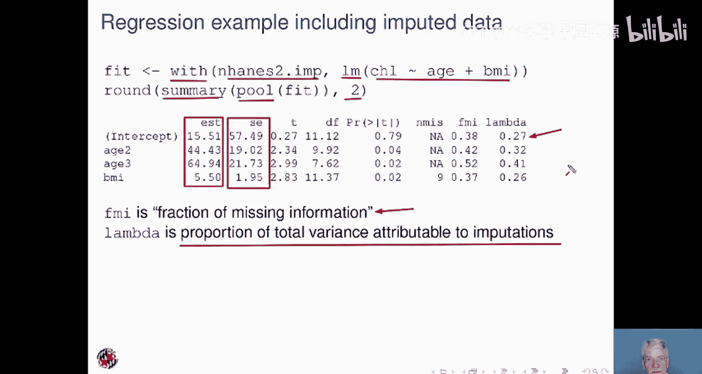

# 调查数据收集和分析：2-6：MICE应用案例 🧩


在本节课中，我们将学习如何使用R语言中的`mice`包进行多重插补，以处理数据集中的缺失值。我们将通过一个具体的案例，了解如何可视化缺失模式、执行多重插补，并对插补后的数据进行回归分析。

---

## 可视化缺失模式 📊

上一节我们介绍了多重插补的基本概念，本节中我们来看看如何通过可视化来理解数据中的缺失模式。边缘图是一种便捷的工具，尤其适用于观察小型数据集中的缺失情况。

首先，需要加载`VIM`包，它提供了绘制边缘图的函数`marginplot`。以下代码展示了如何为NHANES2数据集中的血清总胆固醇和身体质量指数绘制边缘图。

```r
require(VIM)
marginplot(NHANES2[, c("chl", "bmi")],
           col = c("blue", "red", "orange"),
           cex = 1.2,
           cex.lab = 1.2,
           cex.numbers = 1.3,
           pch = 19)
```

在生成的图表中，横轴代表血清总胆固醇，纵轴代表身体质量指数。图表中央的散点图展示了两个变量均存在的观测案例。

图表两侧各有两个箱线图：
*   左侧的蓝色箱线图代表身体质量指数存在但血清总胆固醇缺失的案例。
*   左侧的红色箱线图代表身体质量指数存在且血清总胆固醇也存在的案例（用于对比）。
*   底部的箱线图同理，代表血清总胆固醇存在但身体质量指数缺失的案例，以及两者均存在的案例。

从图中可以观察到，共有9个案例缺失血清总胆固醇，10个案例缺失身体质量指数，7个案例两者均缺失。

此外，如果数据是完全随机缺失的，那么对比组（如存在与缺失胆固醇的BMI箱线图）的分布应该相似。但在此图中，无论是垂直轴还是水平轴，对比组的箱线图都存在明显差异。这表明缺失并非完全随机，因此在插补时必须考虑协变量，才能获得对真实值的无偏预测。

---

## 执行多重插补 🔄

理解了缺失模式后，接下来我们使用`mice`函数对数据进行多重插补。

```r
set.seed(12345)
NHANES2.imp <- mice(NHANES2, seed = 12345)
summary(NHANES2.imp)
```

`mice`函数会执行插补过程，`set.seed`用于设置随机数种子以确保结果可重现。`summary`函数会打印出关于插补的详细信息。

`summary`的输出包含几个关键部分：
*   它回显了函数调用。
*   默认插补次数为5次，但用户可以控制。
*   报告了数据集中每一列的缺失值数量。
*   显示了每个变量使用的插补方法。例如，连续变量（如`bmi`, `chl`）默认使用预测均值匹配法，分类变量（如`hyp`）默认使用逻辑回归法。
*   显示了插补序列，本例中依次插补了身体质量指数、高血压和血清总胆固醇。
*   提供了一个矩阵，说明每个变量使用了哪些协变量进行插补。例如，插补身体质量指数时，使用了年龄、高血压和血清总胆固醇（即除自身外的所有其他变量）。

如果需要，用户可以控制插补方法和使用的预测变量。

---

## 分析插补后的数据 📈

完成插补后，我们可以对插补生成的多份完整数据集进行分析。以下是如何对插补后的数据进行线性回归分析，并正确计算标准误。

```r
fit <- with(NHANES2.imp, lm(chl ~ age + bmi))
summary(pool(fit), digits = 2)
```

这里，`with`函数用于在每一份插补后的数据集上拟合线性模型（血清总胆固醇对年龄和身体质量指数回归）。`pool`函数是关键，它根据多重插补的公式汇总所有数据集的分析结果：
*   参数估计值是所有完整数据集估计值的平均值。
*   报告的标准误使用了特定的多重插补方差公式，该公式结合了**直接估计的平均方差**和**不同插补数据集间估计值变异带来的增量**。

输出结果中，除了回归系数、标准误和t统计量外，还有两个重要指标：
*   **FMI**：缺失信息比例，与方差公式中的B参数大小有关。
*   **Lambda**：归因于插补的总方差比例。例如，截距项的Lambda为0.27，意味着其方差的27%可归因于插补过程。在大数据集中，若缺失比例较小，这个数值会小得多。

---

## 总结 ✨

本节课中我们一起学习了`mice`包的应用。我们首先通过边缘图可视化了数据缺失的非随机模式，认识到在插补时考虑协变量的必要性。接着，我们使用`mice`函数执行了多重插补，并解读了其输出摘要。最后，我们使用`with`和`pool`函数对插补后的数据进行了回归分析，正确地整合了多份数据集的结果并计算了考虑插补不确定性的标准误。



`mice`是一个灵活且流行的R包，它既能执行插补，也能恰当地反映插补对统计推断（特别是方差估计）的影响。