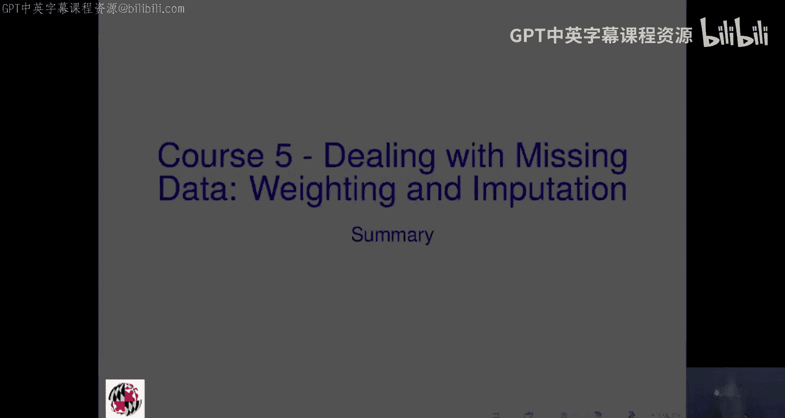
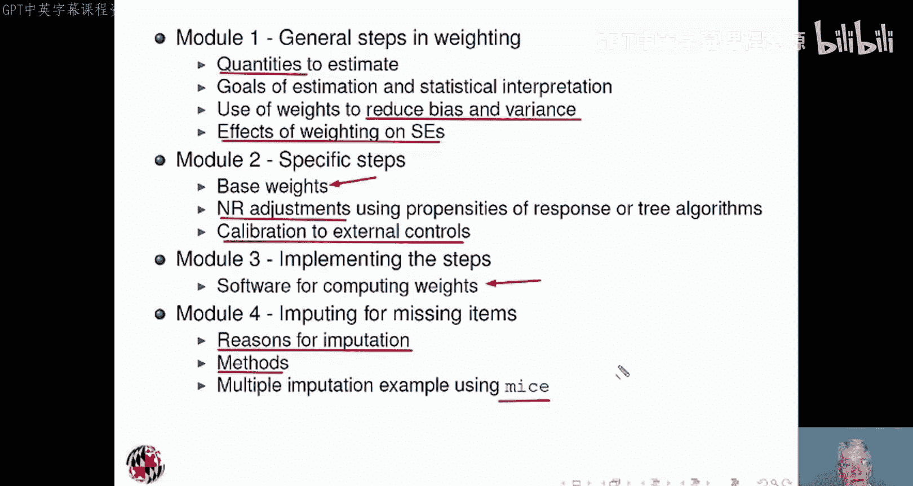

# 密歇根大学《调查数据收集和分析（2-6：方法、社调问卷设计、抽样、缺失数据、分析）｜Survey Data Collection and Analytics》 p148 25_总结.zh_en -BV1fw4m1e7Zh_p148-

In Co five we've covered quite a few things， so I wanted to give you a summary of where we've been。

All along， we've been talking about dealing with missing data and we covered waiting and imputation for those issues。

So there were four modules， the first one was general steps in waitinging。

 so we talked about quantities that we can estimate means， totals， proportions， quantiles。

Goals of estimation， how you interpret what you did statistically。

 how you use weights to reduce bias and variance， and we talked about how to correct for coverage errors。

We talked about how to use auxiliary data to improve estimates。

And then we looked at the effects of waiting on standard errors which need to be accounted for。

 so you need specialized software to do that。The specific steps we looked at for probability samples were computing base weights and then making non response adjustments。

And then calibration to external controls， which you may remember can be used both to correct for things like coverage errors and then also to reduce standard errors。

We looked at some software in R that allows you to actually do this all these steps here。

And then in module four， we looked at imputations。So reasons to impute。

A to create a complete data set so that you don't drop out any cases when you do analyses so that that's important also if you don't impute for missing items。

 you may actually produce biased point estimates because of the missingness pattern in your data。

We looked at methods for imputation。Hot deck predictive mean matching。

 regression estimation and some others， and then we looked at a package in R called mice that stands for multiple imputation through chain equations and that that is a good package to get to know in order to actually do multiple imputing and to properly estimate your variances after you do that。

So that concludes course five。

