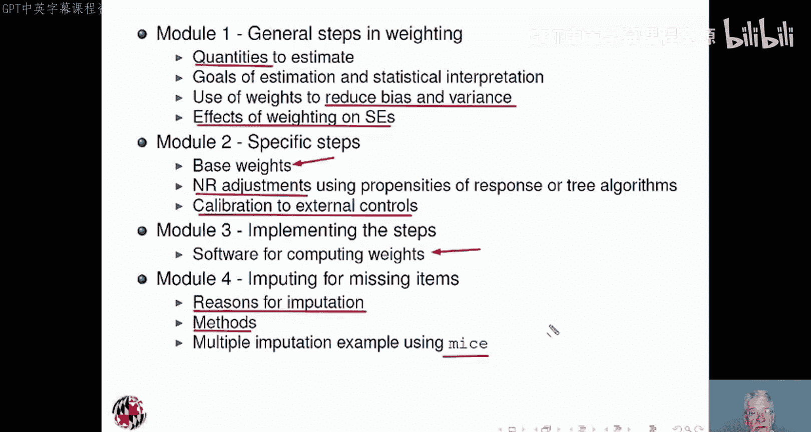

# 密歇根大学《调查数据收集和分析》：课程五：缺失数据处理总结

在本课程中，我们学习了如何处理调查数据中的缺失值问题，主要涵盖了加权与插补两种核心方法。接下来，我们将对课程内容进行系统性的回顾与总结。

## 模块一：加权的一般步骤

上一节我们介绍了课程的整体框架，本节中我们来看看加权处理的一般步骤。我们讨论了可以估计的统计量，例如均值、总和、比例和分位数。

以下是本模块涵盖的核心目标与方法：
*   **估计目标**：明确统计分析的目的。
*   **统计解释**：如何从统计学角度解释加权后的结果。
*   **权重的作用**：如何使用权重来减少估计的偏差（Bias）和方差（Variance）。
*   **覆盖误差校正**：如何校正因样本未能完全覆盖目标群体而产生的误差。
*   **辅助数据的使用**：如何利用外部辅助数据来改进估计精度。
*   **标准误的影响**：我们探讨了加权对标准误（Standard Errors）的影响，这一点必须加以考虑，因此需要使用专门的软件进行计算。

## 模块二：概率样本的具体加权步骤

了解了通用步骤后，本节我们聚焦于针对概率样本的具体加权操作流程。

以下是处理概率样本缺失数据的关键步骤：
1.  **计算基础权重**：通常为抽样概率的倒数，公式为 `基础权重 = 1 / 抽样概率`。
2.  **进行无回答调整**：根据回答者和无回答者的特征差异，调整基础权重以减少无回答带来的偏差。
3.  **外部控制校准**：将样本的加权总和与已知的总体特征（如人口年龄分布）进行校准。这一步既能校正覆盖误差，也能有效降低估计的标准误。

## 模块三：加权软件实践

理论步骤需要工具实现，本节中我们来看看如何在实践中应用这些方法。我们介绍了一款R语言软件，它能够帮助我们完整地执行上述所有加权步骤。

## 模块四：数据插补方法

除了加权，处理缺失数据的另一核心方法是插补。本节我们转向学习数据插补。

进行插补的主要原因有两个：
*   **创建完整数据集**：避免在分析时因缺失值而删除任何个案，确保分析基于全部样本。
*   **避免估计偏差**：如果不对缺失项进行插补，数据中的缺失模式可能导致点估计（Point Estimates）产生偏差。

我们探讨了几种常用的插补方法：
*   **热卡插补**
*   **预测均值匹配**
*   **回归估计** 等。

随后，我们介绍了一个名为 **`mice`** 的R语言包（全称为“通过链式方程进行多重插补”）。这是一个非常实用的工具包，可以帮助我们执行多重插补，并在插补后正确地估计方差。

**课程总结**

在本课程中，我们一起深入学习了处理调查数据缺失值的两大核心策略：加权与插补。我们从加权的基本原理和步骤开始，逐步深入到概率样本的具体调整与校准技术，并介绍了实现这些操作的软件工具。最后，我们探讨了数据插补的必要性、多种方法以及用于多重插补的`mice`软件包。掌握这些内容，将为您处理现实世界中的不完整调查数据奠定坚实的基础。