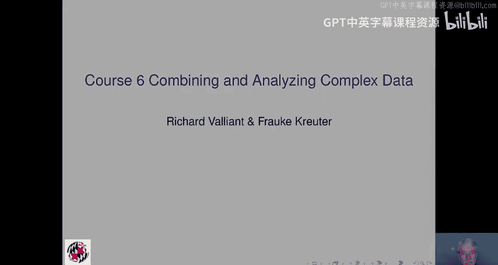
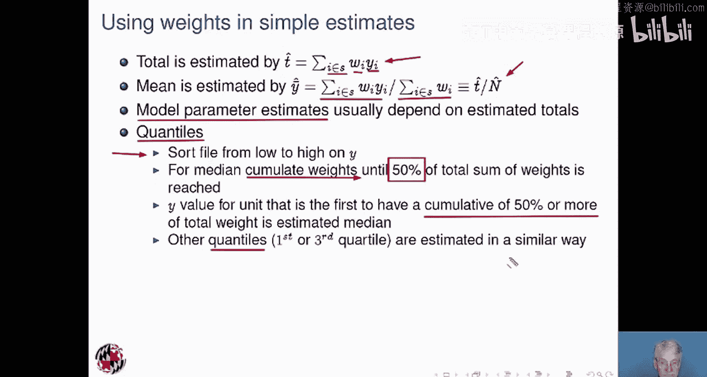

# 密歇根大学《调查数据收集和分析（2-6：方法、社调问卷设计、抽样、缺失数据、分析）｜Survey Data Collection and Analytics》 p149 0_概述.zh_en -BV1fw4m1e7Zh_p149-

嗯。

Welcome to Course 5 on combining and analyzing complex data。This one will be taught by me。

 Richard Valiant and Fraca Croyer。So we've got quite a bit of material to cover in this course。

 and I'd like to give you。A brief overview of what's going on in the first module， basic estimation。

 we'll talk about things like estimating means and totals and quantiles and how you do that in complex samples。

In the second module， we'll talk about model fitting。

 how do you estimate things like the parameters of linear regression models and nonlinear models like logistic？

And we'll look at software for both these in Model3 we're going to look at some basic methods of record linkage which is becoming a more important topic these days。

 and associated with that in module4 are some ethical issues in linking data and these may vary from one country to another so it's worthwhile let you know something about those。

Now module， one basic estimation we'll start out with in this video and talk about totals and means。

So in a complex design， a key thing is that you need to account for the weights。

Now if your population or your sample was a little miniur of the population。

 then everything would have the same weight and a lot of analyses would be simplified。

But because of things like varying selection probabilities in the sample design or non response adjustments or calibration to external control counts。

 we typically have different weights for different units。

And you shouldn't ignore that because the weights mean something。And then another thing that。

You need to account for in。Complex sample analysis is things like weight straight at multiple stages of selection affect the standard errors that should be estimated。

 so we need to properly account for those。And fortunately for us。

 there's software out there available for analyzing complex samples。

 and we'll give you a number of examples of how to use that software。Now。

 totals are the easiest thing to talk about， so let's think about those。

If you've got weights that are scaled in such a way that they take the sample up to the population。

 they project this small set that you've got up to the big set， the population。

Then you estimate totals in the following way， you sum over the sample units。

 and that's what I an element of S means。I indexes the units， s is the set of sample units。

 some over those and we take the weight for each unit times its data value。

 and that'll be an estimated total for whatever this y variable is。You know incomee。

 if y zero or one， it could be a number of people who。

Have got diabetes or number of people whose water supply is somehow contaminated。

 it could be all sorts of things。Now， for the mean。

 all we do is we take that estimated total here and we divide by the sum of the weights。Now。Again。

 if the weights are scaled to estimate population totals。

The sum of the weights is going to be an estimate of the number of units in the population。Also。

 if we were to sum over just a subset like the males in your sample。 if you're sampling people。

 that will be an estimate of the number of males in the population。

 Itll be an estimate of the count of units in whatever subgroup you sum over。

So that's a very handy thing about the standard way of constructing complex survey weights。

Now model parameter estimates typically depend on estimated totals。

 so if you can figure out how to estimate totals， you can。

Typically figure out how to estimate model parameters and their routines in the software that will do that for you。

Quantililes are a little bit different and the software choices are more limited。

 but here's how the algorithm goes。What we do is we first identify the variable we want to quant on。

 so this would be a quantitative variable like income or years of education or something like that。

 so we sort the file from low to high based on that Y variable and then associated with each unit we've got a weight so we accumulate the weights until we reach a certain point。

 so in the case of estimating a median。We want to accumulate the weights until we get to the 50% point。

And 50% of the sum of all weights is reached， and then what you do is you look at the y value for the first unit that's got a cumulative of 50% or more。

Of the total weight。 And that'll be your median value。

 And sometimes that requires some rounding off because of the discreteness of the sample。

 But that sort of thing is built into the software also。

So you could do other things like the first and third quartiles。

Just accumulate the weight until you get to the appropriate point。

 25% or 75% on that accumulated total weight and look at the y value that goes with that unit and that will be your estimate of the first or the third quartile。

So in that way it's fairly straightforward， the hard part with quantiles is estimating。

A measure precision， which。We'll talk about also。So in the next video in this module。

 we'll get into the software that's available for some of these analyses。

