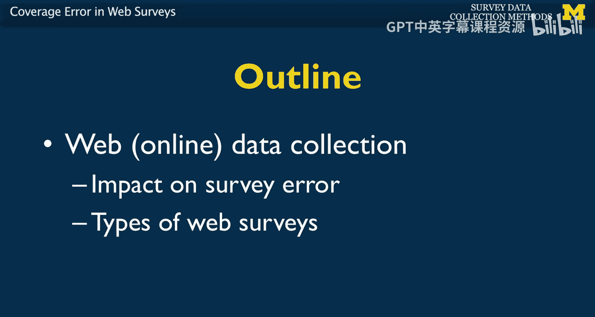
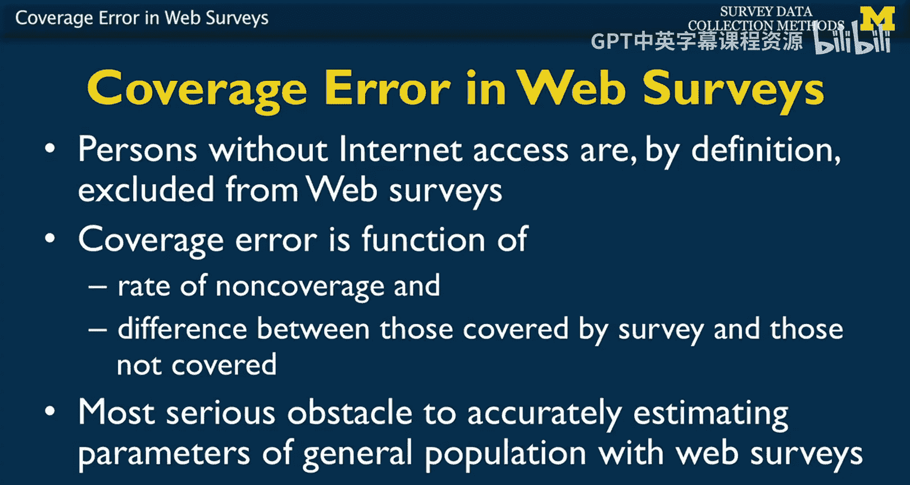
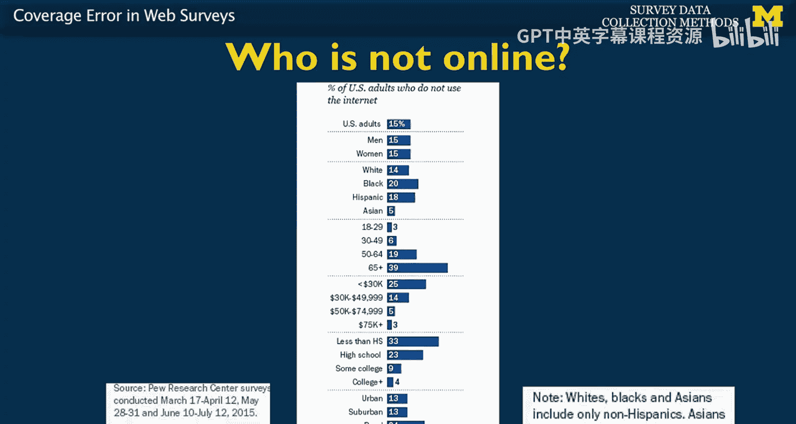
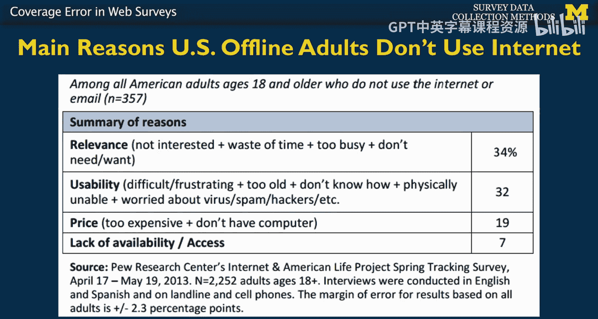
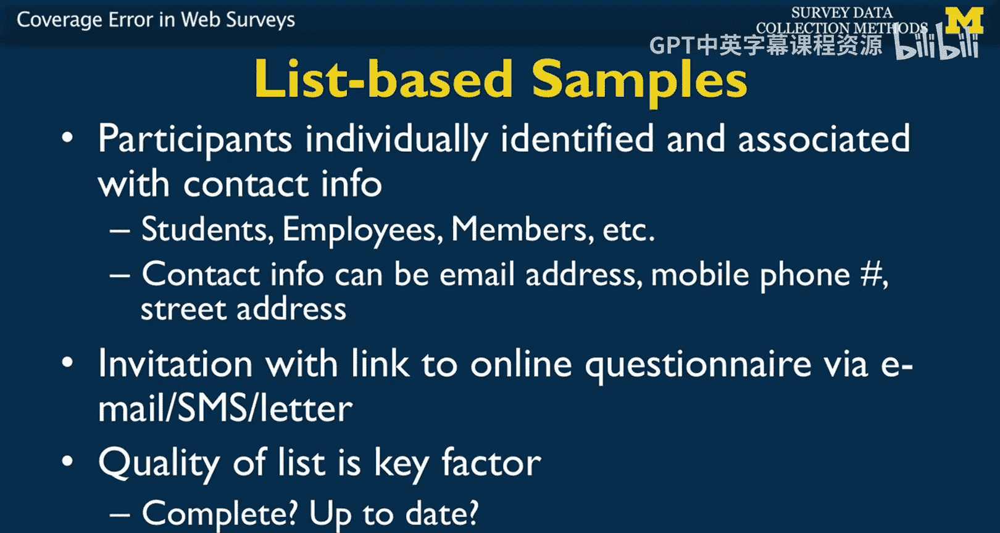
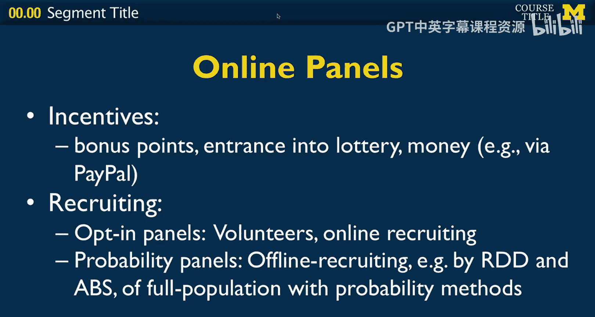
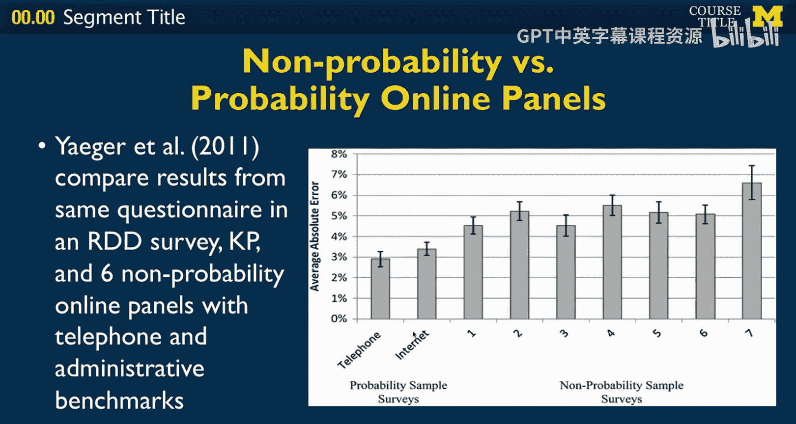
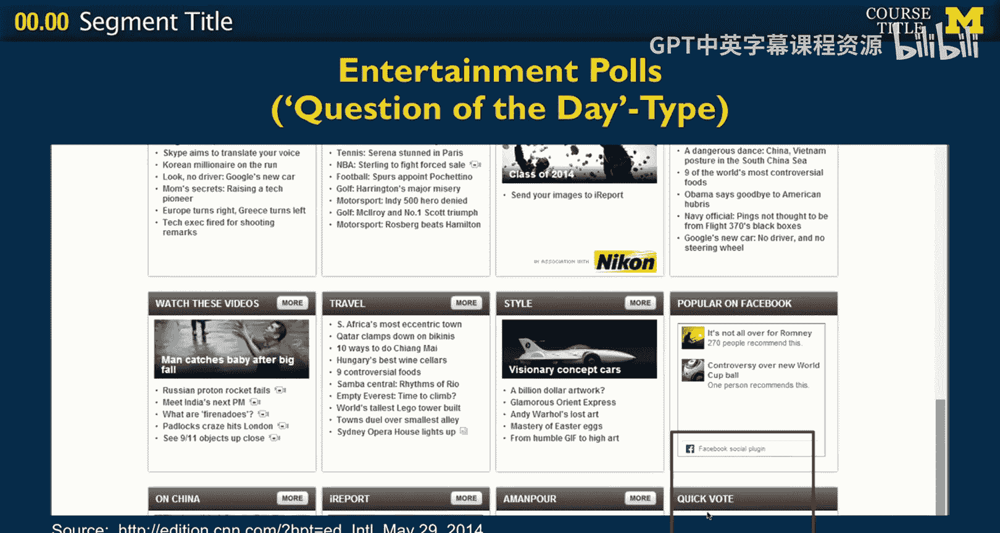
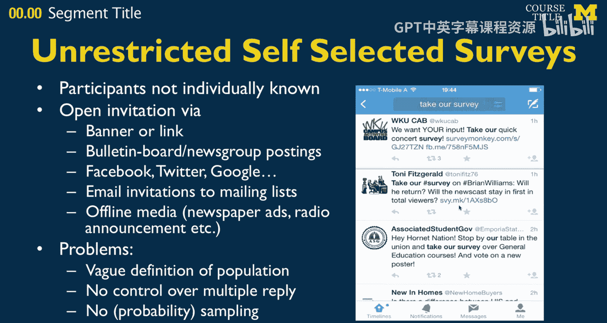
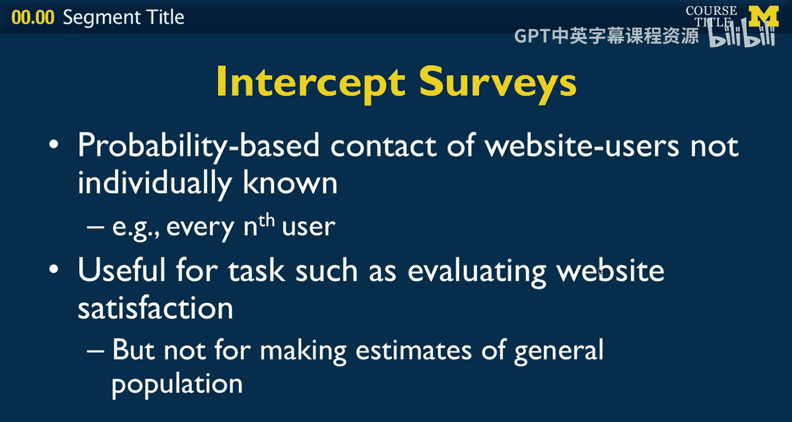

# 密歇根大学《调查数据收集和分析（2-6：方法、社调问卷设计、抽样、缺失数据、分析）｜Survey Data Collection and Analytics》 p15 14_2.2.1 覆盖范围.zh_en -BV1fw4m1e7Zh_p15-

Welcome back we're talking today about web or online data collection so we're transitioning from the kind of self-admin。

 automated self- administrationminist we've been speaking about which occurs mostly in the context of face to face interviews now we're talking about a situation in which respondents are self-administering or questionnaire without any interviewer present in any way really so we'll talk first about the impact of web surveys on different types of survey error。

 the standard types we've been discussing。

Nonresponse sampling coverage and measurement error and we'll talk about a number of different types of web surveys because there are quite a few varieties that are in use today and they have different consequences for error we will subsequently talk about the effects of interactivity in web surveys on data quality interactivity is something that really isn't available in other types of automated self- administrationminist or other types of self- administrationminist in particular paper。

So let's turn first to coverage error in web surveys。

 so you'll remember from earlier discussion that coverage error really is a function of two things。

 the rate of non- coverage and the difference between those who are covered by the survey that are in the sampling frame and those who are not you have to put these two measures together to determine what coverage error。

 how much coverage error there is， so if there is a big difference between those who are covered and those who are not and of course you can't know the attributes of those who are not covered。

 they're not in your frame， you'll never collect data from them。

 but if in principle or through some means outside the survey you're able to determine that there's the large difference between those who are in the frame that is covered and those who are not。

But almost everybody in the population is in the frame that there's a very small rate of non coverageage。

 then that big difference won't affect the estimates nearly as much as if there was more undercoverage that is if more people in the population were not contained in the sampling frame so coverage error is actually a very serious concern with web surveys because people who don't have access to the internet are by definition not covered so someone without access to the internet simply will not provide data because they can never be invited to take part in a survey at least of the sort that provide the kinds of estimates we rely on the most。

 we'll talk about some other varieties of web surveys where this is less of an issue perhaps because the the type of web survey doesn't require an explicit invitation。

So when it comes to coverage， the big question is who is online because if they're not online。

 they cannot provide data in the web survey， so who's not online。

 there is very good data from Pew research， this figure illustrates that there are high rates of not being online and therefore high rates of undercoverage in any kind of frame that's based on internet users。

 for older people， for people with lower income for people with high school only or high school education and for people who live in rural parts of the US。

So let's say that you're wanting to measure attitudes toward some agricultural issues。

 say farm subsidies， using a web survey， the fact that people who live in rural areas are underrepresented online suggests that you might be inaccurately measuring the attitudes toward agriculture。

 where it is more important， that is in rural areas。

 because of this undercover of people who live in rural areas。

 it's a very serious concern if one wants to generalize to the population， whatever that is。

 because not all members of most populations have equal access to the internet。

Some reasons that members of the public are not online， look again from Pew research。

 the most frequent explanations are that it's not relevant that is they're not interested。

 it's a waste of time， they're too busy， they don't need to be online or don't want to be online or it's hard to use the usability issues so it's difficult frustrating。

 they don't know how to do it， they have a disability that prevents them from being online。

 or they're worried about。virusruses or security issues hackers and so on so and there are other reasons as well。

 but the point is not everybody is online and a web survey that is designed to generalize to the population has to address this issue。

Sampling for web surveys poses a number of interesting problems。

 there are a number of different approaches to sampling for web surveys， one is to not sample at all。

 we'll look at a number of examples of types of web surveys that really don't do any sampling。

 there are listbased samples in which all members of a population are sort of enumerated with contact information there are panels which are preasseled groups of large lists of sometimes millions of participants and these really come into varieties what are known as。

Non probability panels and probability panels， and we'll go into them in some detail later。

And transaction or intercept based methods， so for example。

 every nth user at a website might be invited to take part in a survey。

There's no frame of general internet users， including any frame with email contact addresses。

 which means that if members of the public are going to be invited to take part in a web survey。

 it's hard to do this using email but it's desirable to do this using email because it's possible to just include a link in an email message which really reduces the obstacles required to start the survey so instead one can sample from a frame of mobile phone numbers and possibly contact members of the public by texting them with a link this is complicated。

 it's more common still to send a paper invitation through the mail that contains a web address a URL and the sample member then needs to manually enter that URL which can be an obstacle so a list-based samples are desirable。

 preferable these resemble the sampling frames in。Other modes so we talked about telephone frames earlier and they are list based that for example you can randomly generate a list of phone numbers using random digit dialing techniques。

 so there are some list based samples for some populations， not national populations。

 but an organization that has membership list would be an example of this， students at a university。

 good example or employees in a company， all have an email address and can be contacted that way or they may have other contact information in the frame like a mobile phone number。

And so they're invited and given a link， the limiting factor。

 the key issue is the quality of the list is it complete and up to date。

 if it's a student frame and it's a year at a date at an undergraduate institution。

25% of the entries in that list may be inaccurate may have graduated and be gone。

Online panels are an alternative to list based samples and probably more commonly used。

One definition is a pool of prereed people who have registered to occasionally take part in web surveys。

 this comes from Anya Goretz， this is the same as what's known as an online access panel or access pool。

You shouldn't confuse it with panel used in the context of longitudinal survey research。

 so you'll hear about longitudinal panels， which really refers to a group of participants who've been recruited to be repeatedly measured。

 mostly by being asked the same questions over time， repeatedly。

 that's not the same as an online panel in which members are invited to take part in generally one off or cross-seal surveys and they may receive many invitations a day or on a weekly basis。

 but they're not necessarily in this for repeated measurement the way the participants are in what's called a longitudinal panel。

So as I said， the members of an access panel or an online panel may receive frequent invitations to take part in questionnaires on。

嗯。On various topics and they pick and choose and often response rates are quite low。

The incentives that sample companies have found useful are bonus points or entrance into a lottery or money transferred online by service like PayPal。

The recruitment for what are called optin panels is often done online。

 these are volunteers who may see a banner advertisement on a website and click on it and they're brought into the online panel that way they're asked for contact information。

This is quite different from recruitment for probability panels which are designed to support generalization to the generally national populations and so the recruitment for probability panels resembles recruitment for samples。

 representative samples and other modes， in fact it uses techniques used in other modes。

 that is it's done offline， so either by random digit dialing in which telephone numbers are randomly generated。

 called and the households or individuals associated with those phone numbers are invited to join the panel or some sort of addressedbased sampling method in which the recruitment is done face to face and this as I said this is very much how recruitment is done in other modes。

 it's done this way because there is no frame of internet users。

 particularly with email addresses but the result can be a panel of participants。

ent who very much resemble the national population so just as an example there's a lot of text here won't go through it all。

 but you can compare the Harris poll which is a non-probability or optin panel to GFK's knowledge panel which is a probability panel the recruitment is done differently in the case of Harris poll it's a mix of online and offline sources。

 but including clicking links encountered online， they use a telephone survey to calibrate the results of the online survey。

 a small telephone survey which is believed to be representative and this is used to adjust the estimates that are derived from the online data so that a generalization to the national population can be made。

The GFK knowledgege panelel probability panel begins with a combination of address based sampling and random digit dialing。

Sample members or members of the public who are contacted through those methods who are not online are provided with an internet enabled device。

 originally it was a web TV many years ago， more commonly now it's a tablet of some kind。

As well as internet service and this solves to a large extent， the problem of。

Members of the public who are not online， it is quite expensive and so it makes the data collection process much more expensive and closer to or can be closer to telephone interviews in cost。

The response rate is generally better but response rates are complicated because there is a series of opportunities for someone who's being recruited into a probability panel to to not respond to the invitations we'll look at that shortly and the estimates to the population make use of kind of more conventional waiting and post stratification there's no calibration the way there is can be in non-probability panels so how accurate are the different types of or the estimates from the different types of online surveys one comparison was reported by Yeager and his colleagues and they compared results from the same questionnaire。

Administered on the telephone to a sample recruited through random digit dialing methods as well as to a sample in the knowledge panel。

 the GFK knowledge panel and that's the bar labelbeled internet that's what that refers to six non-probability panels access panels of the sort we've been describing Yeager and colleagues were able to derive a measure of error based on comparisons to the telephone survey and treating that as kind of a gold standard and to administrative records which served as a benchmark and as you can see the probability panels very close to the error rate is very close to that of the telephone survey and these are lower than all of the non-probability panels so it does look from this comparison anyway like the non-probability samples are associated with higher error rates than the nonprobability web sample。

So those are panels， there are a number of other approaches that organizations and individuals use to collect data online for example。

 enter what are called entertainment polls like a question of the day typepos。

 you can see in this example， there's a button labeled quick vote。

 and the idea is that if the user happens to be at this site， as media site。

 they might want to click on this button and vote， which generally in this case means answer some poll questions。

There's really no way to define the population of participants and therefore it's really hard to generalize from these data。

 but when they're used for entertainment purposes， there's really no need to generalize to the population。

But these kinds of unrestricted self selected surveys are problematic for those reasons。

 so nothing is known about the participants， they're self selected。

 they follow a link or see an ad with a link in social media， for example。

 or receive an email invitation。We don't know anything about the population so we really can't generalize。

 it's possible the same user， same participants can provide data multiple times。

 and there's really no sampling， so where we spoke about。

 you know one design is up for sampling is no sampling and this is really what we're talking about。

If you look at this would be another example， there's an ad here。

 this is taken from a screen of a smartphone， take our survey on Brian Williams， et cetera。

 anybody can do this， there's really no information about who they are and therefore makes it very hard to。

Make any broad statements about larger groups of people。

And then finally， intercept surveys are quite common online。

 so these are probability based in the sense that it might be every nth user to a website。

 for example， is invited， but again， nothing's known about the individuals in contrast to say a list sample or a panel。

Useful for tasks like evaluating websites， website user satisfaction。

 but not for making estimates of the general population。

So that's an introduction to coverage and sampling concerns and error in online surveys。

 what we'll turn to next is nonresponse and measurement error to other error source we've been concerned with and when we talk about measurement error we'll really talk about visual aspects of the design that can affect the amount of measurement error。

