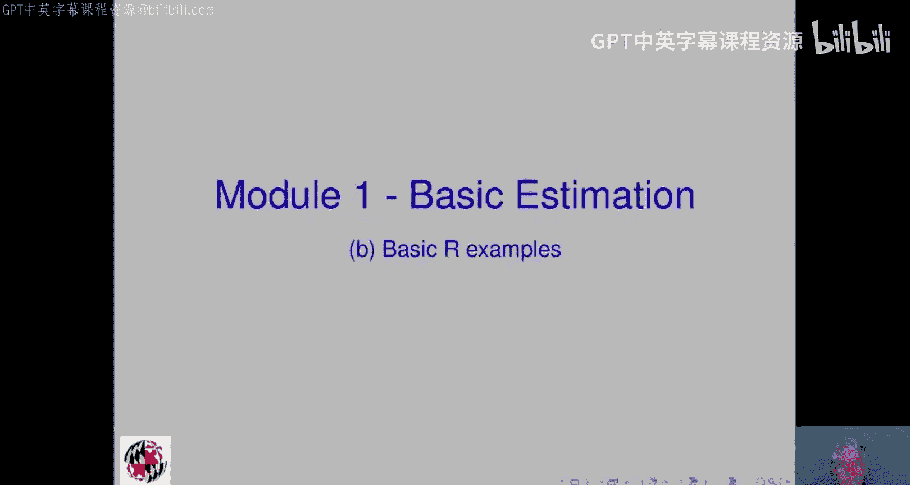
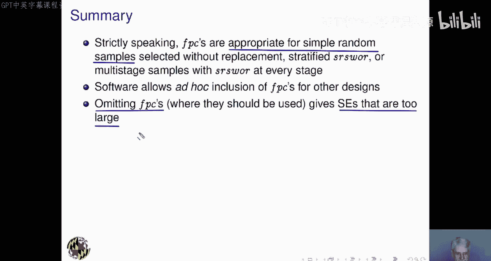

# 密歇根大学《调查数据收集和分析（2-6：方法、社调问卷设计、抽样、缺失数据、分析）｜Survey Data Collection and Analytics》 p150 1_R语言基础示例.zh_en -BV1fw4m1e7Zh_p150-

In the second video of this module， we'll look at some basic examples in R to show you the software statements that are used to compute things like means。

Now， when you're analyzing complex data。You have to inform。The software of what's going on。

 You've got to tell the software。 what are the fields that hold your weights straight on clusters。

 Those are the big things。 If you've got a sample where finiteing population corrections are appropriate。

 then you have to tell it that also。The statement in the R survey package that we'll do that is called SVY design Now in other software the statement is different naturally in stta the keyword is SVY set in SAS。

 each individual proc will have a separate set of lines where you tell it stta and weights and clusters and so forth。

They all work pretty much the same， though you have to let the software know what the complex features of your sample design are。

So for example， we're going to use a stratified simple randomum sample from the National Health Inter Survey population。

In the Prat tools are a package。So I'll create four stta and select 100 persons。

Pur strattum using stratified simple random sampling without replacement。

So here's how I do that the first thing I do is I load up the sampling package。

 which has got a lot of facility for different kinds of samples。I tell it。

That I'm going to use the NHIS data， so I haven't showed it here。

 but I have to load up the Pra toolsol package and I've got to load up the survey package。

 which I'll use later on。So I attach NHIS， you may or may not need to do this depending on what kind of syntax you use to access the NHIS data set。

The data。Statement here is critical， otherwise。Or won't know where to find the data。

So what do we do then， I want to stratify by a variable called EDuc_ R。

Now that stands for recoded Education。So。I need to sort my data file by the stta。

 so the way I do this is I take the NIH HEIS data set。

And then using this order statement before the comma here， this says。Put the rose in the order。

After sorting by this E duckuck underscore R。Field， and then keep the columns the way they are。

 There's nothing after the comma here。So that is a quick way to sort a data set。

 and then I use the strata function in the sampling package to draw the sample。

So I specify data as NHIS， I specify the strata as the ZDuc underscore R。

 and that needs to be in quotes。Then I give it the sample sizes。What does this mean？

Reip 100 coa4 means produce the value1 hundred0 four times。

So I'm going to sample 100 units per strum。And then what method do I use stratified or simple random sampling without replacement within each strata？

This last parameter description equals true， just says。

Print a little bit of output to tell me what happened。

So here's the output that the sampling package produces once you execute that statement。

And it's pretty basic， says the population total and number of selected units in each stum。

So in straightum one， for example， I've got 1，964 units， I selected 100。

So you get similar information on the other。Three started。Now， let's check out the。

Range of selection probabilities。 So I saved that sample in an object called S T Sam。

And then within that object is in a field， a column called Prob with a capital P。So。

Those are the selection probabilities。The range on those， as you can see here go from 0。0509 up to 0。

3389 or so。So there is a range， you we've got different weights that we ought to account for。

I extract the sample data with the get data function， which is part of the sampling package。

 so I say get data from NHIS， pull out the rows that are specified in ST SAM。

So that's the sample data that'll have 400 rows in it。 And now I compute the survey weight this way。

 and I just append it directly on the SAD object。By saying Samda Do S VY Wade， S V Y W T。

Does not exist on Sam dad till I create it。 So what Im assigning it right here。

To be one over the selection probabilities。 So now I've got my survey weight in the object。And。

I can now use。The S V Y design object or function in the survey package to specify the sample design。

 So notice here I'm saving this。 so I can use it later in N HIS S dot D SGn。

What do these parameters mean I've got the first one here， IDs is for specified clusters。

Now this design has no clusters， so I say no。For the value there。

 then I give it the strata stra equals in I tell it the variable name。

The field name in my data file that gives that， so that's EDuc underscore R。

I tell it the weights are SVY weight， which I just computed。In notice here that。

I've got these tildas in front of these parameter specifications。

Now that's because I those expects those to be formulas。

 you could use a more complicated definition than I have here。嗯。The tilda says。

 look for formula if you need one。Now， I also need to say what the data file is。

 so SA data holds my sample data， and then I'm specifying an FPC right here FPC equals S Sam dollar pro。

Now， the convention in our survey and other。Software that analyzes survey data is that if you specify the FPC is a number between zero and1。

It will interpret that as a selection probability， and it'll use one minus that value。

As the finite correction factor in a variance formula。

Now you can alternatively specify the FPC by giving the pop count here。嗯。In that case。

 if you give it a number。Bigger than one。It will interpret the value as being a population count。

 so it'll make a decision based on the size of the numbers that you feed it。

So I've given it selection probabilities here， so that's how it interprets these things a key thing though is。

You're not specifying the F PC the way a textbook would。

In a textbook variance formula for a stratified simple random sample without replacement。

The FPC of the formula is going to be one minus the sampling fraction。

 so what I've given the package right here is that FH itself。And it will。Handle that correctly。

 given the rules that it's kept programmed in。All right now。So I created an object with an FPC in it。

 just for comparison， I'm going to create this other object that's got no FPC。NHIS。dsgn dot。No FPC。

Is a new design object， so I use the survey design function to do it and you see the one thing I left out is just the FPC parameter。

So if you do that， it'll assume that you're drawing from an infinitely big population is what it amounts to。

A population where the sampling fraction is  zero in every statum。All right。

 so now let's just do the mean of something to see how it comes out so SVY mean of age I'm doing here。

 and I do it for the design NHIS。DsGN that has an FPC in it so。I get 45。

88 is my point estimate of the mean， here's the standard error 0。09757。

 and then I do the same thing for the OFPC。Deign and the standard area is a bit bigger。

 probably four percentage points or thereabouts。1。0117。So I。

Naturally get a bigger standard error if I ignore the FPC and you know。

 if you've got a substantial FPC， you want to give yourself credit for that。

 so it would be a good idea to in this case to specify an FPC。So let's look at。Some domain estimates。

 just for comparison and。Now I do。The means of age by the design strata， the education levels here。

So how do I do that， I use this SVY by function。Age is the variable。Right here。

And the domains I want to do it for are given by the by equals parameter。

 so that's the educational levels， I tell it the design， this is the design with an FPC。

 and then I tell it the function I want to use SVY mean I could use other functions in there。

So it gives me。Point estimates。The age in each stratum。

 they vary a little bit standard errors are right here， so they go from about 1。107 up to 1。752。Now。

 just for comparison， let's do the same thing。On the object without an FPC。

 so my standard error should be higher。The point estimates， on the other hand。

 are exactly the same because the FPC doesn't get into the point estimate。

 You're just doing weighted sum of the y's over the sum of the weights。

 Standard errors are a bit different。 So you see here I've got， for example， 1。799 compared to here。

1。753。So， you know， I get FPCs that are bigger， somewhat bigger if I ignore or I get standard errors that are somewhat bigger if I ignore the FPC and just to show you how much bigger I took the ratio so I've got。

 I saved the output in two objects that you can see here， MS。fpcs。nofpc，mS standing for means。

And here's the ratios。So in the third column of those objects are the standard errors。2。

6% too high in the first one， 7。8 and the second one， 22 point well。

 almost 23% higher in the last one。 so you know， pretty big loss right right here。

In terms of estimated precision， if I incorrectly ignore the FPC。So to summarize。

 one thing that you should realize is strictly speaking。

 FPCs are appropriate for simple random samples。Without replacement。

Or stratified simple random samples selected without replacement。

It is possible to include an FPC in your variance formula if you drew some other sort of sample。

PPS sample， for example。Software allows that kind of ad hoc inclusion of an FPC and mathematically。

 it's not strictly right， but it is a way of accounting for the without replacement。

Gain in standard errors that you may achieve。You could omit the FPCs on the other hand you know it's always an option and a lot of times you're provided with data where you don't know enough to actually include an FPC。

 whether it's exact or ad hoc。In that case。You'll probably estimate standard errors that are too large。

But that typically is not。Thought of as a bad thing， you know， it's conservative。

 it would make your confidence interval's wider than if you had an FPC。

But there may be things going on in your sample and your survey that。

Inject some error into your estimates that you really can't account for directly。

 So if you overestimate standard errors。That's indirectly a way of accounting for this other imprecision that you really don't have control of。

