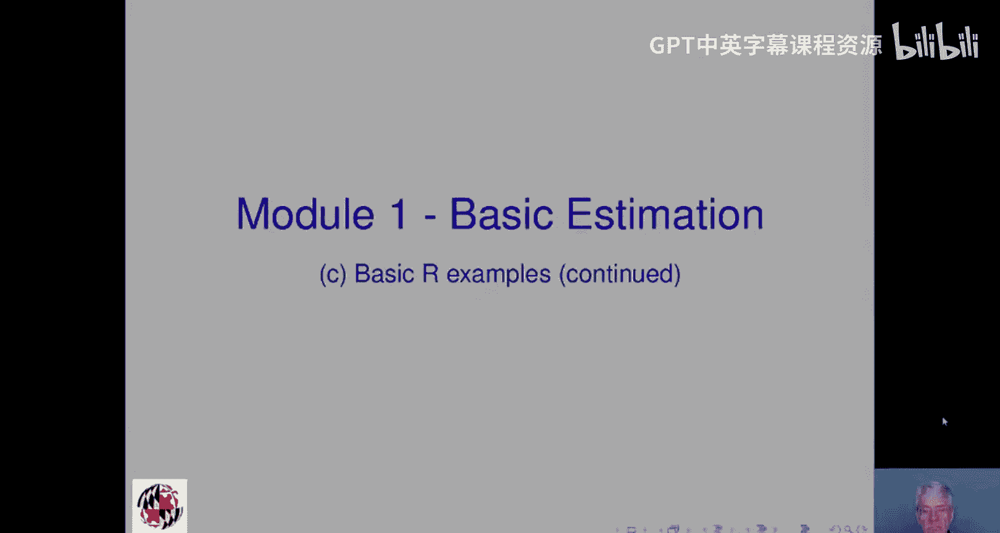
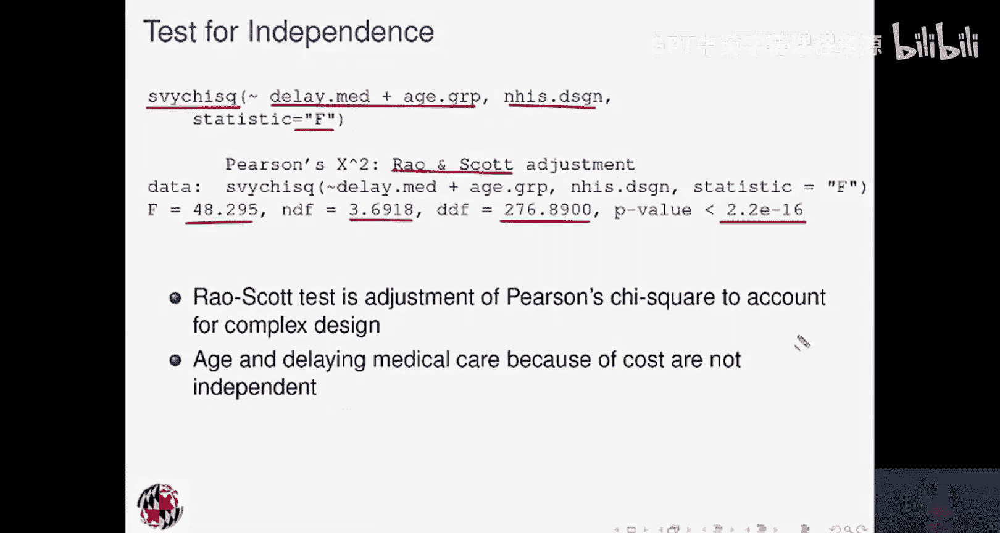

# 密歇根大学《调查数据收集和分析（2-6：方法、社调问卷设计、抽样、缺失数据、分析）｜Survey Data Collection and Analytics》 p151 2_R语言基础示例续.zh_en -BV1fw4m1e7Zh_p151-

Welcome back to Co six on combining and analyzing survey data。In this module， basic estimation。

 we'll continue with another example using R just to show you how to define a more complex sample design than in the last video。

 So what we're going to do is use another data set out of the R Pra toolsols package。

 And this one's called the N HIS dot large。 again， is from the US National Health interview survey here。

 but it's a full sample from that data set。 I'm not treating this as a population。It's got 21。

588 persons， it's got 75 strata and two PSUs per stratum， so a total of 150 PSUs。

 so you can see that the number of persons for analysis is a lot bigger than the number of PSUs。

 so there's a substantial amount of clustering here。

And as in the simpler example that we saw earlier， we've got to define a design object for R so it knows how to handle the data。

So the first thing I do is require the PRC tools package so I can get it the data。

 I require the survey package so I can analyze it。And then I use the data statement to specify which data set I'm going to use。

Now this is a multi stage survey， so I've got PSUs and the first stage sampling unit is called PSU。

 so I specify that here。In the Is parameter， in the strap parameter。

 I give it the name of the strata， which is Stratum。 This is a field in the data set。

 and then the survey weights are called S VY weight。

Now note that they are expects these things to be a formula， so you put a tilda in front。

You can use more complicated expressions to define these things sometimes。

 but this is fairly easy with one feel。We tell it the data is NHIS。

 large and then another parameter is N equals true。

Now what that means is the PSUs and are not numbered consecutively across the whole data set。

 they're renumbered within Strta， 1，2，1，2，12， and so forth。If you leave out the N statement。

 a survey will actually detect the fact that they're not numbered consecutively and it will suggest to you that you use the N statement so you will。

Hear about it if you don't put it in initially。Now。

 what kind of variance estimator are we going to get given the amount of information we provided？

Survey is going to use the ultimate cluster variance estimator， which assumes that。

PSUs are selected with replacement。That's the default if we were able to specify more detailed information then the survey package has available other variance estimators。

 but this is kind of typical in a public use data where the only choice you've got has used the ultimate cluster with replacement variance estimator。

So we'll do a table of proportions and the variable I'm going to analyze is something called delayed medical care because of cost。

What it is is it's an indicator variable， a person delayed getting medical treatment for something。

Because it was too expensive in the prior year。And yes or no。So we'll do a table on age。

 so to do that。I use the SVY by function。诶。Send the first parameter， which is a formula。

 That's our analysis variable。 And to make sure it treats that as a factor， yes， no variable。

 I say factor。Here， and then delay men in parenthesesis。

 So factor is a kind of a function that's being。That's receiving delay man and then the stub of the table is going to be age groups。

 so there's variable called age dot group in the file I use that。The function fun here。

Is survey mean， so I specify that there are other possibilities， survey total， for example。

 you tell it the design object which I just created， and then it's critical that you include this N。

 RM equals true， which means if the analysis variable or this stub of the table has missing values。

 just take those out。Otherwise， you're not going to get a table。

Now the survey package does not tabulate those missings out separately， it might be nice if it did。

 but it doesn't。You'd have to code them as something other than NA in order to get those to be tabulated。

So I save all that in an object called age。mS。IS for means。

 and then it turns out the two columns out of this object that I want to look at for the proportion of the standard error are the second and the fourth。

So I'm extracting those here。And then just to make my table a little more readable。

 I specify row names and column names for this age dot MS object。The second and fourth columns。

 which is what I extracted， and then I print those out here with the round function at around four decimal places。

So you can see in the proportion column here， the proportions are lower。

for young people under 18 years old and older people。

 65 or more than they are for people in the working years and the reason for that is that in the US the old the young tend to have medical insurance at a higher rate than the working age people。

So because they've got insurance， they tend not to delay treatment。So here are the standard errors。

 you can see they're a bit different and those are the width replacement standard errors。Now。

 just for comparison， let's think about what would happen if we just ignored the sample design。

 assumed I had a simple random sample with no weights or everybody's got a weight of one。

So I'll do that by hand， essentially， I'm going to save my output in a result in an object called age。

ms。sRS。And I'm just using the buy function here。 So in this。String here。

 I'm taking the absolute value of NhiIS。 large delay。med。

 and I've got a dollar sign in there to separate the object name from the field within it the column I subtract to and take the absolute value。

I did that because delayed up meant is coded as one or two。For yes or no。

 so if I subtract to and take the absolute value， I recode it to01， which is。

And I want to deal with that。Now。The other parameter。

 another parameter in the by function is indice Cs。 That's just the stub of the table again。

 So I say age dot group again。 The function I'm going to do is just the simple mean。 And I also say。

 take the missing values out。And then for the standard error， I compute that by hand。

 standard error proportion， so this age dot m inB。I haven't showed shown you the separate line of code。

 but it's this thing in the brace。 it's the recode of De dot M201 variable。

 So I'm taking the 01 variables times1 minus that and I'm。Dividing by a table of accountss in。

The stub of age dot group。 So the these。I should say this age。

m andSB is the proportion who delayed medical care in a table。

 and then I round that and combine a couple of things， so I've C bind means put two columns together。

So my first column is the age dot。MNS。sRS， the simple random sample proportions divided by the complex sample estimates。

 which I saved in age。mS comma 1。So， you know that's just taking the ratio of the estimated proportion。

 so I can see whether using weights made any difference there and I name that ratio P hats and then I do the same thing for the standard errors。

 So here's the standard error for the。SRS version， which I just computed up here。

 and here are the standard errors， which I extracted from the complex sample。Estimate object。

 and I round those to two decimal places so we can don't have as much to look at。

 So here's what I get。The ratio the P hats in this column are around one。 This one's a bit off 1。09。

 But using whites doesn't make a tremendous difference in the point estimate。 on the other hand。

 it makes a tremendous difference in the standard errors。 the first one， for example。

 the SRS standard error is。70% of the complex sample standard error。

And the other three here are also less for SRS， almost the same for the fifth category Now that doesn't mean you ought to use the SRS estimates because。

They're more precise。 What it means is you're getting a deceptively low estimate of standard error by ignoring the clustering in this design。

So。Here you'd have， if you were to put confidence intervals on these proportions。

 estimated proportions， you'd have confidence intervals that were much too short。

 they'd be like this， but they ought to be like that。And。You know。

 you'd be fooling yourself that you're getting that much precision from this complicated sample design。

Now we can also do a test of independence here just to show you another analytic technique。

 you might be interested in whether delayed medical care and age are independent of each other now we saw in that table of proportions that you know they're pretty different。

For the young and the old compared to the middle ages。

 so you'd expect that this test of independence would reject the hypothesis of independence。

Now what happens here is we need to account for the complex sample design。

 so the function called SVY chi square CHISQ is the thing you use。

 and then you specify table this way again a formula with the Tilde De dotmed plus Age dot group here's my design object and there are a couple of choices of statistic。

 we're going to use one that's specified by F in quotes which is called the R Scott Ad。

Pierson Ka Square。Test statistics。So this statistic amounts to。Calculating Pearson's Kai square。

 which would be appropriate for simple random sampling， but then multiplying it by something to。

Account for the complex design。So the function echoes back the way I called it and here's the output F is 48。

295 numerator degrees of freedom， 3。69 denominator is 276。89 now notice that these are fractional。

 which is okay， you don't have to have integer degrees of freedom to deal with an F distribution。

So we。Refer that to an F table and the software does that for us。

 and the P value is essentially zero， so we reject this hypothesis of independence。

 know pretty handily in this case。So age and delaying medical care are not independent of each other。

So in the next video， we'll repeat this example in stata just to show you how that goes。

