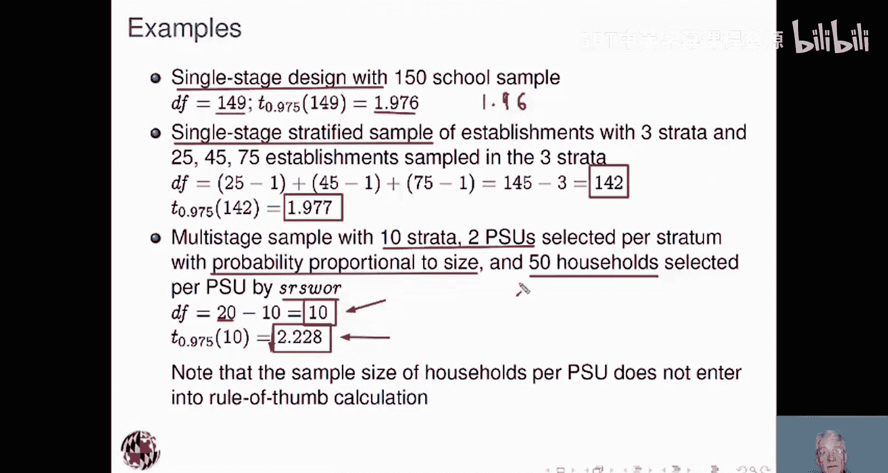

# 密歇根大学《调查数据收集和分析（2-6：方法、社调问卷设计、抽样、缺失数据、分析）｜Survey Data Collection and Analytics》 p152 3_自由度.zh_en -BV1fw4m1e7Zh_p152-

We mentioned degrees of freedom in the last episode of the basic estimation module。

 so I want to say a bit more about that in this video。

Degrees of freedom are associated with a variance estimator。

 and they are related to the stability of a variance estimator， so as degrees of freedom increase。

 the precision of the variance estimator increases。

 which just means the variance of the variance estimator decreases。

Precision goes up as variance goes down， that's the conventional jargon。

Now there are rules of thumb or a rule of thumb that's used by all the software packages and what it is is you take the sum over strata of NH minus1。

 where NH is the number of primary sampling units selected in stratum H。

So that's the total number of PSUs， mine is the total number of straight up。

Now if you use that degrees of freedom， approximation。

 it's largely determined by the number of first stage units in the sample。

 so that that may be fairly crude， the number of sample units within each PSU now this doesn't enter into that rule of thumb at all。

 so as if you don't get credit for drawing a big sample within various PSUs when you compute these degrees of freedom。

Now， this rule is not always accurate， but it's easy to apply and that's why the software packages use it。

So how does this enter into confidence interval construction？

A one minus alpha level confidence intervals for some quantity theta is computed this way。

 We take the estimator theta hat， and then we add and subtract a multiple of the standard error of that estimator so right here。

The variance， little v of theta hat is the symbol for the variance of theta hat。

 I take the square root of that and that's the estimated standard error and then the multiplier I use is out of a t distribution so t of1 minus alpha over t or2 per end df。

Is。The upper percentile of a T distribution so that one minus alpha over two is。

Of the area under the distribution is less than that value， and then alpha over two is above it。

And it's four central T distribution that's got DF degrees of freedom。Now， when is this valid。

 you need a large sample of first stage units to get this working right。

 and essentially what's being said is。If I were to graph the distribution of my estimator theta hat。

 it's going to be symmetric like this。It， ideally， is。Centered around the value theta。😔，And then。

This one minus alpha over two。Percentile is up here somewhere。

So in this area of the distribution up here。😔，That。

Constitutes or the amount of area in that is alpha over two。So for example。

 if you're doing a 95% confidence interval， you want 2% of the area in lower and upper symmetric interval。

 so this would be the 97 and a half percentile right there。On the distribution。

You know that that's the idea。And when does that happen。

 it happens when you got a large sample of first stage units。

 so a central limit theorem sort of result begins to take hold。So let's look at some easy examples。

First， think about a single stage sample with 150 schools。So there's no stta。

 I just subtract one to get my degrees of freedom little thumb， that's 149。

 the 97th and a half percentile of a T distribution with 149 degrees freedom is 1。976 Well。

 that's really， really close to the standard normal number of 1。96。

So very little difference from standard normal when you get that many degrees of freedom。

Now let's take another example， let's suppose I've got a stratified single stage sample of establishments。

 I got three straightta with 25， 45 and 75 establishments in the three。

 so I subtract one from each of those numbers and add them up。

 so I get 24 plus 44 plus 74 is equal to 142。Degrees of freedom。

 and if I look at the T value associated with that， well， that's。Essentially the normal 1。96 again。

 so a lot of degrees of freedom in it our approximation looks just like the standard normal approximation。

Now suppose I've got a multi stage sample with10 strata two PSUs per statum。

 and I pick 50 households。P stum and suppose I do that by simple random sampling without replacement。

 but I select the PSUs with probability proportional the size。Well。

 the rule of thumb for degrees of freedom doesn't distinguish between PP sampling and equal probability sampling。

 So what I do is I just take a total number of PUs。 that's 20。Minus。Number straightta that's 10。

 and here's my rule of thumb degrees of freedom， 10。On the other hand。

 how many households did I have。 I've got 10 times 2。Times 50。 That's 100 households。

 So my degrees of freedom number is 10， which is a whole lot less than 100 or 100 minus-1 or 99。

And then if I look at the T value for 10 degrees of freedom， the upper 97 and a half percentile。

 I get 2。28。And that is quite a bit different from the 1。96 for standard normal so the。

Rle thumb can lead to a fairly big change in how you'd compute a confidence interval you using this there's 2。

28 will make a confidence interval it's wider than 1。96。

 know reflecting that additional uncertainty due to the fact that your variance estimator is unstable。

