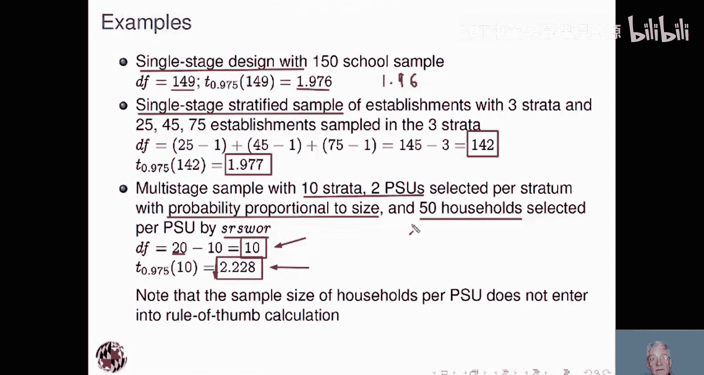

# 调查数据收集和分析：3：自由度

## 概述
在本节课中，我们将要学习抽样调查中一个重要的概念：**自由度**。我们将了解自由度的定义、它与方差估计的关系、一个常用的经验法则，以及它如何影响置信区间的构建。

## 什么是自由度？
上一节我们介绍了基本的估计方法，其中提到了自由度。本节中，我们将更详细地探讨这个概念。

自由度与**方差估计量**相关联，它关系到方差估计量的稳定性。随着自由度增加，方差估计量的**精度**会提高，这意味着方差估计量本身的**方差**会减小。精度提高与方差减小是同一回事，这是常用的术语。

## 自由度的经验法则
以下是计算自由度的一个常用经验法则，所有软件包都采用此方法。

该法则的公式是：`df = Σ (N_h - 1)`。其中，`N_h` 表示在第 `h` 个层中抽取的**初级抽样单元**的数量。因此，自由度近似等于所有层中PSU的总数减去层的总数。

如果使用这个自由度近似值，它主要由样本中**第一阶段单元**的数量决定，因此可能比较粗略。每个PSU内的样本单元数量在这个经验法则中完全不参与计算。这意味着，当你计算这些自由度时，从各个PSU中抽取的大样本并不会增加你的“信用”。

这个法则并不总是精确的，但因其易于应用，所以被软件包广泛采用。

## 自由度在置信区间构建中的作用
那么，自由度如何进入置信区间的构建呢？

某个总体参数 `θ` 的 `1 - α` 水平置信区间按以下方式计算：

`CI = θ_hat ± t_{1-α/2, df} * sqrt(v(θ_hat))`

其中：
*   `θ_hat` 是 `θ` 的估计量。
*   `v(θ_hat)` 是 `θ_hat` 的方差估计值，其平方根即为**估计标准误**。
*   `t_{1-α/2, df}` 是自由度为 `df` 的 **t 分布**的上侧 `α/2` 分位数。这意味着在 t 分布中，有 `1 - α/2` 的面积小于该值，`α/2` 的面积大于该值。

这个方法的有效性取决于拥有足够多的第一阶段单元大样本。本质上，当样本量足够大时，估计量 `θ_hat` 的分布会趋近于以真实值 `θ` 为中心的对称分布（如正态分布），中心极限定理开始生效。

## 实例分析
让我们通过一些简单的例子来看看这个法则的应用。

**例1：单阶段抽样**
假设有一个包含150所学校的单阶段样本（无分层）。根据经验法则，自由度 `df = 150 - 1 = 149`。自由度为149的 t 分布的97.5%分位数是 `1.976`，这非常接近标准正态分布的 `1.96`。当自由度很大时，与标准正态分布几乎没有差别。

**例2：分层单阶段抽样**
假设有一个分层单阶段的企业样本，共有3个层，各层分别有25、45和75家企业。计算自由度：`df = (25-1) + (45-1) + (75-1) = 24 + 44 + 74 = 142`。查看对应的 t 值，同样基本等于 `1.96`。自由度很多时，近似结果看起来就像标准正态近似。

**例3：多阶段抽样**
假设有一个多阶段样本：10个层，每层抽取2个PSU，每个PSU内抽取50户家庭（通过不放回简单随机抽样选取PSU，但PSU的抽取概率与其规模成比例）。

*   **经验法则自由度**：PSU总数 = `10 * 2 = 20`。`df = 20 - 10 = 10`。
*   **总户数**：`10 * 2 * 50 = 1000` 户。

此时，根据经验法则得到的自由度是 `10`，远小于总户数减一（`999`）。对于10个自由度，t 分布的97.5%分位数是 `2.28`，这与标准正态的 `1.96` 有显著差异。

因此，经验法则可能导致置信区间计算的较大变化。使用 `2.28` 作为乘数构建的置信区间会比使用 `1.96` 更宽，这反映了由于方差估计量不稳定而带来的额外不确定性。

## 总结
本节课中，我们一起学习了**自由度**在抽样调查中的核心作用。我们了解到自由度与方差估计的稳定性相关，并掌握了一个基于初级抽样单元数量的常用经验法则 `df = Σ (N_h - 1)`。通过实例我们看到，当自由度较小时（例如在多阶段抽样中），用于构建置信区间的 t 乘数会显著大于标准正态值，从而导致更宽的置信区间，这恰当地反映了抽样设计带来的额外不确定性。理解这一点对于正确解释调查结果的精度至关重要。