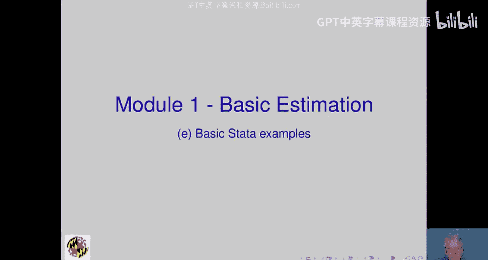
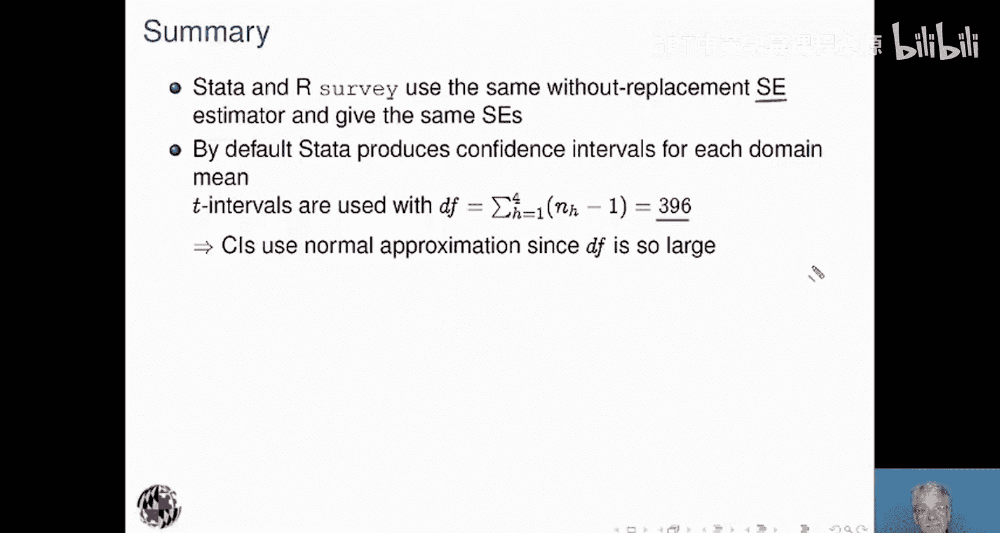

# 密歇根大学《调查数据收集和分析（2-6：方法、社调问卷设计、抽样、缺失数据、分析）｜Survey Data Collection and Analytics》 p153 4_均值估计.zh_en -BV1fw4m1e7Zh_p153-

In the last video we looked at a simple table of proportions calculated using the R survey package now let's do the same thing in state just to show you how it would go there。

In data， as in R， you've got to specify the。Sample design， so how do you do that。

 use SVY set that's the。Magic statement you need to invoke so it takes a few parameters。

 you first list the PSU field and then in brackets you give it the survey weight which the parameter name is P weight for that and then in parentheses you specify the stratum variable。

And then。Also in parentheses， she specified the field that holds the finite correction factor if there is one。

 so the things that I've underlined here straight on FPC or the state awards that you've got and and then in。

Inside the print， these are your field names， so the Stratum field， the FPC field。

 which we'll fill in in a little bit。Now there are other design features that you could specify replicate weights is one of the main ones if you use replicate variance estimators。

 for example， the jackN for balanced repeated replication or the bootstrap or all possibilities in data。

As are in our survey。So let's look at the same example that we looked at in R。

Back then we drew a stratified simple random sample without replacement from the NHIS population。

 the National Health interview survey， and we included FPCs by stratum so here's how you do that in Sta first I wrote out that sample data file in R in Sta format so you can do that and I saved it somewhere where Sta can find it and the way you get at it says is to say in Sta。

Use SADAT。dta dta is the standard ending for a state data file。

 and then comma clear just means if there's anything in memory cleared out。

Then I issue the SVUI set statement， the PSU。there are no PSUs in this case。

 but there is a counter that's called ID， so I specify that as the PSU。

And then the P weight is SVY weight， that's the survey weight。

 the strattum are the recoded education values EDC underscore R。

And you can use an underscore in stata in a variable name， you can't do that in an R。

 you can use the period， but in state you can't use a period in the middle of a variable or a field name。

 so just the opposite in those two packages。Now F PCC， I specify the prob variable。

 so again I'm using that rule of that。If the software sees a value between zero and1。

 it's going to interpret that as a sampling fraction， and that's what state is doing here。

Now all this， these lines are just what sta feeds back to you to tell you what it understood from your statement。

 so it' got the survey weight here， it's telling you it's going to use a linearized or Taylored series variance estimator。

It has a certain way it's going to deal with missing units and it tells you the strumzi underscore R that's fine and the FPC is pro so that that's all as we want it。

And then here are output lines from the mean procedure。

 so how do you do that state they've got a kind of a nice convention if you preface one of the usual state commands with SVY colon。

It'll interpret that as。Do this usual procedure， but use the survey specific way of doing it。

 So computing means that means it's going to。Use the weeds。And when it estimatess standard error。

 it's going to account for straight on clusters， so I'm doing mean age again。

 which is the same thing we did in R。Over in stata is like by in R。

 So I'm doing it over the straightta E underscore R。 and then it it。

Feeds back to me some nice information about what it found there， for st。400 PUs。

 which is the number of first stage sample units。Total number of observations is 400 that's what we expect and interestingly enough here the weights sum to exactly the population size and that's because we got a stratified simple random sample with fixed stratum sizes。

So it's 3，911 is the population size in that prat tools population that we used。

Design degrees of freedom， it subtracts one within every stratum。

 so I've got four straightrata 400 PSUs 396 degrees freedom so that's。

It's going to use the normal approximation for confidence intervals。

And then it gives me a nice readable table of means。And if you look back at the R output。

 these are exactly the same standard errors and means for。

the average age and then another nice thing it does is automatically compute confidence intervals。

 so the confidence interval for mean age in the first age group is 39。53 up to about 46。42。

And that's， as I said， using normal approximation because this degree's freedom is so big。

So to summarize， state NR used the same without replacement standard error estimator。

As you'd expect it's stratified simple random sampling without replacement and it gives the same SEs。

 standard errors by default， it will produce confidence intervals for each domain mean when you call for a table and。

As I said， number of degrees of freedom is 396 so that it'll use a T distribution to get the multipliers。

 but with that many degrees of freedom， the T resolves into the standard normal distribution。

 so that's the kind of confidence interval you're seeing in this case。

