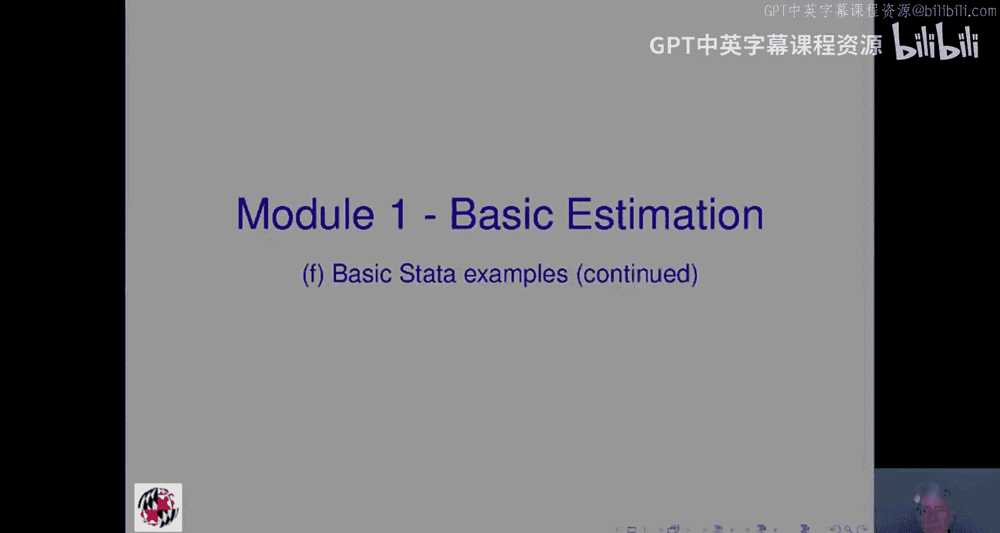
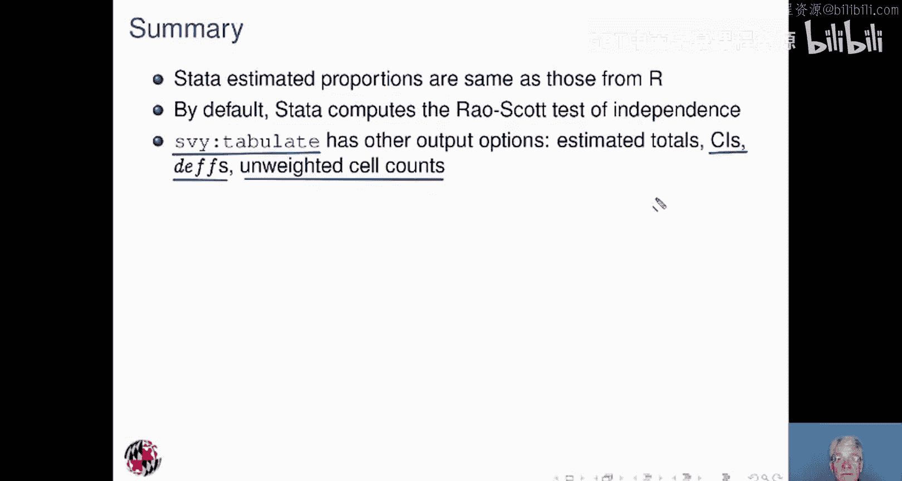

# 密歇根大学《调查数据收集和分析（2-6：方法、社调问卷设计、抽样、缺失数据、分析）｜Survey Data Collection and Analytics》 p154 5_多阶段抽样.zh_en -BV1fw4m1e7Zh_p154-

嗯。

In this video on basic estimation we'll continue with Sta and look at a design that's more complex than in the previous video。

 so what we'll do is look at the same sample as we used in the R examples so I'm looking at in the HIS。

 large and that you may remember is from the R Pra toolsols package。

So I wrote that out in R in a DTA format which is the state of format， then I use it。

 I clear the memory and to do the same sort of thing that I did in R I'm giving labels to the age groups so in state you do that with a label defined statement and you define the label variable and here I'm calling it age underscore lab so I just label the five age categories。

And then I say label values for the age， the field age underscored group。

And my labels are what I just created here， age underscore label。

 so that'll associate the things and give us a nicer looking table。So in SVY set， here's what I do。

 I specify the PSU variable here， which is called PSU。

 the survey weight is SVY WT Stratum variable is stratum。And then I use tabulate。

 and I preface that with the SBY colon to let state now that。

It should use the survey procedure to do the tabulating and I'm getting a table of age group by whether people delayed medical care or not。

This row says give me row proportions， so in the two way table it's going to make the rows sum up to one which we'll see on the next page。

Now， because I didn't tell it。More specific information。It's going to use the ultimate cluster。

 which is a without or with replacement variance estimator， exactly the same as our survey did。

 and that is going to be a standard procedure in survey packages。SS will do the same thing。

So here's the output from that we see as before we've got 75 strata。

 two PSUs per stratum so we got a total of 150 PSUs。

 total number of observations in the data set is 21。

464 now that's omitting the ones with missing delayed medical care and then the population size。

That data reports is just the sum of the weights。So about 66 million。

And the design degrees of freedom are the following， this is using that rule of thumb。

We pick up one degree freedom per stratum since we got a two PSU per stratum design。

 so we got 75 total。And here are the proportions， so you can see that going across a row these things add up to one because that's what I ask for so these proportions of people who did delay medical care。

Value of one here are exactly the same as what we。Estimated from R。 So here's the column。

 And a nice thing about sta is it does give you the marginal proportion。

 You don't have to ask for that separately。 So that's 0。0719。

And another thing that stated us by default is。Calculate the R Scott。Pearson adjusted chi square。

 which is referred to an F distribution and you'll see here the degrees of freedom numerator denoator for the F are exactly as computed in the R survey package。

 The F stat is the same and the P value is to for decimal places zero。 So once again we see that。

Delaying medical care and how old you are are not independent variables in this data set。

So to summarize， state estimated the proportions exactly the same as those in R。

 and that's because it uses exactly the same algorithm。

It did give us that test of independence by default。

But one thing note here is that SVY Tulate has other output options that we could have called for。

 you may have noticed we didn't get standard errors we could have。

It will do confidence intervals on those proportions if you want， it'll do design effects。

 it would give you unweighted cell counts， which is often a useful thing just to give a feel for。

How precise things are。In a way that's different from the standard error。

So Stata has a lot of nice capabilities， as you will find if you get more deeply into it。

