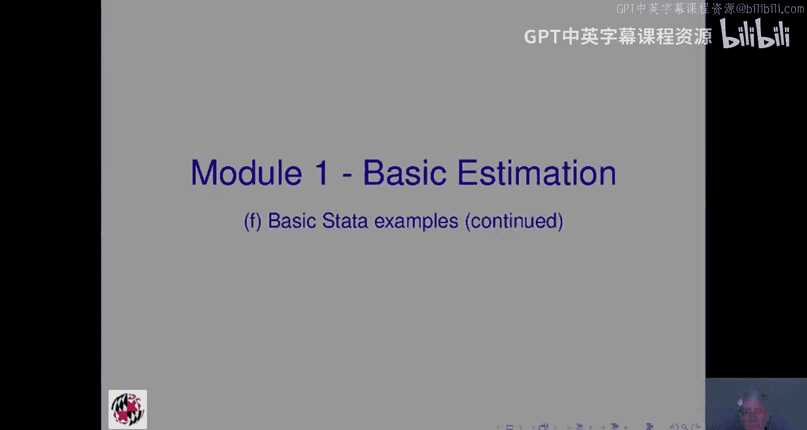
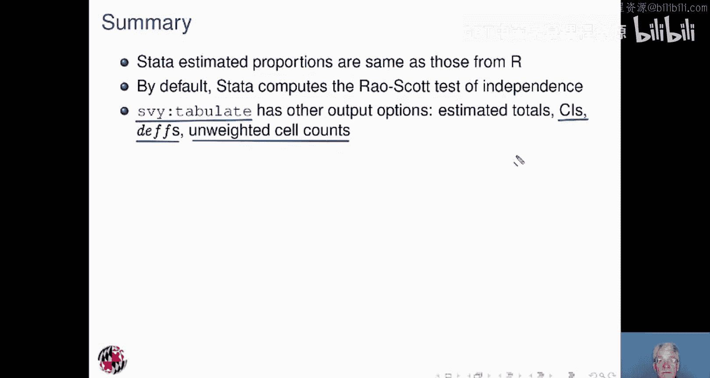

# 调查数据收集与分析：2-6：多阶段抽样

## 概述
在本节中，我们将学习如何使用Stata软件对复杂抽样设计（如多阶段抽样）的数据进行基本估计。我们将使用一个来自R软件`PracTools`包的示例数据集，演示如何在Stata中设置调查设计、计算加权比例并进行独立性检验。

---

## 数据准备与变量标记

首先，我们需要准备数据并为分类变量设置标签，以便输出更清晰易读。

以下是具体步骤：
*   使用`label define`语句创建一个名为`age_lab`的标签，为五个年龄组定义描述性名称。
*   使用`label values`语句将刚创建的`age_lab`标签关联到数据集中的`age_group`变量。

完成此步骤后，在后续的表格输出中，年龄组将以我们定义的标签形式显示。

---

## 设置调查设计

上一节我们介绍了数据准备，本节中我们来看看如何在Stata中指定复杂的调查设计。

我们使用`svyset`命令来定义调查设计的关键参数：
*   **PSU变量**：初级抽样单位，此处变量名为`psu`。
*   **权重变量**：调查权重，此处变量名为`svy_wt`。
*   **分层变量**：抽样层，此处变量名为`stratum`。

通过此命令，Stata将知晓数据的复杂抽样结构，并在后续分析中应用正确的方差估计方法（默认使用“最终聚类”法，与R的`survey`包相同）。

---

## 执行交叉表分析

设置好调查设计后，我们可以进行具体的分析了。我们将检验年龄组与是否延迟就医这两个变量之间的关系。

我们使用`svy: tabulate`命令来生成交叉表，并指定`row`选项以计算行比例（即每个年龄组内延迟就医的比例）。命令前的`svy:`前缀告知Stata需基于之前定义的复杂抽样设计进行计算。

---

## 解读分析结果

现在，让我们详细解读Stata输出的结果。

**调查设计摘要**：
*   数据包含 **75** 个抽样层。
*   每层包含 **2** 个初级抽样单位，共计 **150** 个PSU。
*   分析使用的观测数（剔除缺失值后）为 **21,464**。
*   根据权重推算的总体规模约为 **6600万**。
*   设计自由度为 **75**（即层数）。

**比例估计**：
表格显示了各年龄组中延迟就医（值为1）的比例。这些加权比例与之前在R软件中得到的结果完全一致，因为两者使用了相同的估计算法。

**独立性检验**：
Stata默认提供了经过Rao-Scott调整的卡方检验（其统计量服从F分布）。结果显示：
*   F统计量的值与R软件计算的结果相同。
*   P值极小（约等于0）。
*   结论：在该数据集中，**年龄与是否延迟就医并非相互独立**。

---

## Stata的额外功能

除了上述基本分析，`svy: tabulate`命令还支持许多其他有用的输出选项：

*   **计算标准误**：为比例估计值提供精度度量。
*   **计算置信区间**：为比例估计提供区间估计。
*   **计算设计效应**：评估复杂抽样设计对估计效率的影响。
*   **显示未加权的单元格计数**：直观了解每个单元格的基础样本量，这有助于判断估计的稳定性。

这些功能使得Stata成为处理复杂调查数据的强大工具。

---

## 总结

本节课中，我们一起学习了在Stata中分析复杂抽样调查数据的基本流程。我们涵盖了从数据准备、调查设计设置，到执行交叉表分析和解读结果的全过程。关键点在于使用`svyset`正确定义抽样结构，并使用`svy:`前缀命令执行分析，以确保方差估计的正确性。结果显示，Stata与R软件在核心估计上结果一致，并且Stata提供了丰富的附加输出选项以供深入分析。