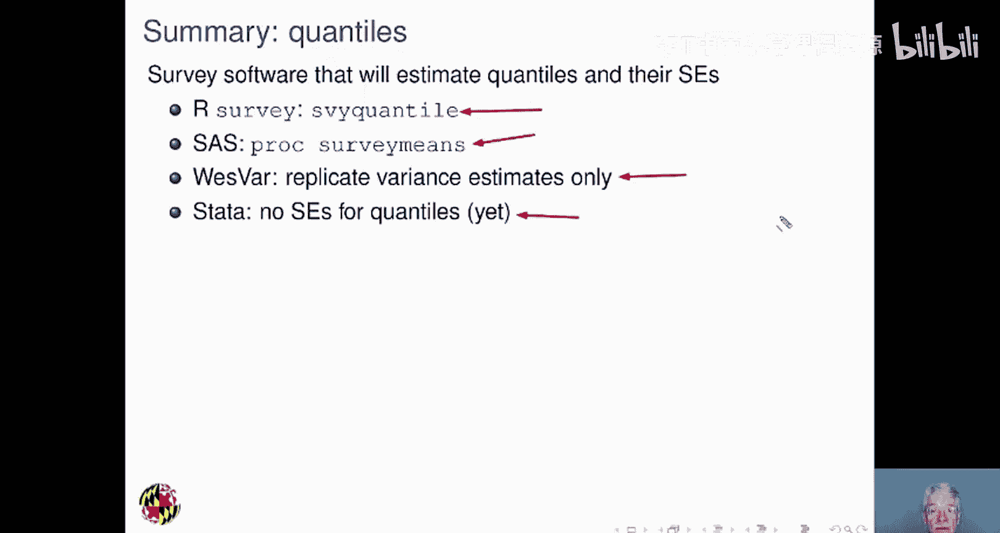
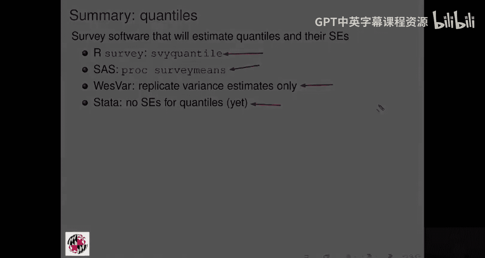

# 密歇根大学《调查数据收集和分析（2-6：方法、社调问卷设计、抽样、缺失数据、分析）｜Survey Data Collection and Analytics》 p155 6_R语言中的分位数估计.zh_en -BV1fw4m1e7Zh_p155-

We'll finish module1 on basic estimation with an example of estimating quantiles in R。Now。

 the thing that happens with quantiles is you need special methods in order to get precision estimates。

 the formulas that we've seen earlier don't work。Because a quantile estimate is a linear kind of statistic。

 which means that you've got to use a different approach。

So the standard thing is compute a confidence interval on a quantile first。

 and then you back into a standard error if you really want that。

So the way it's done is you calculate the length of the confidence interval。

And then you pretend like it's a symmetric interval based on a T distribution。

The length of a T interval will be。Twice the。Multipliier from T distribution times the standard error because you're adding and subtracting for a symmetric interval。

 and then you。You know， they're linked。Based on the calculation that one of these methods is going to give you for a quantile。

 And then you solve for the standard error。 So that's how it goes。 So， for example， if。

1 minus alpha is 0。95。 there's a huge number of degrees of freedom。

 so the t is the same as the normal， then the standard error is going to be estimated as the length of the confidence interval divided by 2 times 1。

96。Now there are a couple of options for getting confidence intervals。

 these are named after the people who invent them， Woodruff and Francisco Fuller。

 and both those are available in the R。Survey package。

So let's take a look at an example the first thing I'm going to do is。

Require the PRC toolsol package because I want to use a data in there。

 then I require sampling because I'm going to select a sample from a particular data set and the one that I'll use here is called the survey of mental health organizations and it's in Pra toolsol it's called SMH。

n874 874 is just the number of hospitals in that data set。

So I'm going to select a PP sample just so I'll have a sample with different weights for the units。

I first I set the measure size equal to the number of inpatient beds in each hospital now some hospitals have zero inpatient beds because they don't treat inpatient so to take care of that。

I'm recoding。All the sizes that are less than are equal to five to be equal to five。

That way I get all cases have non zero measures the size。

 I compute inclusion probabilities PK with this function from the sampling package called inclusion Probabilities。

It's a long name， but it's clear what it means。So I send it the measure size， size。

 which I calculated up here， and I'm going to pick a sample of 100。

So the inclusion probabilities is nice because it figures out if you've got any units that are so big they'll be selected with certainty。

 so when I summarize PK I get a small minimum 0。007 all the way up to1 which are units selected with certainty。

Now， you might not want to design a sample that had weights that vary that much。

 it might not be that efficient， but this is just an example what we're doing here。Now。

 how do I select the P sample first， I use the set dot seed statement with a。

Constant number in here that just starts the random number generator at a particular place so I can repeat this if I wanted to。

And then I use the U systematic PK function to draw a sample。

 So in whatever order the SHO population is， this will。

Take a random start and then it'll skip systematically down the interval or the list of hospitals and select 100。

This is after extracting those that are selected with certainty。

So I save that the result of that in a vector called Sam。

 which is a string of zeros and ones for whether you're in the sample or not。874 along。

I use the get data function to retrieve the data。And then I'm going to bind on the survey weight。

 so I use this CB function with the data I just extracted SAD。

 and then I appendned a new column that I'm going to call SVUY weight WT。

 and that's just one over the selection probability。And I'm extracting， as you see here。

 I only extract the pieces of PK where Sam is equal to one， in other words， the sample cases。

And then I'm going to do。A calculation using expenditure totals。

 so what I do is these are very large numbers in the data file。

 so I'm converting them to millions by dividing by 10 to the sixth。

 the variables is called the EXP total。So I created a new variable and I appended on the SADt this way。

 EXP tote lower ACM for million。Now I define my sample design and I use the SVUI design function again。

I got no。PSU， so IDs is null， I got no strata， so stra is null， I do have weights。

 which I just calculated SBY weight， and I tell it where my sample data is SDap。And it。

Survey package echoes back to me if I type SMHO dot DSsGN at the prompt independent sampling design with replacement。

 So it's going to use。The ultimate cluster variance estimator。

 which is assuming with replacement sampling now。I'm not really giving myself credit for the fact that I selected 100 out of 874 units。

 which is a you know， sizable sampling fraction， so I could include an ad hoc F PCC in here that would probably be better than。

Ignoring the fact that I've got a substantial sampling fraction。

So you might want to modify this example on your own and see how that comes out。

Now how do I compute quantiles， there's SVY quantile， that's the function I use。

 I'm going to do it on that expenditure total in millions， I tell it what design I've got s。dsgN。

 and then in the quantiles parameter， I can send a vector。Quantiles that I want estimates for。

 so I'm doing first quartile， median and third quartile。And C equals true says。

 give me confidence intervals on these things。So here are the point estimates first quartile is 4。

52 million the median is 7。255 million third quartile is 11。

67 million and here are my confidence intervals so on the first quartile I've got a confidence interval that goes from。

1。047 million up to 7。314 million。So the point estimates in the middle here。

 and this is not quite symmetric。In fact， if you take a look at the third quartile。

 it's definitely not symmetric there it goes from。7。5 million up to 23。74 million。

 point estimates 11。6 million。More toward the lower end of the confidence interval。

 and that's just a yeah。A characteristic of the way that these the algorithm used to。

Calculate these confidence intervals， and it's perfectly fine， me mathematicalmatically justified。

Now there's a parameter called interval type which has got a default value of walled that gives the wood roof method。

 so if I had put that parameter up here， interval dot type and said it equal to score。

 that would give me the Francisco Fuller method。Which is more computationally intensive。

 but potentially it's a little more fine tune than Woodruff。So in summary。

We don't have quite as many choices for software as in。

Simpr things like means and totals and proportions。

The our survey package has got the SUY quantile function， which we just saw。If you're using SAS。

 you can get quantiles with the PRC surveyy means procedure， if you're using WestVar。

 which is free software from Westtt， it will do standard errors for quantiles using replicate variance estimates only and at the present time stated does not have the facility for calculating standard errors。

 although if users demanded it， I'm sure they would figure out how to do it。

So that concludes module1 we'll move on now to module2。

 which has to do with estimating model parameters。

