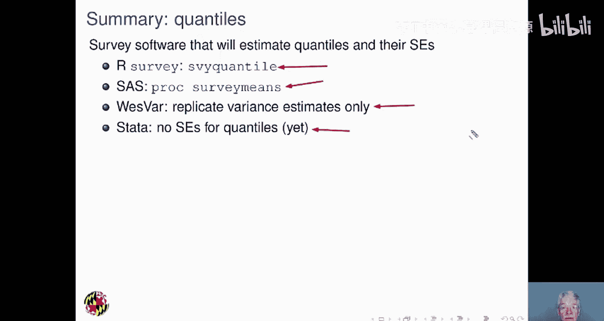
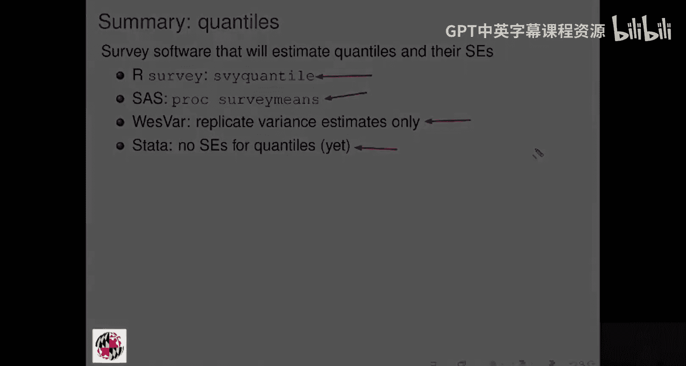

# 调查数据收集和分析：1-6：R语言中的分位数估计 📊


在本节课中，我们将学习如何在R语言中，针对复杂调查数据估计分位数（如中位数、四分位数）及其置信区间。与简单的均值估计不同，分位数估计需要特殊的方法来计算其精确度。

## 概述

上一节我们介绍了基本的估计方法。本节中，我们来看看如何估计分位数。分位数估计（如中位数）是一种非线性统计量，这意味着我们之前见过的用于均值和比例的方差公式不再适用。因此，我们需要采用不同的方法来计算其标准误和置信区间。

## 分位数估计的原理

标准做法是首先计算分位数的置信区间，然后如果需要标准误，再从这个区间反推出来。

计算过程如下：先计算置信区间的长度。然后，我们假设这个区间是基于T分布的对称区间。一个T区间的长度等于 `2 * t乘数 * 标准误`，因为你需要在点估计值两边同时加减。通过某种分位数计算方法得到区间长度后，就可以解出标准误的估计值。

例如，如果置信水平 `1 - α` 是 0.95，且自由度很大（此时t值近似于正态分布的z值），那么标准误的估计值就是：`置信区间长度 / (2 * 1.96)`。

在R的`survey`包中，有两种主要的置信区间计算方法，分别以发明者命名：
*   **Woodruff方法**：这是默认方法。
*   **Francisco-Fuller方法**：计算更密集，但可能更精确。

## 实践示例：估计医院支出分位数

让我们通过一个具体例子来学习如何在R中操作。我们将使用`PracTools`包中的“精神健康组织调查”（SMHO）数据集，并从中抽取一个概率与规模成比例（PPS）的样本。

以下是操作步骤：

首先，加载必要的R包并准备数据。
```r
require(PracTools)
require(sampling)
data("SMHO.N874")
```

接着，设定抽样规模并计算入样概率。我们使用“住院床位数”作为规模度量。为了避免规模为零的情况，将所有小于等于5的床位数重新编码为5。
```r
size <- SMHO.N874$BEDS
size[size <= 5] <- 5
n <- 100
pk <- inclusionProbabilities(size, n)
summary(pk)
```

现在，设置随机种子以确保结果可重复，然后进行系统PPS抽样。
```r
set.seed(428274453)
sam <- UPsystematic(pk)
```

从总体中提取被抽中的样本数据，并计算调查权重。权重是入样概率的倒数。
```r
samp <- getdata(SMHO.N874, sam)
samp <- cbind(samp, WT = 1/pk[sam==1])
```

为了便于分析，我们将支出总额（`EXPTOTAL`）转换为以百万为单位。
```r
samp$ExpMil <- samp$EXPTOTAL / 1e6
```

使用`survey`包定义复杂的调查设计。由于是PPS抽样，我们这里没有设定层或初级抽样单位（PSU），但指定了权重。
```r
require(survey)
smho.dsgn <- svydesign(ids = ~0, strata = NULL, weights = ~WT, data = samp)
```

## 计算分位数及其置信区间

核心函数是`svyquantile`。我们可以一次性估计多个分位数，并请求计算置信区间。

以下代码估计第一四分位数、中位数和第三四分位数：
```r
q.est <- svyquantile(~ExpMil, design = smho.dsgn,
                     quantiles = c(0.25, 0.5, 0.75), ci = TRUE)
q.est
```

函数将输出点估计值和置信区间。例如，结果可能显示：
*   第一四分位数：4.52（百万），95% CI：[1.05, 7.31]
*   中位数：7.26（百万），95% CI：[3.22, 11.29]
*   第三四分位数：11.67（百万），95% CI：[7.50, 23.74]

请注意，这些置信区间通常不是对称的，这是分位数估计的一个特点，在数学上是完全合理的。

如果你想使用Francisco-Fuller方法而非默认的Woodruff方法，可以指定`interval.type`参数：
```r
q.est_ff <- svyquantile(~ExpMil, design = smho.dsgn,
                        quantiles = c(0.25, 0.5, 0.75),
                        ci = TRUE, interval.type = "score")
```

## 其他软件选择

虽然不如均值、总量和比例估计的软件支持那么广泛，但其他主流统计软件也提供分位数估计功能：

*   **SAS**：可以使用`PROC SURVEYMEANS`过程。
*   **WesVar**：这款免费软件可以通过复制法（replicate methods）计算分位数的标准误。
*   **Stata**：目前版本尚不能直接计算复杂调查设计下分位数的标准误，但如果用户需求强烈，未来可能会添加此功能。

## 总结





本节课中我们一起学习了如何在R语言中处理复杂调查数据的分位数估计。关键点在于，分位数是非线性统计量，需要特殊方法（如Woodruff或Francisco-Fuller法）来构建置信区间，并可通过区间长度反推标准误。我们通过`svyquantile()`函数完成了从数据准备、调查设计定义到最终分位数估计的全过程。这标志着基础估计模块的结束，接下来我们将进入关于模型参数估计的新模块。