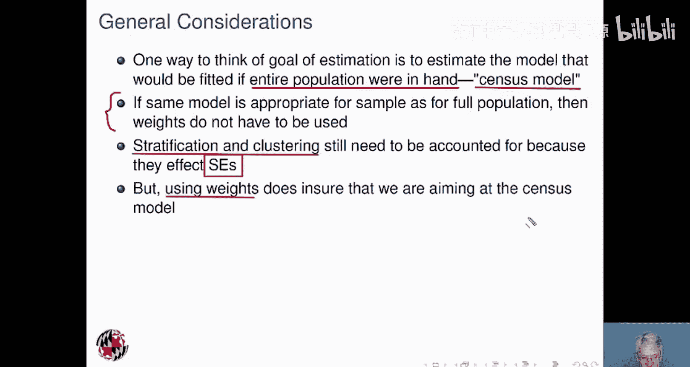

# 密歇根大学《调查数据收集和分析（2-6：方法、社调问卷设计、抽样、缺失数据、分析）｜Survey Data Collection and Analytics》 p156 7_导论.zh_en -BV1fw4m1e7Zh_p156-

So thanks again for joining us in Cose6， which is called combiningbining and Analy complex data。

It's taught by me， Richard Valllt and Frocker Croyder， so you'll be seeing both of us in this course。

We're into module2 now， which has to do with estimating model parameters so we in the。

Previous module we talked about estimating simpler things like means and totals。

 but we're now going to move on to these more complex estimatess。

Now because we're dealing with a finite population。

 it's good to think about what exactly is happening here。

 so one way to think about the whole process is，Suppose there's an underlying superpopulation model up here。

That is really what we're trying to discover or to estimate。And。That popular， that model。Generates。

A finite population。So we get realizations from that model that creates the finite population。

From the finite population， we draw our sample。And then from the sample， we fit a model。Now。

 what is this fitted model estimating？As shown here， we can think of it two ways。

 if we've got the model specified just right， it agrees with the superpopulation model。

 then that fitted model will be estimating this superpopulation model。

 the thing that started the whole process。On the other hand， if we misspecify the model the bit。

 say we leave out some covariates or something， we didn't know about them。

 What we are going to be able to say is the fitted model still is。

Aiming at the best fitting model for the whole finite population。

So it may be misspecified in the sense that we left out a covariate or something that was in the superpulation model。

 but we're still doing a pretty good job at aiming at the full finite population model。Now。

 another way to。Think about that full finite population model is it's the model that you would fit if you had the entire population in hand in your sample。

 so for that reason it's often called a census model you know that's the thing that we're aiming at when we go through the fitting algorithm as we'll show you in a bit。

So one thing that is true and is kind of a source of debate in finite population estimation is。

If the same model is appropriate for the sample as for the full pin。The full population。

You don't have to use the weights。You know this will be true if your sample is a little miniiaur the full。

Population。But if you've done something to kind of。

Throw the sample off balance compared to the population。

 say you've targeted some subgroups or you've used PP sampling。

 so you tend to see the biggest units more often in your sample。Then this may not be true。

And to get back to estimating that census model， you're going to need the weights。

Now another thing that you need to account for is stratification and clustering in your sample design because those will affect standard errors。

They may make them either bigger or smaller， but they'll definitely have an effect and you can't ignore that。

So we're going to use the weights that's our procedure。

 and that means that definitely we'll be aiming at that census model。

If we work hard to specify our model correctly， the census model will also be the same form as the superpopulation model that we hope underlies the whole process。

So we'll see some examples of how to go about this in the next videos。

